<!-- Rendered from handbook/ (an SRS repository) by scripts/render-handbook.mjs. Do not edit: change the records. -->

# Clerk handbook

### How work is driven

This part tells the whole story in order. "Stage by stage" then takes each stage of the chain in turn, with what works today and what does not. "Reference" holds the principles, the SRS elements the process depends on, and where everything is written down.

This handbook is itself an SRS repository (`handbook/` in the clerk). `docs/handbook.md` is rendered from it and is never edited by hand. See "How this handbook is made" at the end.


#### The whole picture

The programme answers one question again and again: **what should we work on next, and why?**

The answer is never "because someone said so". Work is justified by a **problem**, a problem only counts when we know **who** has it (a persona) and **where** it happens (a domain), and the order of work comes from a **ranking** the owner has made. Everything else in this handbook is the machinery that carries that reasoning from a statement of need to a merged pull request, and back again as a report.

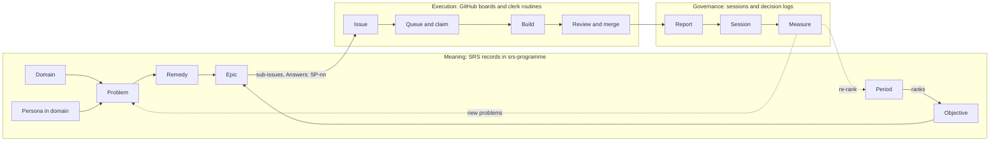

There are three surfaces, each with one job:

| Surface | Holds | Lives in |
|---|---|---|
| **Meaning** | domains, personas, problems, remedies, objectives, periods, epics, decisions, roles | SRS records in `the-greenman/srs-programme` |
| **Execution** | issues, stories, epics as issues, board fields, labels, PRs | GitHub Project #6 "SemanticOps" and the governed repos |
| **Practice** | the code that reads the meaning and drives the execution, and the briefs agents follow | this repository, `the-greenman/clerk` |

The two halves meet in two places only: the epic (a record with an `issue_ref`) and the `Answers: SP-nn` line at the top of every issue. Closing that seam is most of the open work in "Stage by stage".

Three rules shape everything that follows:

- **Agents suggest; the human layer wins.** Agents write to Suggestions. The owner forks a record into Affirmed. Only affirmed records carry weight.
- **Authority comes from the role, not the kind of mind.** Humans and agents claim, review, decide and report through the same commands.
- **Theory and practice together.** There is always a working system, and the theory stays beside it. We build when a trigger fires, not ahead of need.


#### Flow at a glance: what moves each stage

Each step below is one `flow-step` record (clerk#126). Read it top to bottom: work stops at the first step whose input is waiting and whose mover is not live. The flow starts at **Find**: a session that resumes work, or has none, starts at the desk. `clerk flow` reads the dots on issues today (`--chain`, `--open`); deriving the live counts, dead ends and the critical path from these records is clerk#126, part 2. `clerk desk` shows the work day to day.

Each step says how sure we are of it. Low is an agent's reading of the code, medium is what the owner has said or written, high is a step the owner stands behind. Correct a step by updating its record, and its confidence rises.


##### Find

**Moved by**: every session that resumes work, or has no task: `clerk desk`, then the open sequence it lists, then that sequence's next task free to take, run through `clerk flow --chain`

**Mover**: manual

**Needs before it moves**: the desk is current (rewritten on every upkeep run, clerk#203) and shows all active work: each epic's open sequences with the next task free to take, the central lane's queue, and claims with no PR (clerk#204); read the vignettes behind the work before acting

**Theory**: Work run in a chat window is lost when the window closes. Work that is in the flow (an issue, placed, in a sequence) is found again from the desk by any session (owner, 2026-10-25). The srs-context brief "Resuming work" points every new session here. From Find, a session resuming a sequence goes to its next task (Claim and build); new work starts at Story.

**Gap**:
- The flow keeper, which joins the dots the desk reads, has no schedule yet (clerk#201).

**Acting on it**: clerk#203; clerk#204; clerk#201; clerk#112 (a sequence becomes a unit)

**Confidence**: medium

**Maintained by**:
- command: clerk desk
- workflow: programme-pr-upkeep.yml (Desk step)
- issue: the pinned desk (settings digest repository, label desk)
- context: srs-context brief "Resuming work"
- command: clerk flow --chain

**Evidence**: owner, 2026-10-25, verbatim in srs-programme Narrative explorations (note 71d4c10a); clerk#197 run reports; desk staleness, discovery 16

**Flows to**: Claim and build, Story


##### Story

**Moved by**: the session agent, from the owner's own words

**Mover**: manual

**Needs before it moves**: the owner's words, verbatim, one Tier-0 vignette per thought in srs-programme's Narrative explorations (`80b283ef`), under the conversation's note, tagged `vignette` and `topic:<slug>`

**Theory**: All problems and domains evolve from stories (owner, 2026-10-25). The method is the chapter *Narrative explorations: how meaning grows*. Vignettes are collated by conversation (the note) and by topic across sessions (the tag).

**Gap**:
- No clerk command captures a vignette or lists them by conversation and topic; agents use `srs note create` (clerk#199).

**Acting on it**: clerk#199 (clerk story); remedy 74a2cbd2

**Confidence**: medium

**Maintained by**:
- command: srs note create (pinned CLI)
- container: Narrative explorations (80b283ef)

**Evidence**: owner, 2026-10-25, verbatim in srs-programme Narrative explorations (note 71d4c10a); clerk#197 run reports

**Flows to**: Derive


##### Derive

**Moved by**: agents

**Mover**: manual

**Needs before it moves**: each record that comes from a vignette (problem, remedy, domain, decision, exercise) is a suggestion `derived-from` it, or an existing record gets an `evidences` link from it; look before you create

**Theory**: Records follow the narrative (decision 77e04b19, proposed). Affirming them is not a step of this flow: it is its own layer (*The affirmation layer*), and work never waits on it.

**Gap**:
- Nothing lists the vignettes that have no derived or linked record yet (clerk#199).

**Acting on it**: clerk#199; remedy 2910ac1e (affirm in context)

**Confidence**: medium

**Maintained by**:
- command: srs relation create (pinned CLI)
- command: srs record list

**Evidence**: owner, 2026-10-25, verbatim in srs-programme Narrative explorations (note 71d4c10a); clerk#197 run reports

**Flows to**: Domain


##### Domain

**Moved by**: agents suggest; the owner affirms (control-room affirmation rounds; CLI `record fork` fallback)

**Mover**: manual

**Needs before it moves**: purpose, in scope and out of scope

**Gap**:
- All seven domains are affirmed (by 2026-10-20). Axes are placed in Semantic records only (3 of 3); the other domains have none, so their group leans cannot settle a choice yet (`clerk domains`).

**Acting on it**: Axes PRs clerk#135, srs-programme#206, srs-lab#18, srs-context#58 (unblocked by cdd272a3, ratified 2026-10-24)

**Measure**: domains.axes-unplaced

**Confidence**: medium

**Maintained by**:
- client: srs-web Method editor
- client: srs-lab control room (affirmation rounds)
- command: clerk domains
- command: clerk check

**Evidence**: the former hand-typed Flow at a glance table, row 1 (live 2026-10-16); work-flow audit 2026-10-23 (srs-programme source document 6c0c8c5c); `clerk check` 2026-10-24

**Flows to**: Persona in domain

**Part of stage**: Domain


##### Persona in domain

**Moved by**: agents suggest; the owner affirms

**Mover**: manual

**Needs before it moves**: `refines` a shared persona, `in-domain` exactly one domain

**Gap**:
- Four problems are held by no affirmed persona-in-domain.

**Acting on it**: Finish the domain walks (audit, session item)

**Measure**: problems.no-affirmed-persona

**Confidence**: medium

**Maintained by**:
- client: srs-web Method editor
- client: srs-lab control room (affirmation rounds)
- command: clerk check

**Evidence**: the former hand-typed Flow at a glance table, row 2 (live 2026-10-16); work-flow audit 2026-10-23 (srs-programme source document 6c0c8c5c)

**Flows to**: Problem

**Part of stage**: Persona


##### Problem

**Moved by**: anyone suggests; the owner affirms

**Mover**: manual

**Needs before it moves**: `held-by` a persona-in-domain (the principle 2 gate, warn level)

**Gap**:
- Problems are nearly all affirmed (97 of 100 suggestions have an affirmed copy). Real-use problems reach issues but no queue.

**Acting on it**: H7 (real use is an occasion)

**Measure**: problems.suggested-only

**Confidence**: medium

**Maintained by**:
- routine: wg-analyst (suggests; standing job 3cb9ff9b)
- routine: synthesiser (names clusters; standing job 0e366cfd)
- client: srs-web Method editor
- command: clerk check

**Evidence**: the former hand-typed Flow at a glance table, row 3 (live 2026-10-16); decision-flow survey 2026-10-24 (srs CLI and gh api counts, recorded on clerk#126)

**Flows to**: Remedy

**Part of stage**: Problem


##### Remedy

**Moved by**: agents suggest 1 to 3 per domain; the owner affirms

**Mover**: manual

**Needs before it moves**: `answers` affirmed problems, a falsifier

**Gap**:
- The decision problems (SP-64, SP-69, SP-71, SP-72, SP-91, SP-92, SP-93) have no remedy; only SP-63 has one, the owner desk.

**Measure**: problems.unanswered

**Confidence**: medium

**Maintained by**:
- client: srs-web Method editor
- command: clerk check

**Evidence**: the former hand-typed Flow at a glance table, row 4 (live 2026-10-16); decision-flow survey 2026-10-24 (srs CLI and gh api counts, recorded on clerk#126)

**Flows to**: Objective, period, epic

**Part of stage**: Remedy


##### Objective, period, epic

**Moved by**: the owner ranks; `roadmap --apply` (daily) derives priority

**Mover**: auto

**Needs before it moves**: an epic `implements` a remedy and `serves` a ranked objective

**Gap**:
- Epic 5746dee3 answers no affirmed problem. Four of the seven roadmap epics sit in semanticops.com, which has had no commit since 2026-10-07.

**Measure**: epics.ungrounded

**Confidence**: medium

**Maintained by**:
- command: clerk roadmap --apply
- workflow: derive-priority.yml
- record: programme/period, programme/objective, programme/epic

**Evidence**: the former hand-typed Flow at a glance table, row 5 (live 2026-10-16); work-flow audit 2026-10-23 (srs-programme source document 6c0c8c5c)

**Flows to**: Placement and sequence

**Part of stage**: Objective and period


##### Placement and sequence

**Moved by**: the filer: the session agent, analyst, scout or owner

**Mover**: manual

**Needs before it moves**: `Answers: SP-nn` naming a suggested or affirmed problem; the problem's domain and the group that holds it; a remedy where one fits; `Part of` an epic or story, with the sub-issue link (a new epic goes up as a proposed decision: *Escalating*); where work has steps, a sequence: a tracking issue whose sub-issues are its tasks, with `Blocked by` links where order matters; the issue carries `Answers:`, `Part of`, a `## Technical plan` and `## Acceptance`; proved with `clerk flow --chain`, `clerk care`, `clerk claim --dry-run` and `clerk board explain`

**Theory**: Confidence grades care, it does not gate work (decision 9d50126b, ratified 2026-10-24): an issue that names a suggested problem is worked in the care mode the policy gives; only no problem, or an unknown or set-aside one, stops it. A unit of work that must survive a closed chat is a sequence (clerk#197 is the first); the desk lists it until clerk#112 makes it a unit of its own.

**Gap**:
- No command suggests a placement (problem, domain, group, epic) for a new item (clerk#200).
- `clerk queue` and the briefs do not read the care mode yet (clerk#156 phase 4).

**Acting on it**: clerk#200 (clerk place); clerk#156 phase 4; clerk#112; decision 9d50126b

**Measure**: issues.ungrounded

**Confidence**: medium

**Maintained by**:
- command: clerk flow --chain
- command: clerk care
- command: clerk claim --dry-run
- command: clerk board link
- command: clerk board dep add
- routine: wg-analyst (files; standing job 3cb9ff9b)
- routine: handbook-watcher (files; standing job e8109ff8)
- command: /ship
- command: clerk board explain

**Evidence**: the former hand-typed Flow at a glance table, row 6 (live 2026-10-16); clerk#156; work-flow audit 2026-10-23 (srs-programme source document 6c0c8c5c)

**Flows to**: Routing to a group

**Part of stage**: Intake


##### Routing to a group

**Moved by**: the flow keeper (joins the lane dot by its rule), then topup

**Mover**: manual

**Needs before it moves**: the group whose charter holds the problem's domain gets its `wg:` label; a domain no group holds goes to `lane:unattended`

**Theory**: Ruled: D4, D5 and D15 (ratified 2026-10-16).

**Gap**:
- The flow keeper has run by hand but has no schedule yet (clerk#201); until it does, an unrouted item waits for the next session that joins it.
- Two holding groups, or a domain read only from the repository, is a choice for a person, listed in the flow keeper's report.

**Acting on it**: clerk#201; clerk#196 (strength slots in topup); C13 clerk#124

**Measure**: issues.unrouted

**Confidence**: medium

**Maintained by**:
- routine: flow-keeper (standing job 9c0ce5f8)
- command: clerk flow (the lane dot)
- command: clerk board (topup)
- label: lane-unattended
- label: the group's wg: label
- record: governance/role (holds-domain)

**Evidence**: the former hand-typed Flow at a glance table, row 7 (live 2026-10-16); work-flow audit 2026-10-23 (srs-programme source document 6c0c8c5c)

**Flows to**: Ready

**Part of stage**: Working groups


##### Ready

**Moved by**: `board sync` hourly: topup writes `promote:ready`, promote sets `ready`

**Mover**: auto

**Needs before it moves**: routed to a lane, not blocked, not `needs-input`, on the board; target about six

**Gap**:
- Feeds only routed issues; 19 issues wait on `needs-input`, the oldest 93 days.

**Acting on it**: H5, C10 (held questions reach the owner)

**Measure**: issues.needs-input

**Confidence**: medium

**Maintained by**:
- command: clerk board (topup, promote)
- workflow: board-sync.yml
- label: ready
- label: promote-request

**Evidence**: the former hand-typed Flow at a glance table, row 8 (live 2026-10-16); work-flow audit 2026-10-23 (srs-programme source document 6c0c8c5c)

**Flows to**: Claim and build

**Part of stage**: Priority and queue


##### Claim and build

**Moved by**: nightly worker (00:00, up to 3, `lane:unattended`); WG builder (hourly at :10, one `wg:` issue)

**Mover**: routine

**Needs before it moves**: `ready` and a lane, no assignee, no open PR or branch; within budget, group not paused; the care mode from the policy

**Gap**:
- A stopped run keeps its claim and `needs-input`, so the issue stays in progress unseen (clerk#25 since 2026-10-17). Worktrees are left behind.

**Acting on it**: H4, H5; C8 clerk#169, C9 clerk#170, C10

**Measure**: claims.stuck

**Confidence**: medium

**Maintained by**:
- command: clerk claim
- command: clerk group-state
- routine: unattended-worker (standing job 2aee4156)
- routine: wg-builder (standing jobs 63def3a3, a12f5821)
- routine: bug-fixer (no standing job yet)
- command: /ship

**Evidence**: the former hand-typed Flow at a glance table, row 9 (live 2026-10-16); work-flow audit 2026-10-23 (srs-programme source document 6c0c8c5c)

**Flows to**: A decision arises, Review

**Part of stage**: Assignment and claim


##### Review

**Moved by**: central lane: a self-review subagent; a group: the reviewer (hourly at :40) posts the quorum

**Mover**: routine

**Needs before it moves**: gates green by exit code, within the mandate

**Gap**:
- The quorum's `mandate=` is parsed and never checked; a cited `Mandate:` is never resolved (lib/practice/upkeep.mjs:20-31, pr-decisions.mjs:33).

**Acting on it**: clerk#63 (precedent along the boundary chain)

**Measure**: prs.unreviewed

**Confidence**: low

**Maintained by**:
- routine: wg-reviewer (standing jobs 49d82dc1, f3ecdcc0)
- command: clerk pr-check

**Evidence**: mechanics survey 2026-10-24; the former hand-typed Flow at a glance table, row 10 (live 2026-10-16)

**Flows to**: A decision arises, Merge on green, Owner merge

**Part of stage**: Review and merge


##### Merge on green

**Moved by**: `pr-upkeep` (every 15 minutes, and on push and workflow_run); in the programme repository, GitHub native auto-merge, armed by upkeep (clerk#208, decision c373c2c1)

**Mover**: auto

**Needs before it moves**: `gate:auto-merge` and clean; in the programme repository a PR with no gate label also merges on green, while `gate:owner-merge` and group labels still route as before; for a group, a valid quorum, within budget, not paused

**Gap**:
- Few PRs take this path: in the week to 10-23 every one of 254 merges went through the owner's account.

**Acting on it**: C5 (practice data auto-merges); C3 srs-programme#227 (govern srs-lab)

**Measure**: prs.auto-waiting

**Confidence**: medium

**Maintained by**:
- command: clerk upkeep
- workflow: programme-pr-upkeep.yml
- label: gate:auto-merge

**Evidence**: the former hand-typed Flow at a glance table, row 11 (live 2026-10-16); work-flow audit 2026-10-23 (srs-programme source document 6c0c8c5c)

**Flows to**: Report

**Part of stage**: Review and merge


##### Owner merge

**Moved by**: the owner, on GitHub; from the control room once clerk#174 lands

**Mover**: manual

**Needs before it moves**: `gate:owner-merge`, its asks answered, green and clean

**Theory**: H1: an owner act is the last step of its work. H2: a PR reaches the owner only with a question only the owner can answer.

**Gap**:
- About 78 merged PRs carried `gate:owner-merge` in a week; an answer does not merge the PR, so every answered PR still needs a second act.

**Acting on it**: H1, H2 (in force through pr-check, clerk#172), H3; C6 clerk#164; C11 clerk#166 (clerk#174, srs-lab#25)

**Measure**: prs.owner-waiting

**Confidence**: medium

**Maintained by**:
- command: clerk merge (POST /api/clerk/merge)
- client: srs-lab control room (PR page)
- command: clerk desk
- label: gate:owner-merge

**Evidence**: work-flow audit 2026-10-23 (srs-programme source document 6c0c8c5c); mechanics survey 2026-10-24

**Flows to**: Report

**Part of stage**: Review and merge


##### Report

**Moved by**: WG steward daily at 11:30 (run-report record and #31 comment); worker run reports on issues

**Mover**: routine

**Needs before it moves**: the cycle's merged PRs

**Gap**:
- Receiving a report still means a thumbs-up on semanticops.com#31; two unreceived reports pause a group.

**Acting on it**: C12 clerk#167

**Measure**: reports.unreceived

**Confidence**: medium

**Maintained by**:
- routine: wg-steward (standing jobs 53ba8d1b, 312a26b1)
- record: stewardship/run-report
- command: clerk upkeep (the pause rule)

**Evidence**: the former hand-typed Flow at a glance table, row 12 (live 2026-10-16); work-flow audit 2026-10-23 (srs-programme source document 6c0c8c5c)

**Flows to**: Ratified once, at its level

**Part of stage**: Report, session and ratification


#### The affirmation layer: beside the flow, never a step in it

Affirmation is how the owner turns a suggestion (a problem, remedy, domain, cluster, persona) into an affirmed record. It is its own layer, with its own interface. It is never a step that work waits on, and never a question in a chat (the rule is also written in *Narrative explorations*, step 6, clerk#202).

- **Where.** The affirmation editor must show each derived record in context, beside the vignettes it came from and the conversation in order, and find the same topic across sessions (remedy 2910ac1e; owner, 2026-10-25). It is not built: srs-web#617 (open), tick or deny on proposed links, is its first part. Until it exists, the Affirmation review meeting walks Suggestions in the srs-web Method editor.
- **What it changes.** An affirmed problem raises the grounding grade, so `clerk care` may give a lighter mode; it also feeds the problem gate, the affirmed-remedy rule and the objectives. For work in flow, nothing else: an unaffirmed suggestion is worked in the mode the policy gives (decision 9d50126b).
- **Why not in chat.** In a chat the owner cannot see the structure, so a yes there is a fake decision: the sovereign anchor becomes the thing that undermines it (owner, 2026-10-25).


#### Decision flow at a glance: how a decision is settled and cited

How a decision arises, is settled and is cited, step by step, beside the theory each step rests on: the compass, the layers, domains and tensions, and the framing standard. The decision flow joins the work flow where a claim or a review raises an ask, and where an answer or a ratification lets work move again. The last three steps are side exits: a decision that goes there does not come back.


##### A decision arises

**Moved by**: anyone: a builder or reviewer in a PR, the steward in a report, the owner in chat or an issue, a session, an RFC

**Mover**: manual

**Theory**: A decision exists when making a commitment will reduce future options (muDemocracy foundation 4.1). Decisions rarely stand alone: most follow from principles.

**Gap**:
- Decisions arise in at least nine places (PR bodies and comments, chat, issues, run reports, sessions, exercises, srs RFCs, srs-rust ADRs, srs-context) and nothing gathers them.

**Confidence**: medium

**Maintained by**:
- record: governance/decision
- record: governance/exercise
- block: srs-decisions in a PR body

**Evidence**: mechanics survey 2026-10-24; owner, 2026-10-24

**Flows to**: Placed: layer, domain and boundary


##### Placed: layer, domain and boundary

**Moved by**: the builder; for the spec, the /rfc Charter Check (an LLM procedure)

**Mover**: none

**Needs before it moves**: the change's layer and the boundary it is made in

**Theory**: The level test and six layer rules (srs/docs/charter/decision-compass.md). A rule holds at the boundary that made it (owner, 2026-10-09 and 10-12).

**Gap**:
- Only the spec places its decisions. No programme decision links to a domain, so every one reads as global (SP-69; taxonomy discoveries §2).

**Acting on it**: clerk#63

**Measure**: decisions.unscoped

**Confidence**: medium

**Maintained by**:
- command: /rfc (Charter Check, the spec only)

**Evidence**: decision-compass.md; srs-programme source-documents/decision-taxonomy-2026-10-22/discoveries.md; clerk#63

**Flows to**: Precedent and principles consulted


##### Precedent and principles consulted

**Moved by**: nothing in code; the spec's Charter Check step 4 and the steward brief by judgement

**Mover**: none

**Needs before it moves**: the decision logs in scope, the compass cell and axis, the group's lean on its tensions

**Theory**: Clear and complicated decisions are settled by rule: cite the cell, apply the preference. A choice that follows the group's lean needs no one (clerk/docs/pr-decisions.md).

**Gap**:
- No code searches earlier decisions. pr-check never passes groupHasLean. Principles 7 of 25 and poles 6 of 36 are affirmed and no axes are placed, so no lean can settle anything: everything escalates.

**Acting on it**: clerk#179, clerk#178, clerk#63; decision 4445b9cf (proposed); affirm principles and poles

**Measure**: principles.unaffirmed

**Confidence**: medium

**Maintained by**:
- command: /rfc (Charter Check step 4, the spec only)
- routine: wg-steward (names a repeated ruling)

**Evidence**: decision-flow survey 2026-10-24 (srs CLI and gh api counts, recorded on clerk#126); lib/practice/pr-decisions.mjs:92,101

**Flows to**: Cited thereafter, Classed: choice, ruling or escalation


##### Classed: choice, ruling or escalation

**Moved by**: the builder (srs-decisions `made[].class`; Mode and Door lines)

**Mover**: routine

**Needs before it moves**: the mandate and the lean

**Theory**: Choice: the builder decides, never ratified. Ruling: inside the mandate, in the group's log. Escalation: outside it, a framed ask to the parent. Mode (clear, complicated, complex, chaotic) and door (1, 2, 3) set who merges.

**Gap**:
- `made` choices are never promoted to records; doors are not enforced (srs#589); 33 of 92 decisions have no kind and the kinds themselves are in question.

**Acting on it**: exercise b430b7e0 (a taxonomy by practice)

**Measure**: decisions.unkinded

**Confidence**: medium

**Maintained by**:
- command: clerk pr-check
- block: srs-decisions made

**Evidence**: clerk/docs/pr-decisions.md; decision-compass.md; decision-flow survey 2026-10-24 (srs CLI and gh api counts, recorded on clerk#126)

**Flows to**: Claim and build, Framed, Recorded


##### Framed

**Moved by**: the asker, checked by `pr-check` (run only by the reviewer routine)

**Mover**: auto

**Needs before it moves**: a question, two or more options including doing nothing, what each leads to, a recommendation, the tension or why it is unplaced

**Theory**: The four tests and seven kinds (clerk/docs/decision-log.md); well-formed asks (clerk/docs/pr-decisions.md).

**Gap**:
- Two formats run side by side (the block and the `Decision asked:` line); the control room's copy of the standard is stale; asks are framed without the principles behind them.

**Acting on it**: clerk#178

**Measure**: asks.unframed

**Confidence**: medium

**Maintained by**:
- command: clerk pr-check

**Evidence**: clerk/docs/pr-decisions.md; srs-lab/control-room/spec/decision-standard.md

**Flows to**: Asked


##### Asked

**Moved by**: the builder in a PR; the steward in a group log and report; the analyst in an exercise; a held claim as `needs-input`

**Mover**: routine

**Theory**: One decision with its stakes, options and recommendation, never a flood (handbook, Decisions).

**Gap**:
- Asks are scattered: PR bodies, group logs, report text, exercises and `needs-input` issues. The agenda's Merges section ignores block asks.

**Acting on it**: C10; C11 clerk#166

**Measure**: asks.open

**Confidence**: medium

**Maintained by**:
- block: srs-decisions asks
- record: governance/exercise
- label: needs-input
- command: clerk desk
- client: srs-lab control room (PR page)

**Evidence**: mechanics survey 2026-10-24 (lib/practice/agenda.mjs:197-200)

**Flows to**: Answered, Escalation deferred


##### Answered

**Moved by**: the owner: in the control room (`srs:answer`), in chat, in a session

**Mover**: manual

**Theory**: Your answer is the act; the system finishes the job (H1).

**Gap**:
- Only 6 of 41 asks in PRs merged since 10-10 got an `srs:answer`. Nothing reads an answer except `pr-check --merging`, which no workflow passes, and the desk never clears an answered PR.

**Acting on it**: C6 clerk#164; H1

**Measure**: asks.unanswered

**Confidence**: medium

**Maintained by**:
- client: srs-lab control room (srs:answer)
- command: clerk pr-check --merging

**Evidence**: decision-flow survey 2026-10-24 (srs CLI and gh api counts, recorded on clerk#126); lib/practice/pr-decisions.mjs:44,58

**Flows to**: Merged without a minute, Owner merge, Recorded, Ruled in conversation, never recorded


##### Recorded

**Moved by**: an agent writes the decision record when asked; no code turns an answer or a ruling into a record

**Mover**: none

**Needs before it moves**: a decision record in the log of the boundary it is made in

**Theory**: An owner ruling written anywhere else is recorded as a decision before it is cited (0b1c25b1).

**Gap**:
- 2 of 41 asks became records; 21 of 31 owner rulings in 30 days have no record that cites them.

**Acting on it**: decision 4445b9cf (proposed); clerk#179

**Measure**: rulings.unrecorded

**Confidence**: medium

**Maintained by**:
- record: governance/decision
- container: SemanticOps decision log
- container: the group's decision log

**Evidence**: decision-flow survey 2026-10-24 (srs CLI and gh api counts, recorded on clerk#126)

**Flows to**: Ratified once, at its level


##### Ratified once, at its level

**Moved by**: the owner's session (`/session`); for the spec, RFC acceptance

**Mover**: manual

**Needs before it moves**: a `proposed` decision recorded in a decision log

**Theory**: Ratified in exactly one session, at the level that owns it, with that level's quorum (handbook, Decisions).

**Gap**:
- Two ratification models (sessions for the programme, RFC acceptance for the spec). Merges taken in a session are not minuted; interrupted sessions leave partial minutes; exercises never close (0 of 5).

**Acting on it**: H6; C11 clerk#166

**Measure**: decisions.proposed

**Confidence**: medium

**Maintained by**:
- command: clerk session (/session)
- record: programme/session

**Evidence**: handbook; decision-flow survey 2026-10-24 (srs CLI and gh api counts, recorded on clerk#126); work-flow audit 2026-10-23 (srs-programme source document 6c0c8c5c)

**Flows to**: Cited thereafter, Ready

**Part of stage**: Report, session and ratification


##### Cited thereafter

**Moved by**: the next builder, reviewer or session, by reading the logs

**Mover**: none

**Needs before it moves**: the recorded decision holds where the change lands

**Theory**: A decision already taken is cited, never asked again (4445b9cf, proposed).

**Gap**:
- rfc-decisions, ADRs and srs-context decisions are invisible to the clerk; the same question has been decided twice (1e5df0d9 and a5c769be; 2637af0a and 0b1c25b1).

**Acting on it**: clerk#178 (cite instead of ask), clerk#179, clerk#63

**Confidence**: medium

**Maintained by**:
- command: clerk pr-check (a made entry with its id)

**Evidence**: decision-taxonomy discoveries §2-3; mechanics survey 2026-10-24

**Flows to**: Claim and build


##### Merged without a minute

**Moved by**: the owner on GitHub, or the agenda's Merges `[m]`

**Mover**: none

**Gap**:
- The merge is recorded only by GitHub (and clerk serve's acts.jsonl, which nothing reads); the decision it carried is lost.

**Acting on it**: C11 clerk#166

**Confidence**: medium

**Maintained by**:
- command: clerk merge
- command: clerk (agenda Merges)

**Evidence**: mechanics survey 2026-10-24 (bin/clerk.mjs:321)


##### Escalation deferred

**Moved by**: the owner's `[d]efer` in the agenda

**Mover**: none

**Gap**:
- Defer only skips the item; nothing is recorded, so it returns unchanged.

**Confidence**: low

**Maintained by**:
- command: clerk (agenda [d]efer)

**Evidence**: bin/clerk.mjs:272


##### Ruled in conversation, never recorded

**Moved by**: the owner in chat, an issue or a PR comment

**Mover**: none

**Gap**:
- The ruling cannot be cited, so the question comes back (SP-99, suggested).

**Acting on it**: decision 4445b9cf; clerk#179

**Measure**: rulings.unrecorded

**Confidence**: medium

**Evidence**: decision-flow survey 2026-10-24 (srs CLI and gh api counts, recorded on clerk#126); owner, 2026-10-24


#### Keeping the flow: the dots, and who joins them

Work flows when every dot an issue needs is joined; confidence never stops it, it sets the care mode (decision 9d50126b, ratified 2026-10-24). Every command and brief reads the same dots, `clerk flow --chain <repo#n>` shows them, and `clerk flow --open <repo>` sweeps a repository. A dot a recorded rule supplies is joined by whoever finds it missing, citing the rule; any other missing dot is a choice for a person.

| Dot | Holds when | Rule that joins it | Producers (file it joined) | Consumers (check before claim) |
|---|---|---|---|---|
| Problem | `Answers: SP-nn` names a suggested or affirmed problem | none: a person or a brief names it | wg-analyst, handbook-watcher, /ship, the steward's escalations | claim (collisions, the problem), then the care mode |
| Epic | the issue, or its top parent, is a sub-issue of a ranked epic | "Part of" names the parent, when the issue has none | every producer: `Part of` and the sub-issue link | clerk flow |
| Lane | `lane:unattended`, or the label of a group that works in the issue's repository | the group that holds the problem's domain, else the central lane (D4, D5, D15); two holders are a choice | every producer | clerk flow; topup feeds only routed issues (the same `routed` rule) |
| Plan | a `## Technical plan` section, or written steps | none: a person or a brief writes it | wg-analyst, handbook-watcher where the fix is known | a missing plan lowers the care mode, it does not stop the work |
| Blockers | every `Blocked by` is recorded, and none is open | "Blocked by" names the dependency | every producer: the line and the link | clerk flow, then the board's blocked mirror |
| Hold | no `needs-input`, `parked` or `blocked` | none | | claim, queue and topup |

The elements that keep each step moving are listed on the step (Maintained by). An element named there that does not exist (a routine with no standing job, a command that is gone) is a gap in the flow itself: the bug fixer has no standing job yet, and no job sweeps the governed repositories to join the mechanical dots.


#### How an issue reaches a group

**Ruled** (decisions D4, D5 and D15, ratified in the owner's session of 2026-10-16; step 1 revised by decision 9d50126b, *Confidence grades care, it does not gate work*, ratified in the owner's session of 2026-10-24). `clerk flow --chain <repo#n>` shows each step below as a dot, and agents join the mechanical ones by these rules.

1. **Grounded.** Its first line is `Answers: SP-nn`, naming the problem it answers, suggested or affirmed. How sure the grounding is sets the care mode (`clerk care`), and the work proceeds in that mode; only an unknown or set-aside problem, or none, stops it. An issue that reveals a problem nobody has recorded yields a problem *suggestion* in the domain, named in `Answers:`.
2. **Routed.** The problem's domain decides the group: the group whose charter names that domain (a `com.semanticops.method/holds-domain` relation from the group's role to the domain record) takes it through its input queue (its `wg:` label); a domain no group holds goes to the central group (`lane:unattended`).
3. **Ranked.** Its epic serves a ranked objective, which gives its priority. An issue under no ranked objective stays `parked`.

`parked` means "waiting for meaning", not "rejected": the 2026-10 backlog was parked so that domains, problems and personas are established first. Issues come out of parking by passing steps 1 to 3, a domain at a time, never in bulk.

#### Where flow stops, and how to see it

| Symptom | Usual cause | See it with |
|---|---|---|
| Hundreds of issues, an empty queue | domains and personas not affirmed, so nothing can be grounded (Domain to Problem) | `clerk check`, `clerk roadmap --explain` |
| `ready` issues nobody takes | no lane label (Routing to a group), or the routine cannot reach the repo | `clerk queue`, the routine's run log |
| A group merges nothing | builder or reviewer trigger missing or disabled | `clerk routines --check <dump>` |
| A decision you were asked for never appears in a session | it exists only as PR text, or is in no decision log | `clerk desk` ("in no log") |
| A group stops | two unreceived reports | `clerk desk`, then a session's Reports |


#### Narrative explorations: how meaning grows

Our semantics (domains, problems, tensions, principles, decisions) are developed actively, from the owner's own words, not designed in advance and affirmed record by record (SP-101, SP-102, SP-103). The owner's narrative is the human source; records are derived from it (decision 77e04b19).

1. **Capture verbatim.** When the owner explains the work (a story, a frustration, a theory, a ruling given in conversation), record it before acting on it, as a Tier-0 note in srs-programme's **Narrative explorations** container (`80b283ef`). One vignette per thought: a short title with the date, a `narrative` section holding the owner's words exactly as written, typos included, and a `source` section ("The owner, in conversation with <agent>, <date>; recorded verbatim"). Never paraphrase, summarise or tidy a vignette; an agent's reading of it goes into the records derived from it.
2. **Vignettes, not a whole.** Vignettes are interconnected and need not agree. Never merge them into one document.
3. **Derive, and point back.** A record that comes from a vignette (a problem, remedy, principle, domain, axis or pole, decision, exercise) is written as a suggestion with `derived-from` to the vignette. Look before you create: when a record already holds the meaning, relate to it instead (remedy 662030b3).
4. **Keep contradictions.** When a vignette contradicts another vignette, a record or the practice running today, never resolve it silently: record it, citing both, as a problem or a comment on the record (SP-104 is one). Paradox is how a domain is explored.
5. **Cycles and spirals.** Return to the vignettes, cluster and synthesise them, and let the owner refine them; the records follow the narrative, never the other way. Domains emerge from this and are refined, all within the base domain *Semantic engineering in practice*.
6. **Affirm the story.** The owner ticks or denies a derived record beside the words it came from (srs-web#617). Until then it is a suggestion, and work does not wait on it: confidence grades care, it does not gate.


#### Domains, personas and problems define the work

A **domain** says *where* and *when* a problem occurs: an area of work with a purpose, and what is in and out of scope. A **persona** says *who* has it: their jobs and needs. A **problem** is a claim that something is wrong for that persona in that domain.

> A problem lives in a domain and for a persona. Without knowing who it is for and when it occurs, it cannot be prioritised and no remedy can be found. (Owner, 2026-10-11.)

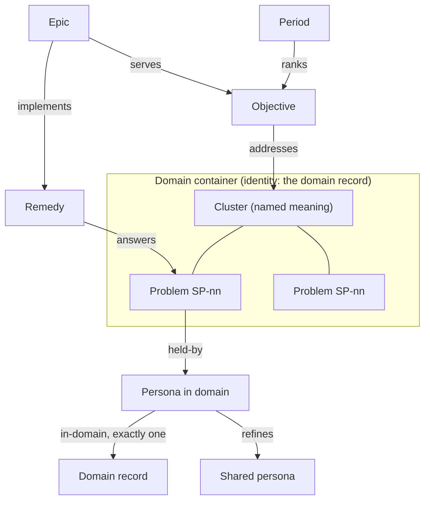

**How the pieces fit.**

1. **Domain container.** A domain is a container whose identity is the domain record. Its outline holds clusters at depth 0 and their problems at depth 1. Membership is arrangement, not meaning.
2. **Cluster.** A cluster is named meaning: problems are raw ideas, and a synthesiser job groups and names them. The owner affirms the cluster's name and description; which problems sit under it stays fluid.
3. **Persona in domain.** The same person needs different things in different domains, so each domain gets a persona-in-domain that `refines` the shared persona and points to exactly one domain with `in-domain`.
4. **Problem.** A problem is `held-by` a persona-in-domain. Its domain is derived through that link and never stored twice.
5. **Remedy.** A remedy `answers` one or more problems. It carries a **falsifier** (what would show it failed) and a **return_when** (when to look again).
6. **Objective and period.** An objective `addresses` clusters. A period ranks objectives, and that ranking alone gives priority.
7. **Epic.** An epic `implements` remedies and `serves` an objective. It is also a GitHub issue, where the execution half begins.

**Suggested, affirmed, set aside.** Every record sits in one of three layer containers.

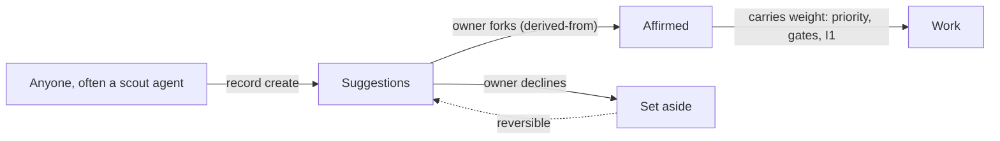

A scout or any participant writes a suggestion under its own actor (`createdBy`). The owner affirms by forking it into Affirmed, which keeps a `derived-from` link back to the suggestion. Set aside is a reversible no. Readers resolve every link to its affirmed end through `canon()` (follow `derived-from`).

**Where it stands** changes week by week. The stages Domain, Persona, Problem and Remedy, in "Stage by stage", hold the current state.


#### A domain's axes: three orthogonal trade-offs

> **Proposed, not in force** (clerk#158; owner's direction, 2026-10-23). This chapter is Theory until the owner's session ratifies it. The method keeps being refined: change it by decision, not by quiet edits.

A domain is not fully defined until it names its trade-offs (SP-94). The goal is **three foundational axes that are orthogonal**: knowing where a choice sits on one axis tells you nothing about where it sits on another. Orthogonality is rare and hard to see. That is why the method leans on synthetic logic, the practice of mapping a whole with a few complete, independent lenses (sources: greenmans_creation, `Foundational-Synthesis`, `Orthogonality`, `Building-Complete-Complementary-Structures`, the T3 axis generation agent). The method is **iterative cross-referencing**, and any domain that is effectively designed can follow it.

**Two synthetic systems, two maps.** Two synthetic systems map the same space. They are related, but they are different maps, built from different rubrics. Neither is the other renamed.

- **The trigram (the three axes).** Three lines read from the bottom: line 1 Earth, line 2 Human, line 3 Heaven. It is built directly from tensions, one per line, so it is **the default for a domain**. The T3 stance and the decision ratings use it too.
- **The zodiac (the SRS decision compass).** Twelve cells from the Pattern Grid (element × level: Individual, Relational, Systemic), giving six opposite-cell axes. Systemic Data Ethics groups them by its own movements (Action, Form, Time). It has twice the axes and a fixed grid, so it is the better map **for finding gaps**: a cell or axis with nothing in it is a question the domain has not asked.

They meet through the I Ching ↔ zodiac alignment: hexagram line k is the zodiac axis that begins at sign k. Moving between them is a **translation**, so say so whenever you do it, and say which translation. The local reference for both, and for the translation, is `srs-programme:source-documents/decision-taxonomy-2026-10-22/three-axes-by-trigram.md`.

**1. Place before judging.** A tension can be weighed only inside a domain. Without one there is no polarity, no foundational status and nothing to test it against. So the first act is to place each tension in the domain whose purpose it trades on. The groups that hold a tension (`holds-tension`) are evidence of where it belongs, not the answer.

**2. Generate the axes from the trigram; don't just collect them.** Tensions gathered from the bottom up, from the work, cluster. In Programme coordination, three said "one way" and two said "throughput". So ask what the domain's tension is on each line, in the owner's definitions:

- **Line 1, Earth.** Does the energy go out onto the world, or in to change the system itself? Act ↔ Observe.
- **Line 2, Human.** Do we add energy to change state, or let the system settle? Disrupt ↔ Stabilise.
- **Line 3, Heaven.** Is the boundary closed and steered by our will, executing a plan? Or is it open, sensing and responding to what is outside? Focus ↔ Zoom out. Traditionally this is where the system's direction comes from: a goal we have chosen (yang), or alignment with other actors (yin). This line is not about breadth: a small, specific choice can be open, and a system-wide one can be closed.

Collected tensions are then matched to a line. One tension per line is foundational. The rest are recorded **in prose**, under the axis they refine.

Then **use the compass to look for gaps.** Translate the domain's three axes onto the compass, and read the compass's six axes and twelve cells for what the domain has not named. A compass axis with no tension, or a cell with no case, is a candidate for a missing tension or a misplaced one. The compass finds the gap; the trigram holds the answer.

Do not number lines from the compass's own movements or from T3's dimension names (Energy, Time, Space). Those are other triads, and they do not run along the trigram's lines.

**3. Test every pair as a 2×2.** Fill each of the four cells with a **real case from the domain's own history**. If a cell is impossible or unnatural (a "hot winter"), the pair is one axis seen twice. Signs of a duplicate:
- the two tensions share a pole word ("Throughput" on both);
- one tension is the *how* of the other (mechanism over policy is *how* semantics stay in the core once).

**4. Test the three as a cube.** Name all eight corners, each with a real case. A corner nobody can fill means the set is not orthogonal, or not complete.

**5. Assign yang per domain.** Yang is the pole that is thing over relation, movement over stillness, outward over inward, assertive over reflective, forward looking over retrospective. On the trigram lines: Act, Disrupt and Focus are the yang poles. Yang is **not** the preferred pole: preference is the principle's lean, a separate record. Polarity belongs to the line in its domain, and a narrower domain may flip it (decision cdd272a3). Three cross-checks:
- tensions that refine one axis should lean yang the same way;
- **across domains, one line should lean yang the same way** unless a domain is known to flip it. A disagreement here is a finding to rule on, not a mistake to hide. Compare domains on the trigram; compare against the compass only through the translation;
- yang must not be read as "good". A corner's health is not its count of yang poles.

**Polarity on the compass is derived by rule, not read.** Yin and yang alternate around the zodiac, starting with Aries as yang, except at 6/7 (Virgo → Libra) and 12/1 (Pisces → Aries), where they do not alternate. So the yang signs are Aries, Gemini, Leo, Scorpio, Capricorn and Pisces. The yang pole is the first sign on axes 1-7, 3-9 and 5-11, and the second sign on 2-8, 4-10 and 6-12. The ratified compass matches this on all twelve signs. The only judgement is the mapping, which comes first: which of the domain's concepts sits in which cell. Two cross-checks follow from the rule. Every element holds both poles, split 2–1, and every level (Individual, Relational, Systemic) splits 2–2. If either fails, a concept is on the wrong cell (owner, 2026-10-23).

**6. Cross-reference and revisit.** Edges are blurry. Placing one tension can reopen another placement, or show that a tension belongs to a narrower or wider domain. That is the method working, not failing. Expect three to five passes. Record each pass's evidence (the 2×2 cases, the cube, the compass gaps), so the next pass starts from it. A domain's placements are revisited on a cadence, as the dream cycle revisits long-term memory: re-verify the cases, merge tensions that turned out to be one axis, and move tensions whose domain was mis-read.

**Things the first pass taught (Programme coordination, 2026-10-23)**:
- **Correlated leanings are not correlated axes.** The programme prefers both Core once and One way. That is where we choose to stand, and it says nothing about the shape of the space.
- **Movement between cells is evidence of independence.** Work graduates from the lab (adapter, one way) into the core (core once, one way). It takes on compatibility as clients come to depend on it, and a ruling cuts it clean again. If lines 2 and 3 were one axis, there would be nothing to move between.
- **The cube locates the failure.** The corner we keep cleaning up is deliver · compatibility · adapter (drift), and its poles are mixed.
- **Human forks only.** Every tension has an AI suggestion and a human fork, often with the poles in the opposite order. Place and judge the human fork.

The trigram, lined up across Programme coordination and Stance:

| Line | Programme coordination (yin ↔ yang) | Stance (yin ↔ yang) |
|---|---|---|
| 1, Earth | Refine ↔ **Deliver** (owner, 2026-10-23) | Observe ↔ **Act** |
| 2, Human | Compatibility ↔ **One way** | Stabilise ↔ **Disrupt** |
| 3, Heaven | Adapter convenience ↔ **Core once** (owner, 2026-10-23) | Zoom out ↔ **Focus** |

The compass translated onto the same lines through the alignment (axis k on line k). This is a translation of a different map, given for comparison and for finding gaps. It is not the compass's own grouping, which pairs its axes by Systemic Data Ethics movement and is not changed here.

| Line | Decision compass (Semantic records), by the alignment |
|---|---|
| 1, Earth | Semantic integrity ↔ **Practical expression** (1-7); Testimony ↔ **Office** (4-10) |
| 2, Human | Continuity ↔ **Evolution** (2-8); Reliability ↔ **Renewal** (5-11) |
| 3, Heaven | Local autonomy ↔ **Shared coherence** (3-9); Possession ↔ **Portability** (6-12) |

**Line 2 agrees everywhere:** the yang pole is the change pole, on the trigram and on the translated compass alike.

**The second pass, on the owner's definitions (2026-10-23):**
- **Line 1 is Refine ↔ Deliver.** Does the change land on the world (shipping the work already defined), or on the programme itself (refining how and whether we are ready to act)? Deliver is yang. The first pass had no line 1 tension, because every named tension was inward. That is the programme's own stuck point (srs-programme discoveries, 13).
- **Human layer ↔ Agent throughput moves off line 1** (proposed: prose under line 1, beside Reviewable ↔ fast). It is not where the change lands. It is how the energy gets turned inward: a human layer that judges each item before anything ships. Its yang, Agent throughput, goes with Deliver. It is not a line 3 tension either, because agents carry our direction; they do not bring their own.
- **Line 3 is Adapter convenience ↔ Core once.** The core is control from the centre. Adapters let direction come from outside. Core once is yang.
- **The translated compass.** On line 3, Shared coherence (3-9, ♊) is a direction chosen at the centre, so the two maps agree. Portability (6-12, ♓) is yang by the zodiac rule, but reads as yin on trigram line 3, because a capability that travels aligns with other actors. That is a translation difference between two maps, not an error in either.

| Corner (line 1 · line 2 · line 3) | Real case |
|---|---|
| Deliver · One way · Core once | a clean-cut release from the centre (srs-rust#878: federation removed, no shims) |
| Deliver · Compatibility · Core once | a release that lands with a migration path (RFC-043: revision 8, migration staged) |
| Deliver · One way · Adapter | a client ships the shape its users need, with the old form dropped (the control room on clerk serve, srs-lab#19) |
| Deliver · Compatibility · Adapter | shipping through shims and local copies (hand-written client types: drift) |
| Refine · One way · Core once | the centre replaces a process (label bindings, f58db200) |
| Refine · Compatibility · Core once | the centre widens its allowance to keep going (clerk#152 raising rule ceilings; srs-rust#866) |
| Refine · One way · Adapter | a client reworks its own practice and drops the old one (the lab middleware, rewritten weekly) |
| Refine · Compatibility · Adapter | proposed practice kept beside live practice (the "Proposed, not in force" chapters) |

Recorded in prose: Human layer ↔ Agent throughput and Reviewable ↔ fast refine line 1, and Mechanism ↔ policy refines line 3. Strict ↔ repairable and Spec-led ↔ implementation-led are proposed for Semantic records, and Depth ↔ overload for Agent memory, each to be tested there.

**Where it is written**: tensions and poles live in srs-programme. A placed axis is an `axis-in-domain` record (line, `yang-pole`, `in-domain`, `refines` the tension; method package 1.1.0, clerk#135), set with `clerk domains set-axis`. Its `line` is the trigram line (1 Earth, 2 Human, 3 Heaven).


#### How work moves across the boards

The boards are GitHub Project #6 "SemanticOps" and a set of plain labels that mirror it. Priority is **derived, never hand-set**: it flows down from the period ranking.

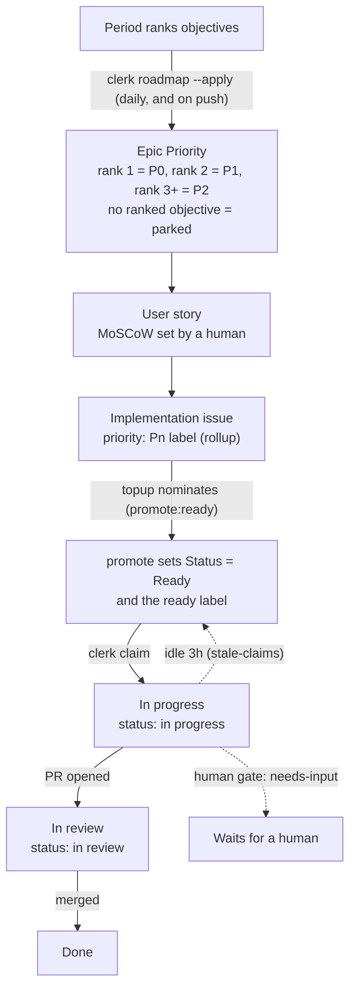

**The levels.** An epic lives in the story repo (`the-greenman/semanticops.com`) with the label `epic` and a title `Epic NN: Name`. Stories hang under it as sub-issues, with the label `user-story` and a MoSCoW. Implementation issues hang under stories, across any governed repo. An epic is a release: whatever it reaches through sub-issues.

**Derived priority.** `clerk board rollup` walks each issue up to the stories it serves. Must gives P0, Should P1, Could or blank P2, and Won't excludes. With no story, the issue inherits its epic's Priority one tier down. A bug is never weaker than P1. `critical-path`, `blocks-gate` and `regression` bump one tier. Rank flows to blockers (clerk#113): an issue that blocks ranked work by a blocked-by edge takes that work's priority. A `parked` blocker (its own label or a parked epic) gets none, since it is still ungrounded; once the programme package defines a `blocks-ranked` work label and the programme binds it (clerk#155), the hourly reconcile labels it and it goes to the desk to be re-grounded; until then reconcile reports it unlabelled. The pulled priority shows on the issue, but topup still feeds in epic order (clerk#155). An explicit Won't blocker stays a hard block. So a prerequisite is recorded as an edge (`board dep add`), never only in text; `steward` flags text-only prerequisites.

**The ready queue.** `topup` keeps about six issues Ready. It nominates the top Backlog candidates in implementation order (epic Priority, started epics first, the `NN` in the title, issue priority, sub-issue position) by writing `promote:ready`. `promote` turns that intent into Status Ready. Blocked issues (an open blocked-by edge, or the `blocked` label), `needs-input` issues and bugs are never nominated. Bugs have their own track: `label:bug`, oldest first.

**One hourly pass.** The srs-programme workflow `board-sync.yml` runs `clerk board sync` every hour: stories sync, rollup, topup, promote, stale claims, reconcile. Only this tool writes Projects v2 fields. Cloud routines cannot reach Projects v2, so they read and write the label mirror: the labels the programme binds to the work-status set (decision f58db200), such as `ready`, `status: in progress`, `status: in review`, `promote:ready`, `blocked` and `needs-input`.

**Claiming.** Before anyone starts, `clerk claim <repo#n> --as <seat>` checks that the issue is open, has no branch, PR or assignee, answers an affirmed problem, falls under a group, and that the actor holds the seat. It then assigns, labels and comments. The same command serves humans, local sessions and routines.

**Grounding.** `clerk ground` walks a merged PR back up the chain (issue, `Answers:` problem, affirmed persona and domain, epic, group) and reports how far it got. The daily share of grounded PRs is indicator I1.

Full detail, every command and the API budget: [board.md](board.md).


#### Intake: how a request reaches a group

> **Proposed, not in force** (clerk#56, `plans/wg-srs-operations.md`). This chapter is Theory until the owner's session ratifies decisions D2 to D7 (D11 is ratified).

Work should never start as a finished `ready` issue that nobody assessed. A bug, a piece of friction or a feature idea first enters as a **request**. It is **placed** in a domain, and through the domain in a group. That group **assesses** it against its own priorities and queue, **proposes** what it becomes, **decides** inside its mandate (or escalates), and **reports** up.

A scout's ruling-backed work (for example the WG Third-party ready analyst filling its queue) is not a request: it already has its ruling and its group, and keeps its own path.

**The same shape at every level.** The programme, a working group and any future sub-group each run the same six steps. Only what the level looks across changes. A level places work one level down, and never decides for the level above.

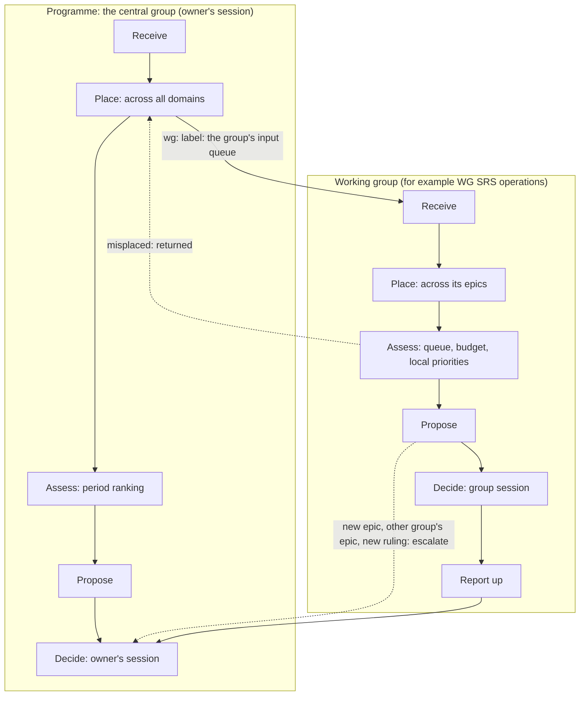

**The steps, and who takes them.**

1. **Receive.** Anyone, human or agent, files a request while doing work (the Request template, in Reference). Label `intake`. A session that hits friction files it at once and carries on; it does not fix it in passing. An srs-context **finding** is memory (the trap, so the next agent avoids it); the work to remove it is a request. A finding with no issue gets a Request, and its issue link points at it. The srs-context dream cycle files these when it records new findings.
2. **Place.** The programme's router reads the domain records (purpose, in and out of scope) and the problem register. It runs the duplicate guard and posts a Placement. When a group's domain fits, it adds that group's `wg:` label, and the request is now in the group's **input queue**. When no group holds the domain, the request stays with the central group. When no domain fits, it adds `needs-input`, and the request becomes an exercise for the owner's session: perhaps a new domain.
3. **Assess.** The group's analyst reproduces the request and posts an Assessment. The verdict is *accept*, *merge into* an existing issue, *return* (misplaced: the `wg:` label is removed and the request goes back to step 2), *set aside* (with a reason) or *needs a ruling* (an exercise, never work). The analyst judges against the group's mandate, its ready queue against its budget, and its local priorities. It never sets a priority.
4. **Propose.** For an accepted request, the group's synthesizer posts a Proposal and files the issues in the governed repos, each with `Answers:` and as a sub-issue of the group's epic or story. Placement under a story is what gives the issue its priority, through the rollup. Bugs get the `bug` label and the bug track. If no affirmed problem fits, it writes a **suggested problem `held-by` a persona-in-domain** in srs-programme. That record is the durable form of the domain estimate: the domain is derived through it, never stored.
5. **Decide.** Inside the mandate, the filed issues flow through the board as usual, and any group decision is ratified at the group's session. A new epic, a placement in another group's epic, or anything needing a new ruling goes up as one proposed decision.
6. **Report.** The request is closed with links to what it became. The steward's cycle report carries an Intake section, and the router's misplacements are counted there.

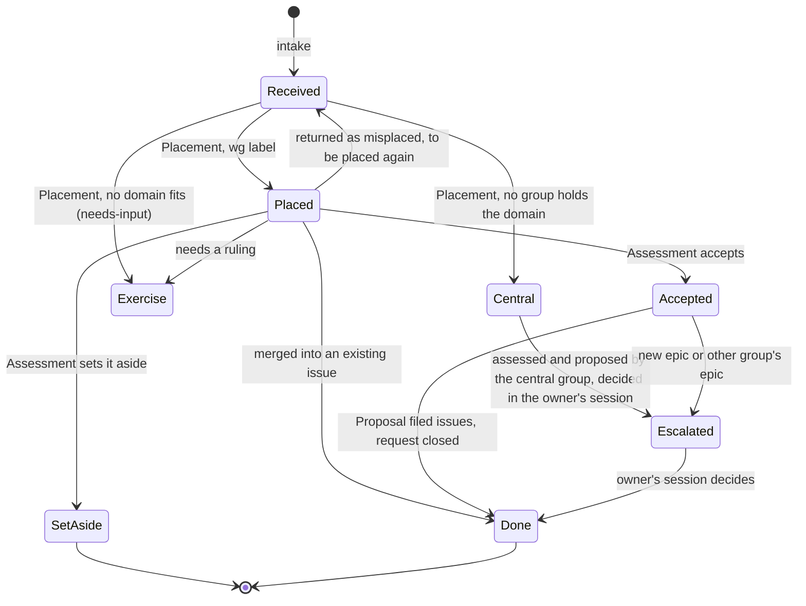

**Parking a decision.** A decision someone cannot make in the moment is a request too, of kind *decision*. It is the commonest way a working window is lost: the work stops on a question, and the question is never asked anywhere it would be answered. So the question is recorded at once as a proposed decision, never held in the head of whoever is stuck (D11, ratified 2026-10-15):

1. Whoever is stuck, human or agent, writes it as a **proposed decision** in the decision log of the level that owns it. It records what is blocked, the options seen so far, and the next action once it is decided (template T8). If you do not know which level owns it, use the SemanticOps log: the router moves it.
2. The blocked issue gets `needs-input` and a comment linking the proposal. Work moves to something else, or stops cleanly with a run report.
3. The proposal appears on that level's agenda (decisions to ratify), where the session ratifies it, amends it or sets it aside.
4. When the decision is ratified, `needs-input` comes off and the work resumes under it.

Nothing new is needed but a one-step way to write the proposal; today it takes two srs CLI calls with the right container ids.

**What is new.** One label (`intake`) and three comment markers (`<!-- intake-placement -->`, `<!-- intake-assessment -->`, `<!-- intake-proposal -->`), on the pattern of `<!-- wg-quorum -->`. Everything else is existing practice: domains, persona-in-domain, problems in Suggestions, the duplicate guard, the board, escalation. There is deliberately no intake record type, no board status and no command: `label:intake` is enough until intake regularly exceeds about ten items a week.

**Measure.** Indicator I5, "Does intake flow?" (proposed): the median days from Request to Assessment, the share of placements returned as misplaced, and the requests set aside or waiting longer than one cycle.


#### Working groups and delegation

The owner cannot judge every merge. So the owner **delegates**: a working group gets a mandate, decides and merges inside it, and reports back. Anything outside the mandate comes back to the owner as one proposed decision. This is how a co-op runs a subcommittee.

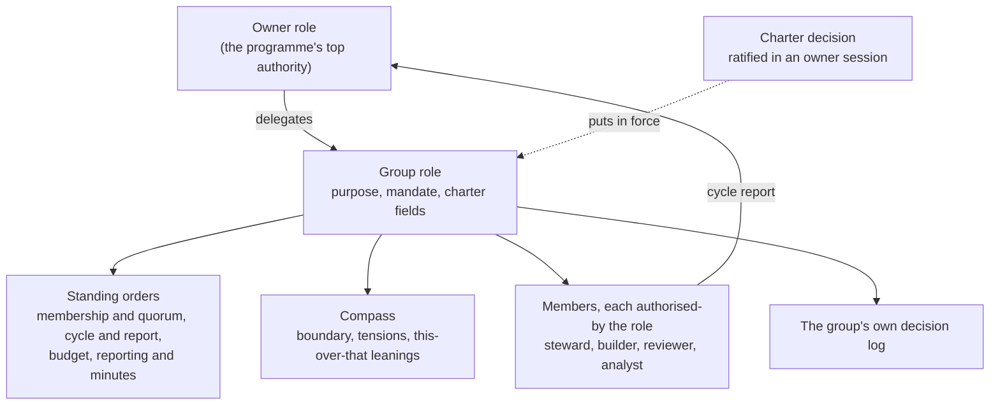

**What a group has.** A purpose; standing orders; a delegation order (what it decides, what it escalates); a compass; membership and quorum; a rhythm with a cycle and a budget; its own decision log; and a duty to report. All of it is records in srs-programme. The numbers that code needs (label, quorum seats, budget per cycle, cycle close, pause limit, governed repos) are fields on the group role, read by `clerk groups`. Nothing is hard-coded.

**Inside or outside the mandate.**

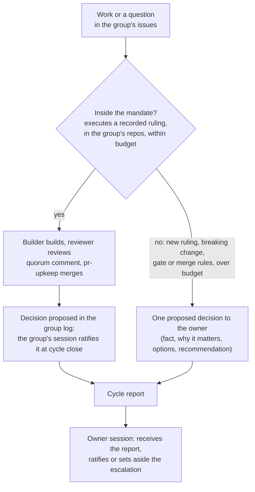

**Quorum and merge.** A group PR merges only when a builder and a *different* reviewer agree after the last commit, the gates are green, the cycle's budget is not spent and the group is not paused. The reviewer posts a `<!-- wg-quorum -->` comment; `pr-upkeep` checks it every 15 minutes and merges. A new commit voids the quorum.

**Pause.** If the owner leaves two cycle reports unacknowledged, the group pauses: no new builds and no group merges, though reviews and escalations continue. Silence slows the group down rather than letting it run unwatched.

**The central group.** Work with no `wg:` label belongs to the central group, SemanticOps, held by the Owner role. Its seats are the owner's builder and reviewer, plus agents `authorised-by` the Owner role, such as the nightly `agent:unattended-worker`. The central group never claims a delegated group's work.

**Rulings, ratified** (srs-programme#113): SemanticOps is the root decision-making authority for its domain, and other bodies such as muDemocracy are separate (31e40305); the central group undertakes all work no group holds by delegation (4fca091f); anyone working on a group's work joins that group and works within its practices (ccd593c3); a group is chartered only with a known domain, a problem set and standing orders (9a45c0a1).

**Groups today.** WG Third-party ready (semanticops.com#31, `wg:third-party-ready`) is in force. WG Agent-supported editor (semanticops.com#29, `wg:agent-editor`) has been chartered as records. WG SRS operations (`wg:srs-ops`) is proposed in `plans/wg-srs-operations.md` (clerk#56), with an input queue fed by intake (chapter "Intake"); it is chartered only when that queue becomes steady, the usual trigger. A new group is chartered only on a trigger: a steady ready queue that needs delegated merges.

**Chartering.** `clerk charter` writes the whole charter as drafts and a proposed decision; an owner session ratifies it and asserts `delegates`. The steps are in stage 10. The briefs the members follow: [routines/working-groups.md](../routines/working-groups.md).


#### Stances: members built on eight archetypes

> **Proposed, not in force** (clerk#56, decisions D8 and D9). This chapter is Theory until the owner's session ratifies it.

A group brings in members according to its purpose, and each member is built on one of **eight stances**. A stance is a position on three trade-offs:

| Line | One pole | The other pole |
|---|---|---|
| 1 | **Observe**: how we work | **Act**: what we do |
| 2 | **Stabilise**: consistency, care, reliability | **Disrupt**: drive forward, change |
| 3 | **Focus**: projects and specific goals | **Zoom out**: open up and align systems |

| Stance | Lines | Brings | Watch for (shadow) |
|---|---|---|---|
| Initiator | Act · Disrupt · Focus | starts what needs to begin | overdrive, blind to nuance |
| Challenger | Act · Disrupt · Zoom out | questions what needs examining | constant friction |
| Builder | Act · Stabilise · Zoom out | gives form to what needs it | over-engineering |
| Synthesizer | Act · Stabilise · Focus | weaves what needs connecting | overdesign, rigidity |
| Analyst | Observe · Disrupt · Focus | clarifies the core issue | paralysis by insight |
| Rebel | Observe · Disrupt · Zoom out | exposes what needs revealing | destruction without direction |
| Steward | Observe · Stabilise · Focus | protects what needs care | resistance to change |
| Watcher | Observe · Stabilise · Zoom out | holds space for what needs time | passivity, delay |

**Stances are relative to a boundary.** The labels are coordinates inside the boundary we have drawn, not fixed traits. A group has a stance relative to the programme, and its members have stances relative to the group. Draw a different boundary and the same agent may sit at a different point. So the same eight stances describe a domain, a group and a single agent: the process is fractal.

**Seats are jobs; stances are archetypes.** A seat (steward, analyst, synthesizer, builder, reviewer, router) says what the member does. A stance says how it leans while doing it. Seat names and archetype names often coincide, but they need not: a reviewer is a **Challenger**. Some stances need no seat. Anyone who hits friction and files a request acts as an **Initiator**. Anyone who asks "why are we doing this at all?" acts as a **Rebel**, and that question becomes an exercise, never work.

**Composition.** A group checks that every stance is present or reachable, pairs stances with their listed complements, and names its own shadow in its compass. Example (proposed): **WG SRS operations** is a *Steward* relative to the programme (Observe · Stabilise · Focus: how we work, kept reliable, for our current goals). Its complements are the Challenger (its reviewer) and the Initiator (everyone who files a request). Its shadow, hoarding the queue or turning requests away, would show in the requests it sets aside or leaves waiting, which the proposed indicator I5 counts. The group's stance (Steward, seen from the programme) and its steward seat (the member who closes the cycle) are different things that share a name.

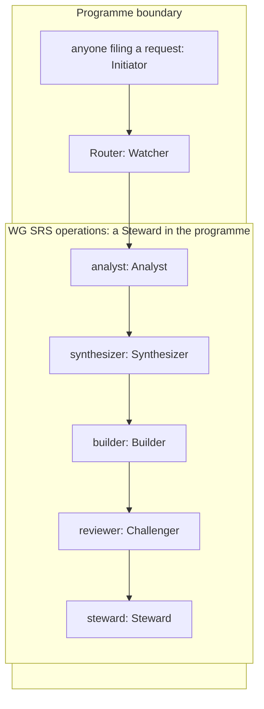

**In records.** A seat-holder (`stewardship/agent`, with `seat` and `actor_id`) is `derived-from` a stance agent (`method/agent`), which `instantiates` its archetype (`method/archetype`). No new type is needed; today only these links are missing.


#### Decisions

A decision is **one standing choice that governs later choices**. It is not a task, not a plan and not a diary entry.

**The four tests.** A candidate goes in the decision log only if it passes all four:

1. **Reuse.** Would a later choice be settled by pointing at it?
2. **One thing.** Can it be said in one sentence without "and"?
3. **Timeless.** Does it read true with every date, issue number and id removed?
4. **Testable.** Can someone apply it to a new case and say whether the case conforms? Does it say when to review it?

Anything that fails the first test is still recorded, but as an issue (a task), an application or a plan, linked to the decision it serves.

**Seven kinds**, adopted to test (`decision_kind` on the decision record):

| Kind | Frame | Example |
|---|---|---|
| Purpose | We exist to X, for Y. | Deep context for action (f5b4656a) |
| Boundary | X covers A, not B. | Programme coordination domain (da7877f3) |
| Premise | We work as if X. | Stance agents are universal (7841bb87) |
| Preference | X over Y, unless Z. | Convention before enforcement (e337703b) |
| Policy | Every X must Y; measured by I. | A group's session ratifies (70a05a5c) |
| Design | We model X as Y, because principle P. | Domain container (a6280447) |
| Mandate | Group G may X within M. | Charter for WG Third-party ready (00567bf1) |

**How a decision is made.**

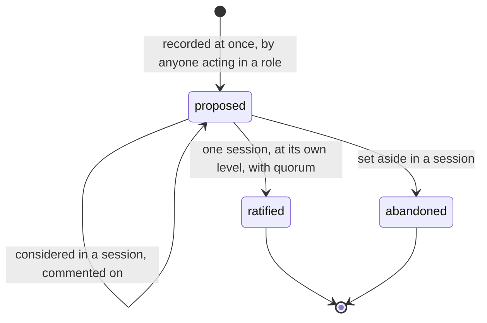

- **Recorded at once.** A choice made between sessions is written straight away as `proposed` and may be acted on if it falls inside the group's remit.
- **Ratified once.** A decision is ratified in exactly one session, at the level that owns it (a group's log, or the SemanticOps log for the owner) and with that level's quorum. Before that it may pass through many sessions as a proposal, each recording `considers`.
- **Sessions.** A session has attendees, a time and an agenda in this order: decisions since the last session, reports, exercises, decisions for this session, merges. `clerk` (a terminal UI) and `clerk session` write one `programme/session` record with `attended-by`, `ratifies`, `sets-aside`, `considers` and `receives` relations, and open a signed PR that merges itself.
- **Three kinds of minute.** A *report* is received, not decided. An *exercise* is an open discussion that feeds proposals and is never ratified. A *decision* is ratified or set aside.
- **Discussion.** Humans and agents comment the same way: a comment record `comments-on` the decision (`clerk comment`). A comment between sessions is discussion, not a session.

**Kinds of meeting** (proposed, clerk#56 decisions D12 and D13, clerk#59). Different questions need different meetings. Each kind has its own agenda, and every kind writes the same `programme/session` record, with its kind.

| Kind | What it handles | How often | Tool today |
|---|---|---|---|
| **Decision** | ratify or set aside decisions, receive reports, merges | weekly, or when the agenda fills | `clerk session` (works) |
| **Affirmation review** | walk Suggestions: domains, personas in domain, clusters, problems, remedies; affirm, edit and affirm, or set aside | when a domain is walked | srs-web Method editor: problems now; remedies, clusters and personas with srs-web#548; domains with srs-web#562 |
| **Unblock** | short and frequent: parked decisions (proposals), `needs-input` issues, approved PRs that have not merged, PRs stating a `Decision asked:` | daily, minutes long | partly: exercises and owner-merge PRs only |
| **Intake triage** | requests at the programme level waiting for placement | with Unblock until volume grows | proposed (chapter "Intake") |
| **Retrospective** | period close: keep, change or drop practices and indicators | once a period | theory only |

An Unblock meeting is the cheapest way to keep a working window: anything that needs you is a short list, and every PR says what it asks (template T9).

**Escalating to the owner.** Information must fit the reader. An escalation is one decision with its stakes, options, consequences and a recommendation, never a flood of technical questions.

Full rules, kinds and the worked re-read of the log: [decision-log.md](decision-log.md).


#### Routines review, report and allocate

A **routine** is a cloud agent that runs a brief on a trigger. A **workflow** is a GitHub Action that runs clerk code with no AI. Together they keep the programme moving between sessions.

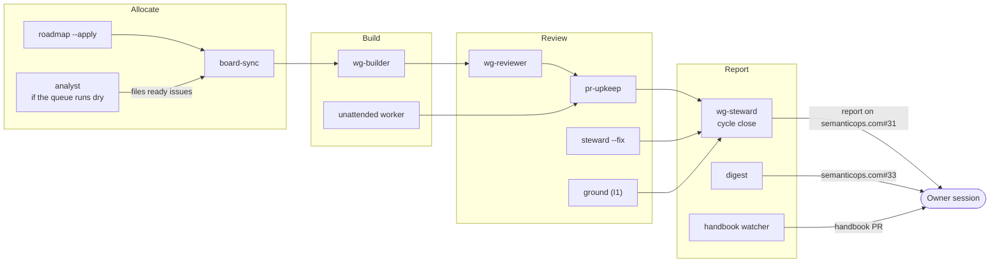

Exact schedules and triggers live in [tools.md](tools.md); this table says what each one is for.

| Job | Runs | Kind | What it does |
|---|---|---|---|
| Allocate | `board-sync` hourly | workflow | rollup, topup, promote, stale claims, reconcile |
| Allocate | `roadmap --apply` daily and on push | workflow | epic Priority from the period ranking, `parked` label |
| Allocate | analyst, daily 12:00 | routine | only when the last report says "Queue running dry": files ruling-backed issues as ready |
| Build | wg-builder, on events | routine | one group issue per run, claimed with `clerk claim` |
| Build | unattended worker, nightly | routine | up to 3 `lane:unattended` issues, as the central group's builder |
| Review | wg-reviewer, on PR events | routine | gates, mandate check, quorum comment; never reviews its own work |
| Review | pr-upkeep, every 15 min | workflow | merges PRs whose gate label and quorum allow it; daily digest |
| Review | steward check, daily | workflow | reopens false closes; comments on issues with no `Answers:` line |
| Review | ground, daily | workflow | I1: share of merged PRs grounded to an affirmed problem |
| Report | wg-steward, daily 11:30 | routine | closes the cycle: run report record, ratifies the group's decisions in one group session, report on #31 |
| Report | handbook watcher, weekly | routine | re-reads code, data and boards; updates the handbook records; renders; opens a PR |

**The desk.** Everything that needs the owner is on one pinned issue, semanticops.com#35 (label `desk`). `clerk desk --post` rewrites its body in place, never as a comment, on every pr-upkeep run that applies (clerk#203), in three parts: **Needs you** (unreceived reports first when a group is paused, decisions to ratify, open exercises, owner merges with the question each asks (an owner-merge PR that asks nothing is not listed: Threads shows it as misclassified, back to an agent; clerk#165), approved PRs that have not merged and why, issues assigned to the owner with their age, `needs-input` issues oldest first, parked issues that block ranked work (`blocks-ranked`) to re-ground), **Threads** (one line per ranked epic, working group, the central lane and unthreaded PR: state, last moved, next step, who; an epic with open PRs, ready or claimed items or open sequences is never idle, and each open sequence, a sub-issue with open sub-issues of its own, gets a line with its next unblocked task; then the issues claimed with no PR yet, with who claimed them and when; clerk#204) and **Running fine** (counts only). If it is not on the desk, it does not need the owner; #31 and #33 are history.

**Rules for every routine.**

- **Thin prompt.** The trigger only points at its brief in `routines/`. Rules live in the brief, so a change is a pull request.
- **Record first.** Each routine has a standing-job record in srs-programme (`routine_id`, `brief_path`) and an agent record with its `SRS_ACTOR`. `clerk routines --check` reports drift between records, triggers and briefs.
- **Never run a brief that is not on the clerk default branch.**
- **Stop honestly.** A run that hits a human gate comments the exact question, adds `needs-input`, and stops.
- **Report what you learned.** Every report ends with a short "What we learned": which part of the theory held, which did not.

Lifecycle and drift check: [routines.md](routines.md). Every routine and workflow: [tools.md](tools.md).


### Stage by stage

Each stage has the same parts:

- **Theory**: where we are trying to get to. It is kept even when practice falls short.
- **Status**: *working*, *partial* or *theory only*.
- **Practice**: what works today, naming the record type, the tool and the doc.
- **Gap**: where practice differs from theory, or from itself.
- **Open questions**: what we do not know yet. Each one is answered by a decision in the decision log, never by editing this text alone.
- **Test**: where `test/process.test.mjs` proves it.

Facts here were checked against clerk and srs-programme on 2026-10-11. The weekly handbook watcher re-checks them.


#### Roles and layers

**Theory**: Every act is done by someone holding a role. The **owner** is the programme's top authority and delegates to working groups. **Members** of a group hold seats: steward, builder, reviewer, analyst. **Scouts** suggest problems. Records carry who made them (`createdBy`) and sit in one of three layers: Affirmed, Suggestions, Set aside.

**Status**: partial

**Practice**:
- **Layers:** the Affirmed, Suggestions and Set aside containers in srs-programme, checked by `scripts/check-method.mjs` (`checkGates`): an AI actor cannot author a record in a human layer.
- **Roles:** only the owner is built into `lib/practice/roles.mjs`. Every group role is read from records: a `governance/role` with charter fields, the Owner role `delegates` to it, and agents `authorised-by` it carry `actor_id` and `seat` (`clerk groups`; it does not yet check the `delegates` edge, clerk#137).
- **Agents:** a `method/agent` is a universal stance agent that `instantiates` one of the eight archetypes. A `stewardship/agent` is a seat-holder in a group and is `derived-from` a method agent. The unattended worker (`agent:unattended-worker`) is `authorised-by` the Owner role as the central group's builder.

**Gap**:
- Set aside has never been used: its only member is its own identity record.
- The difference between `method/agent` and `stewardship/agent` is practice, not a ruling.

**Open questions**:
- Should the stance-agent and seat-holder split be ruled, or one type retired?

**Test**: Stage 1: 3 passing. Two todos (roles read from records; the analyst as a member role) describe work already done and should become passing tests.


#### Domain

**Theory**: A domain is an area of work with a purpose and what is in and out of scope. It tells us *when* a problem occurs. A domain is a container whose identity is the domain record; its outline holds clusters at depth 0 and their problems at depth 1. A problem with no cluster sits at depth 0: early in a domain we do not yet know all its parts, so an unclustered problem is valid, never a gap. Where a cluster is required (an objective `addresses` clusters), a cluster holding one problem is valid. Clusters evolve, and problems move between them as understanding changes (owner, 2026-10-11). A problem's domain is derived (problem `held-by` persona-in-domain `in-domain` domain), never stored. Domains nest by perspective. The owner affirms a domain in the srs-web Method editor.

**Status**: partial

**Practice**:
- Type `com.semanticops.method/domain` (title, purpose, in_scope, out_of_scope).
- The domains: `srs record list --repo <programme> --type com.semanticops.method/domain`; which are affirmed: `srs container get 5e28aa7e-4b35-4474-8f62-cf8dcae1e506 --repo <programme>` (the Affirmed container); their axes: `clerk domains --repo <programme>`.
- 6 domain containers exist. Evidence-backed writing's outline holds its clusters and their problems (srs-programme#112).
- Deep context nests Semantic records, Group meaning ownership and Agent memory (decision dbaa4716).
- `clerk ground` reads domains through `contains` (domain to cluster to problem) to compute I1. Nothing else reads them.
- Plan: [plans/two-domains-end-to-end.md](../plans/two-domains-end-to-end.md), walking Evidence-backed writing and Agent memory first.

**Gap**:
- Clusters still hang off domains by `contains` edges as well as by container outline: two groupings for one goal, until readers switch to the outline (decision a6280447).
- Nothing checks that a problem has a domain.
- An affirmed domain is a fork, so its container identity still names the suggestion; readers resolve it with `canon()`.
- Decision a8aabd01 (unclustered problems and one-problem clusters are valid) is proposed, not yet ratified.

**Open questions**:
- How is a domain retired?
- How does a domain relate to a working group's boundary or compass?

**Test**: Stage 2: pending (every problem has a domain; the domain says when).


#### Persona

**Theory**: A persona is someone the work is for: their jobs and needs. It tells us *who* a problem is for. The shared persona stays general. Each domain adds a **persona-in-domain** (title, goals, jobs, needs) that `refines` the shared persona and points to exactly one domain with `in-domain`. A problem is `held-by` the persona-in-domain.

**Status**: partial

**Practice**:
- Type `com.semanticops.method/persona` (title, summary, jobs, needs): count and state with `srs record list --repo <programme> --type com.semanticops.method/persona`.
- Type `com.semanticops.method/persona-in-domain`, field `goals` and relation `in-domain`: method package v1 (clerk#34), installed in srs-programme (srs-programme#105).
- 3 persona-in-domain records, all suggestions, all in Evidence-backed writing: Writer, AI agent, and A person working with AI.
- 15 `held-by` edges point to a persona-in-domain; the rest still point to shared personas, as domains not yet walked are allowed to (decision e4a9b0ac).
- `clerk roadmap --explain` shows personas as labels, marked "suggested".

**Gap**:
- Personas never reach issues, priority or assignment.
- The exactly-one `in-domain` rule will be checked in clerk `check-method`, not in core, until the process settles (decision 071eadb2).
- No persona or persona-in-domain is affirmed, and only Evidence-backed writing has persona-in-domain records.

**Open questions**:
- Do personas weight priority, or only qualify it?
- How do we hear from a real persona, as opposed to a modelled one?

**Test**: Stage 3: 1 passing; pending: personas reach issues and priority.


#### Problem

**Theory**: A problem is a claim, held by a person or agent, about something wrong for a persona in a domain. Anyone may suggest one; a human affirms it. Work is judged by the problem it answers. Gate (decision e3ed9e54): an affirmed problem must be `held-by` an affirmed persona-in-domain whose `in-domain` reaches an affirmed domain. It warns until both pilot domains are walked, then errors.

**Status**: partial

**Practice**:
- Type `com.semanticops.method/problem` (problem_id `SP-nn`, statement, kind, source_ref).
- The problems: `srs record list --repo <programme> --type com.semanticops.method/problem`; which are affirmed: `srs container get 5e28aa7e-4b35-4474-8f62-cf8dcae1e506 --repo <programme>` (the Affirmed container); the rule warnings on them: `clerk check --repo <programme>`.
- Problems group into clusters. Parked issues are sources for problems, never bulk imports.
- **Duplicate guard:** search the trackers and comment rather than file a near-duplicate.
- The gate is ruled and not built (clerk#35, in the unattended lane).

**Gap**:
- A problem can be affirmed with no persona and no domain, which breaks the rule above.
- Problems link to issues only backwards, as text (`source_ref`, `Answers:`).
- The affirmed problems outside the two pilot domains (`clerk check` lists them) must be grounded or set aside before the gate errors.
- Decision ee59155b (proposed) duplicates the ratified gate e3ed9e54.

**Open questions**:
- What closes a problem: solved, set aside or superseded? Who says so?
- How often are suggestions reviewed, and by whom?

**Test**: Stage 4: 2 passing; pending: the persona and domain gate; problem closure.


#### Intake

**Theory**: A request (a bug, friction, a feature idea) enters a level's input queue, is placed in a domain and so in a group, is assessed by that group against its priorities and queue, and becomes proposed issues, flagged bugs and an epic placement. The same six steps (receive, place, assess, propose, decide, report) run at every level; a level never decides for the level above. Proposed, not in force (clerk#56, decisions D2 to D7).

**Status**: theory only

**Practice**:
- Nothing implements intake. Work enters a group only as `ready` issues with its `wg:` label.
- The nearest practice is the WG Third-party ready analyst (`routines/wg-analyst.md`), which files ruling-backed issues when the queue runs dry, with a duplicate guard and a fixed issue shape.
- Proposed design, templates and charter: `plans/wg-srs-operations.md`; templates T1 to T6 in Reference.

**Gap**:
- No `intake` label, no Request issue form, no router or group-intake brief.
- Domain estimates are never written: no persona-in-domain exists outside Evidence-backed writing.
- `clerk charter` writes only steward, builder and reviewer seats, so an analyst or synthesizer seat must be added by hand.
- No one-step way to park a decision: writing an exercise into a log takes two srs CLI calls, and no exercise record exists yet.

**Open questions**:
- Who acts as the programme router before a routine exists: the owner's session, or any session under its own actor?
- Should a request with no fitting domain wait for a new domain, or be held by the central group meanwhile?

**Test**: Stage Intake: pending: placed before assessed; input queue is label plus wg label; seat stance read from records.


#### Remedy

**Theory**: A remedy is a move that answers one or more problems. It carries a **falsifier** (what would show it failed) and a **return_when** (when to look again). Agents suggest one to three remedies per domain; the owner affirms them; an existing epic implements each one.

**Status**: partial

**Practice**:
- Type `com.semanticops.method/remedy`, linked to problems by `answers`.
- `check-method` requires an affirmed remedy to answer an affirmed problem and to carry a falsifier.
- Remedies and their state: `clerk roadmap --explain` and `srs record list --repo <programme> --type com.semanticops.method/remedy`.

**Gap**:
- Falsifiers and `return_when` are never evaluated.

**Open questions**:
- Who checks a falsifier, and when: each report, or period close?
- What happens when a falsifier fires?

**Test**: Stage 5: 2 passing; pending: falsifiers and return_when evaluated.


#### Objective and period

**Theory**: A period is a focus span. It ranks objectives, which are directions that `addresses` clusters of problems. Priority is derived from that ranking and never set by hand. A period ends with a retrospective.

**Status**: partial

**Practice**:
- Types `programme/period` (objective_rank) and `programme/objective`.
- Current period "Focus 1: writing and memory", from 2026-10-08, no end date. Its ranked objectives, in order: `clerk roadmap --json`.
- `clerk roadmap --apply` sets epic Priority from the rank and labels unranked epics `parked`.

**Gap**:
- Objectives have no success criteria.
- Periods have no end condition and no retrospective.
- Only one objective `addresses` a cluster.

**Open questions**:
- What does an objective need before it can be ranked: a domain, a persona, success criteria?
- How does a period end: a date, objectives met, or the owner's call?

**Test**: Stage 6: 2 passing; pending: objective success criteria; period retrospective.


#### Epic

**Theory**: An epic is tracked work that implements remedies, answers problems and serves an objective. An epic becomes a working group only when chartered, on a trigger: a steady ready queue that needs delegated merges.

**Status**: partial

**Practice**:
- Type `programme/epic` (issue_ref), linked by `implements`, `answers` and `serves`.
- 12 epic records: 6 serve a ranked objective, 6 are parked.
- Only Third-party ready (`8cbb562f`, semanticops.com#31) carries the whole chain from persona to epic.

**Gap**:
- Most epics have no remedy or problem link.
- Epic `answers` and `implements` edges point at suggestion-layer problems, not their affirmed forks.
- `6c5cbdde` (muDemocracy.org#159) nearly duplicates `8cbb562f`.

**Open questions**:
- Must an epic implement a remedy before it can serve an objective?

**Test**: Stage 7: 2 passing; pending: epic is a working group; remedy before serving an objective.


#### Work item

**Theory**: An issue names the problem it answers (`Answers: SP-nn`, or "No affirmed problem yet: ..."), sits under a story or epic from the moment it is filed, and is small enough for one session.

**Status**: partial

**Practice**:
- GitHub issues on the governed repos; stories carry MoSCoW.
- `clerk steward` comments on an issue with no `Answers:` line, and reopens false closes.
- `clerk claim` refuses an issue whose `Answers:` is not an affirmed problem.
- `clerk ground` walks a merged PR to its issue, problem, persona and domain, epic and group, and reports the level reached.
- The analyst files issues in the group's issue shape (`routines/wg-analyst.md`). Board model: [board.md](board.md).

**Gap**:
- The link to the problem is a line of text, not a record.

**Open questions**:
- Should the problem link become a record or relation? What would it be?
- Can a work item answer a problem directly, without an epic?

**Test**: Stage 8: 1 passing; pending: problem link as a record.


#### Priority and queue

**Theory**: Priority flows down the chain: period rank, then epic, then story MoSCoW, then work item. A group may set local priorities by a ratified decision. The queue is fed before it runs dry.

**Status**: working

**Practice**:
- **Rollup:** `clerk board rollup` writes the `priority: Pn` label.
- **Promotion:** `topup` and `promote` set Status Ready and the `ready` label, run hourly by `board sync`.
- **Held work:** the queue and the builders skip issues labelled `blocked` or `needs-input`, and issues already assigned or with an open PR.
- **Local priorities:** a ratified "Local priorities: ..." decision, read by `lib/practice/agenda.mjs`.
- **Preview:** `clerk queue`. Detail: [board.md](board.md).

**Gap**:
- Personas and domains do not affect priority, although no problem may be prioritised without them.

**Open questions**:
- Does the persona and domain rule enter priority as a gate (not ready without them) or as a weight?

**Test**: Stage 9: 3 passing; pending: persona and domain in priority.


#### Working groups

**Theory**: A working group is a delegated authority with a purpose, standing orders, a delegation order, a compass (at least three tensions, this-over-that leanings, separate layers), membership and quorum, a rhythm with a cycle and a budget, its own decision log and a duty to report. Its charter is records, and its rules are read from them.

**Status**: partial

**Practice**:
- **WG Third-party ready** (semanticops.com#31, `wg:third-party-ready`): in force. Charter decision `00567bf1`, group role `834b61fd` (the Owner role `delegates` to it), decision log `88c32389`. Charter fields on the role: quorum of 2 with the reviewer required, budget 10 delegated merges per cycle, cycle close 11:30 UTC, pause after 2 unacknowledged reports.
- **WG Agent-supported editor** (semanticops.com#29, `wg:agent-editor`): chartered by `clerk charter`, charter decision `384a704a`, role `1fc9ce85`, log `e509eb61`.
- **WG SRS operations** (`wg:srs-ops`): proposed only, not chartered (clerk#56, `plans/wg-srs-operations.md`). Domain SRS operations, five seats (steward, analyst, synthesizer, builder, reviewer), each seat built on a stance (chapter "Stances").
- **Central group** (SemanticOps, the Owner role) holds all work with no `wg:` label.

**Chartering, step by step.**

1. An orchestrator session runs `clerk charter --repo <programme> --title "WG ..." --epic <repo#n> --label wg:... --repos a,b --budget N --cycle-close HH:MM --quorum-seats builder,reviewer --required-seat reviewer --prefix <p> --dry-run`, reads the plan, then runs it for real. Duplicates and malformed options are refused before anything is written.
2. It creates, as drafts and proposals: the group's log and container, the group role with its charter fields, four standing-order articles, one member agent per seat, a boundary with a compass copied from the first group, and the charter decision, listed in both the group log and the SemanticOps log.
3. The orchestrator validates, commits on a branch and opens a PR.
4. An owner session ratifies the charter decision and asserts `delegates` from the Owner role to the group role.
5. Then, by hand until `clerk group provision` exists (clerk#139): the `wg:` label in each governed repo, the cloud routines and their standing-job records.

**Gap**:
- The articles' prose and the role's fields state the same numbers twice; nothing checks they agree.
- Every group reports to the same issue (#31), a programme setting.
- The analyst was added before its decision `b447e8ea` was ratified.
- The compass is all Suggestions.
- `clerk charter` hard-codes the steward, builder and reviewer seat briefs (`lib/practice/charter.mjs`) and links no seat to a stance.

**Open questions**:
- How is a group dissolved? There is no command or rule yet.
- Which relation links an epic to its group? None fits; `clerk charter` names the epic in the role text.
- Does a group's boundary map to a domain?
- Where two groups work in the same repos (Third-party ready and the proposed SRS operations), which placement rule separates them? Proposed: a request naming a ruling, RFC requirement or invariant the tool breaks goes to Third-party ready; the rest goes to SRS operations.

**Test**: Stage 10: 3 passing; pending: epic-group relation. Also test/charter.test.mjs.


#### Assignment and claim

**Theory**: Before work starts, check that no branch or PR exists, then claim the issue (assignee, In progress, and a comment naming the branch). A dead claim is recovered.

**Status**: working

**Practice**:
- `clerk claim <repo#n> --as <seat> [--branch <name>]` is the one claim path. It refuses unless the issue is open and free, answers an affirmed problem and falls under a group, and the actor holds the seat. Exit 2 with the reasons if refused.
- **Jurisdiction:** an issue with a chartered group's label stays with that group. An issue with no `wg:` label falls to the central group, whose seats are the owner's builder and reviewer and the agents `authorised-by` the Owner role. The central group never claims a delegated group's work.
- **Local sessions** act as members under the same rules (decision f799b6bc): `SRS_ACTOR='{"kind":"human","id":"human:the-greenman"}' clerk claim <repo#n> --as builder --branch <n-slug> --repo <programme>`. Start only if it exits 0.
- `clerk board stale-claims` returns claims idle for 3 hours to Ready. `clerk queue` is read-only.

**Gap**:
- The epic-owned-by-the-group check waits for an epic-group relation; the label is the binding.
- The owner holds builder and reviewer seats by convention until humans have seat records.

**Test**: Stage 11: 5 passing, including the central group.


#### Execution

**Theory**: One issue per session, in a fresh worktree, with gates judged by exit code. The ship stages run: plan, design pause, review, docs, dogfood.

**Status**: working

**Practice**:
- Briefs: `routines/wg-builder.md`, `routines/unattended-worker.md`. Both call `clerk claim` first; the unattended worker acts as `agent:unattended-worker`.
- Worktrees only through `scripts/wt new <repo> <issue#-slug>`.

**Test**: Stage 12: pending (no pure function to assert; briefs and scripts/wt only).


#### Review and merge

**Theory**: A group PR merges when its quorum is met: a builder and a different reviewer agree, and the gates are green, within the cycle's budget and while the group is not paused. Anything beyond the mandate escalates.

**Status**: working

**Practice**:
- The reviewer posts the `<!-- wg-quorum -->` comment and adds `gate:auto-merge` (`routines/wg-reviewer.md`). It assents to a builder's decision and never ratifies it; the group's session at cycle close does (decision 70a05a5c).
- `pr-upkeep` checks the quorum every 15 minutes and merges.
- PRs outside any group follow their gate label: `gate:auto-merge` or `gate:owner-merge`.

**Gap**:
- Every agent posts as the owner's GitHub account, so builder and reviewer identities are stated by the routines, not proven by GitHub.

**Test**: Stage 13: 5 passing. The todo about the reviewer ratifying is out of date (decision 70a05a5c settled it) and should be replaced.


#### Report, session and ratification

**Theory**: There are three kinds of minute: a **report**, received by the parent's session; an **exercise**, an open discussion that feeds proposals and is never ratified; and a **decision**, ratified in exactly one session. A session has attendees, a time, and an agenda: decisions since the last session, reports, exercises, decisions for this session, merges.

**Status**: partial

**Practice**:
- The group steward writes a `stewardship/run-report` record and the cycle report on #31 (`routines/wg-steward.md`), and ratifies the group's proposed decisions in one group session.
- `clerk` (terminal UI) and `clerk session` write one `programme/session` record with `attended-by`, `ratifies`, `sets-aside`, `considers` and `receives`, then open a signed PR with auto-merge enabled. `clerk comment` does the same for a comment between sessions.
- Each act keeps when it was taken (the key press, not the write time), its agenda position (section, i of n) and what had been opened first (`v`, `o`, with the record's `updatedAt`). The session `summary` lists the acts in the order taken, and a linked `acts.json` source document (`sessions/<date>/`) holds them per act. `createdAt` stays the write time.
- The recorder warns, never blocks, when a decision fails the framing tests; the kind goes in `decision_kind`.
- Detail: README "Sessions", `.claude/commands/session.md`, [decision-log.md](decision-log.md).

**Gap**:
- `endSession` returns from the whole function when a session takes up an exercise: that exercise's `considers`, comments and proposals, every later choice, and the validate, commit and PR are all skipped. The session record is left uncommitted in its worktree.
- There are no exercise records yet.
- The owner's thumbs-up on #31 still drives the pause rule, alongside the `receives` link.
- There is one kind of meeting. Affirmation, unblocking and triage happen ad hoc or not at all, and what waits for the owner is assembled by hand (clerk#59).

**Open questions**:
- Should the pause rule read `receives` instead of the thumbs-up?
- Should a group session's quorum also be recorded on the session itself?

**Test**: Stage 14: 5 passing; pending: the endSession exercise bug; pause rule reads `receives`.


#### Measurement and retrospective

**Theory**: The process must show whether it has value. Each cycle records a few indicators; each report reads them and asks whether they still mean anything; each period closes with a retrospective that keeps, changes or drops practices. Every governing decision names an indicator (decision f6175b4a).

**Status**: partial

**Practice**:
- **I1** is computed by `clerk ground --since <date>` and the daily `programme-ground.yml` job summary: the share of merged PRs grounded to an affirmed problem, and separately with an affirmed persona and domain. No result record is written yet.
- `argument/indicator` and `argument/measurement-result` are installed but have no records.
- `revisit_when` on decisions and roles is displayed but never checked; remedy falsifiers are never tested.

| # | Question | Indicator |
|---|---|---|
| I1 | Is work grounded? | Share of merged PRs whose issue answers an affirmed problem with an affirmed persona-in-domain and domain |
| I2 | Does work flow? | Delegated merges against budget, and ready count at cycle close against target |
| I3 | Does governance keep up? | Median days from proposed to ratified; reports awaiting acknowledgement |
| I4 | Does done mean done? | Reopened issues, false closes and reverted PRs |

Each report records the indicators with one line each: useful, noisy or misleading. At period close a retrospective decision keeps, changes or drops each one.

**Gap**:
- I2 to I4 have no computation, and no indicator writes a result record (clerk#25).

**Open questions**:
- Who rules on the retrospective: the owner's session, every time?

**Test**: Stage 15: 2 passing (routine drift, I1); pending: I2 to I4, revisit_when, the retrospective loop.


### Reference

Principles, the SRS elements the process depends on, and where everything else is written down.


#### Principles

The owner's standing rulings. Every stage must respect them.

1. **Theory and practice together.** There is always a working system, and the theory is kept beside it. We build when a trigger fires, not ahead of need. Rulings grow into principles.
2. **A problem lives in a domain and for a persona.** Without knowing who it is for and when it occurs, it cannot be prioritised and no remedy can be found.
3. **Measure a little, then evaluate as we report.** Start with a few indicators. Each report says whether they still tell us anything.
4. **Authority comes from the role, not the kind of mind.** The same rules and tools apply to humans and AI agents.
5. **Agents suggest; the human layer wins.** Agents write to Suggestions. A human forks a record into Affirmed. Set aside is a reversible no.
6. **A decision is ratified in exactly one session, at its own level and with that level's quorum.** Before that it may pass through many sessions as a proposal.
7. **Rules hold at their boundary.** A rule is valid inside the boundary that made it.
8. **Outputs are projections.** Any task is understood within the whole picture. A document, a roadmap or an issue is one projection of the records, never a second source (decision f5b4656a). This handbook is one.
9. **Dogfood everything.** We run the programme on our own tools, and log every bug and missing feature we hit as an issue.


#### Templates

> **Proposed, not in force** (clerk#56). These are the templates for the intake cycle ("Intake: how a request reaches a group") and the group's report. Briefs copy them; a template changes here first.

Each step's comment starts with a marker line that tools can find. Fields in *italics* are optional. Write in plain words, and keep one request per issue.

**T1. Request** (anyone; an issue labelled `intake`, in semanticops.com unless the repo is obvious)

```
Kind: bug | friction | feature | question | decision (use T8 instead)
What happened / what is wanted:
Where: repo, command or screen, version or build (e.g. srs v0.1.0-build.502)
While doing: the task you were on (issue, PR or session)
Who it is for: the persona you think has this problem
Evidence: output, link, repro steps
*Guess at domain:*
```

**T2. Placement** (router; comment on the request)

```
<!-- intake-placement --> domain=<domain id> group=<wg:label | central | none> confidence=<high|medium|low>
Domain: <title>, because <the in_scope line it fits>; not <nearest other domain>, because <its out_of_scope line>
Persona in domain: <title or "none yet">
Problem: SP-nn | "new: <one-line statement>"
Duplicates checked: <searches run>; related: <links or none>
```

**T3. Assessment** (group analyst; comment on the request)

```
<!-- intake-assessment --> verdict=<accept|merge-into|return|set-aside|needs-ruling> kind=<bug|friction|feature>
Reproduced: yes | no | not applicable, with how
Core issue: <one sentence: what is actually wrong, and for whom>
Mandate: inside, under <ruling or charter clause> | outside, because <reason>
Queue: <ready count> ready against a budget of <n>; local priorities: <decision id or none>
Recommendation: now | next cycle | later, because <reason>
*Severity (bugs): data loss | false green | wrong output | inconvenience*
```

**T4. Proposal** (group synthesizer; comment on the request)

```
<!-- intake-proposal --> epic=<repo#n | new> escalation=<decision id | none>
Problem: SP-nn | suggested problem <record id> held-by <persona-in-domain>
Issues filed: <repo#n: title> (sub-issue of <story or epic>), one line each
Bugs flagged: <repo#n>
Epic placement: <own epic> | proposed: <other or new epic>, escalated as <decision id>
Then: request closed | waits on <decision id>
```

**T5. Bug** (an issue in a governed repo, filed from T4)

```
Answers: SP-nn | No affirmed problem yet: <one line>
Found while: <task, issue or session>
Version: <build or commit>
Steps: 1. ... 2. ...
Expected: ...
Actual: ...
Severity: data loss | false green | wrong output | inconvenience
Done when: <a check that fails now and passes after the fix>
```

**T6. Intake section of a cycle report** (steward)

```
Intake: received R, placed in by the router P, accepted A, merged M, returned (misplaced) X, set aside S, escalated E
Waiting longer than one cycle: <links>
I5: median days request to assessment = d; returned share = X/P; useful | noisy | misleading
```

**T8. Parked decision** (anyone who is stuck; a proposed decision in the owning level's decision log, body as named)

```
title: <the question, as one line ending in "?">
blocking: <repo#n or session> and what cannot continue until it is decided
thinking_reached: what is known; the options seen so far, each with its main consequence
tensions: the trade-off that makes it hard (name a compass tension if one fits)
unresolved_questions: what the decider needs that is not here
next_action: what happens, and who does it, once it is decided
```

**T9. Decision asked** (first lines of any PR that needs the owner: `gate:owner-merge` or a proposal)

```
Decision asked: <one sentence: the choice between the courses of action in the srs-decisions block (docs/pr-decisions.md, Well-formed asks)>
Unblocks: <what proceeds once it is answered>
If not now: <what waits, and the cost of waiting>
```

**T7. Escalation** is the existing one: one proposed decision with the fact, why it matters, the options and their consequences, and a recommendation ([decision-log.md](decision-log.md)).


#### The SRS elements behind the process

What the clerk reads and writes in srs-programme. When a stage changes, these are the records to check. Namespaces: `method` is `com.semanticops.method` (clerk `packages/method`), `programme` is `com.semanticops.programme`, `governance` is `com.mudemocracy.governance`, `stewardship` is `com.mudemocracy.stewardship`.


#### Layer containers

**Kind**: container

**Defined in**: srs-programme

**Meaning**: Affirmed, Suggestions and Set aside. Which one a record sits in is its standing: affirmed records carry weight, suggestions do not.

**Read by**: `check-method` (`checkGates`), `roadmap`, `ground`, `claim`


#### Domain container

**Kind**: container

**Defined in**: srs-programme (containerType method/domain)

**Meaning**: One per domain; identity is the domain record; outline holds clusters at depth 0 and problems at depth 1.

**Read by**: `ground` (through `contains` today), srs-web Method editor


#### method/domain

**Kind**: type

**Defined in**: method

**Meaning**: Where and when a problem occurs: purpose, in scope, out of scope.

**Read by**: `ground`; planned: `check-method` gate (clerk#35)


#### method/persona and method/persona-in-domain

**Kind**: type

**Defined in**: method

**Meaning**: Who a problem is for. The persona-in-domain refines a shared persona for one domain.

**Read by**: `roadmap --explain`, `ground`


#### method/problem

**Kind**: type

**Defined in**: method

**Meaning**: A claim that something is wrong for a persona in a domain; carries `problem_id` SP-nn.

**Read by**: `roadmap`, `claim`, `ground`, `steward`, `check-method`


#### method/cluster

**Kind**: type

**Defined in**: method

**Meaning**: Named meaning grouping problems; objectives address clusters.

**Read by**: `roadmap`, srs-web board


#### method/remedy

**Kind**: type

**Defined in**: method

**Meaning**: A move that answers problems; carries falsifier and return_when.

**Read by**: `check-method`, `roadmap`


#### programme/period and programme/objective

**Kind**: type

**Defined in**: programme

**Meaning**: The period ranks objectives (`objective_rank`); the rank derives priority.

**Read by**: `roadmap`


#### programme/epic

**Kind**: type

**Defined in**: programme

**Meaning**: Tracked work, with `issue_ref` to its GitHub issue.

**Read by**: `roadmap --apply`, `ground`


#### programme/programme

**Kind**: type

**Defined in**: programme (clerk packages/programme)

**Meaning**: The settings record: owner, governed repos, report and digest issues, board project, story repo.

**Read by**: every clerk command (`clerk settings`)


#### governance/decision and governance/decision_log

**Kind**: type

**Defined in**: governance

**Meaning**: Decisions with lifecycle proposed, ratified or abandoned, and an optional `decision_kind`; logs are containers per level.

**Read by**: `clerk session`, the agenda, `wg-steward`


#### governance/role

**Kind**: type

**Defined in**: governance

**Meaning**: Owner and group roles; a group role carries the charter fields (`group_label`, `quorum_*`, `budget_per_cycle`, `cycle_close_utc`, `max_unacked_reports`, `governed_repos`).

**Read by**: `clerk groups`, `claim`, `queue`, `pr-upkeep`, `session`


#### programme/session

**Kind**: type

**Defined in**: programme

**Meaning**: One per session, with attendees and what it ratified, set aside, considered and received.

**Read by**: `clerk session`, the agenda


#### stewardship/agent and method/agent

**Kind**: type

**Defined in**: stewardship, method

**Meaning**: A seat-holding member (`actor_id`, `seat`) derived from a stance agent, which instantiates an archetype.

**Read by**: `clerk groups`, `claim`, `session`


#### stewardship/standing-job

**Kind**: type

**Defined in**: stewardship

**Meaning**: A routine's record: `trigger`, `routine_id`, `brief_path`, done_when.

**Read by**: `clerk routines --check`


#### stewardship/run-report

**Kind**: type

**Defined in**: stewardship

**Meaning**: One run's minute: chose, rationale, figures, landed_as.

**Read by**: the agenda (Reports), `pr-upkeep` pause rule (with the #31 thumbs-up)


#### held-by, in-domain, answers, implements, serves, addresses

**Kind**: relation

**Defined in**: method, programme

**Meaning**: The chain: problem held-by persona-in-domain, in-domain domain; remedy answers problem; epic implements remedy and serves objective; objective addresses cluster.

**Read by**: `roadmap`, `ground`, `check-method`


#### delegates, authorised-by

**Kind**: relation

**Defined in**: governance, stewardship

**Meaning**: Owner role delegates to a group role; agents and standing jobs are authorised-by a role.

**Read by**: `clerk groups`, `claim`


#### ratifies, sets-aside, considers, receives, attended-by

**Kind**: relation

**Defined in**: programme

**Meaning**: What a session did, one edge per act.

**Read by**: `clerk session`, the agenda, I3 (planned)


#### derived-from

**Kind**: relation

**Defined in**: core

**Meaning**: Affirmed fork to its suggestion; resolved by `canon()`.

**Read by**: every reader of affirmed records


#### Board labels

**Kind**: label

**Defined in**: GitHub (clerk `gh-project.mjs`)

**Meaning**: What each status, hold, gate and classification means is the work-status set in the clerk's programme package (decision f58db200); the label text is the programme's `label-binding` records. Today: `ready`, `status: in progress`, `status: in review`, `promote:ready`, `priority: Pn`, `blocked`, `needs-input`, `parked`, `gate:auto-merge`, `gate:owner-merge`, `lane:unattended`, and each group's `wg:*` (from its charter). `intake` is proposed (clerk#56). Planned, not yet live: `blocks-ranked` (derived: a parked blocker of ranked work), once the programme package defines that work label and the programme binds it (clerk#155).

**Read by**: `board sync`, `queue`, `claim`, `pr-upkeep`, every routine


#### How we know

`test/process.test.mjs` runs one full programme cycle as a fixture (domain, persona, problem, remedy, objective, epic, issue, PR, report, session), with one test group per stage. It is the progress bar: a stage moves from theory to practice when its `test.todo` becomes a passing test. A Practice claim that the test contradicts is a bug in this handbook or in the code, fixed under its own issue.

On 2026-10-11 it ran 60 tests: 36 passing, 24 todo, none failing.


#### Where things are documented

| Topic | Doc |
|---|---|
| Method chain, sessions, minutes | [README.md](../README.md) |
| Board, priority rollup, queue | [board.md](board.md) |
| Every command, script, workflow, routine and label | [tools.md](tools.md) |
| What goes in the decision log | [decision-log.md](decision-log.md) |
| Routine lifecycle | [routines.md](routines.md) |
| Working groups | [routines/working-groups.md](../routines/working-groups.md) and `routines/wg-*.md` |
| Unattended lane | [routines/unattended-worker.md](../routines/unattended-worker.md) |
| Handbook watcher | [routines/handbook-watcher.md](../routines/handbook-watcher.md) |
| Two-domain walk | [plans/two-domains-end-to-end.md](../plans/two-domains-end-to-end.md) |
| Clerked owner session | `.claude/commands/session.md` |
| Narrative explorations (the owner's vignettes) | srs-programme `Narrative explorations` container (`80b283ef`); this handbook, *Narrative explorations: how meaning grows* |
| Programme data rules | srs-programme `CLAUDE.md` |
| Concept and boundary mapping | srs-programme `source-documents/agent-democracy-2026-10-10/`, `boundaries-2026-10-09/` |


#### How this handbook is made

The handbook is an SRS repository in `handbook/`, with its own package `com.semanticops.handbook`: a `chapter` (title, body), a `stage` (theory, status, practice, gaps, open questions, test), an `element` (kind, home, meaning, read by) and a `flow-step` (flow, moved by, mover, needs, theory, gap, what acts on it, measure, confidence, evidence), joined by `flows-to` and `refines` to the stage it belongs to. Confidence uses the clerk's `confidence_level` from the installed `com.semanticops.programme` methodology package (`handbook/packages/methodology`, a copy refreshed with `srs package upgrade`). `clerk flow` is to read the flow steps (clerk#126, part 2); nothing derived is stored in them. The root container's outline is the order of the document. The composition `handbook` renders it.

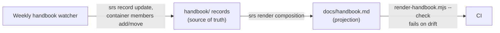

- **Edit the records, never the markdown.** Use the srs CLI: `srs record update`, `srs container members add|move|remove`, then `node scripts/render-handbook.mjs` and commit both.
- **Check:** `node scripts/render-handbook.mjs --check` exits 1 if `docs/handbook.md` differs from the records.
- **Why it is built this way:** it answers SP-67 (the handbook says things that are no longer true) and SP-68 (no one place tells how work is driven), both suggested in the Programme coordination domain, and SP-65 (the same rule restated in many places drifts apart).
- **Keep it current:** the weekly handbook watcher (`routines/handbook-watcher.md`) does this as a routine. Anyone may do it in a session.
