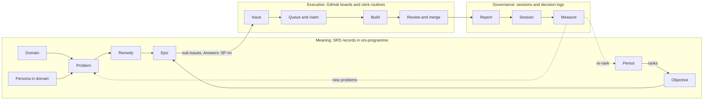
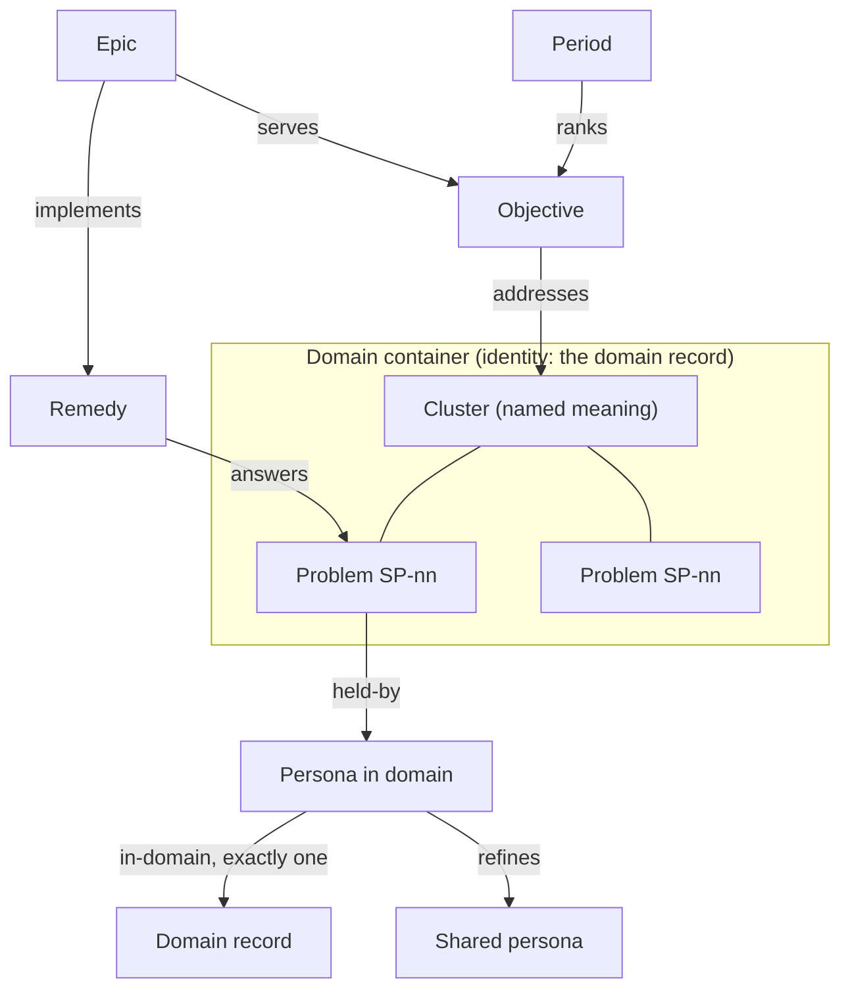
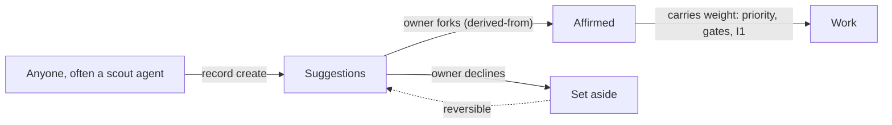
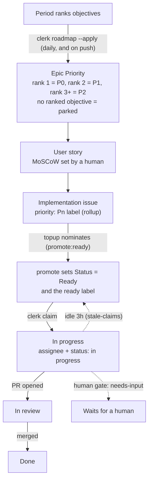
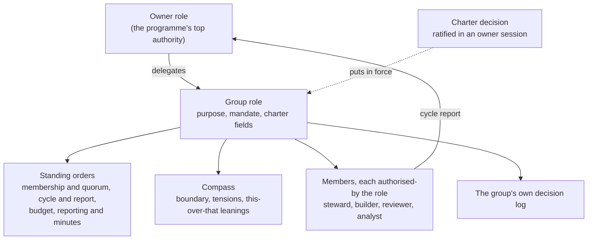
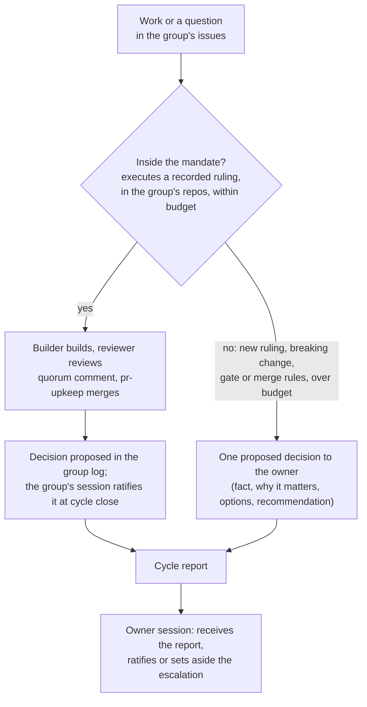
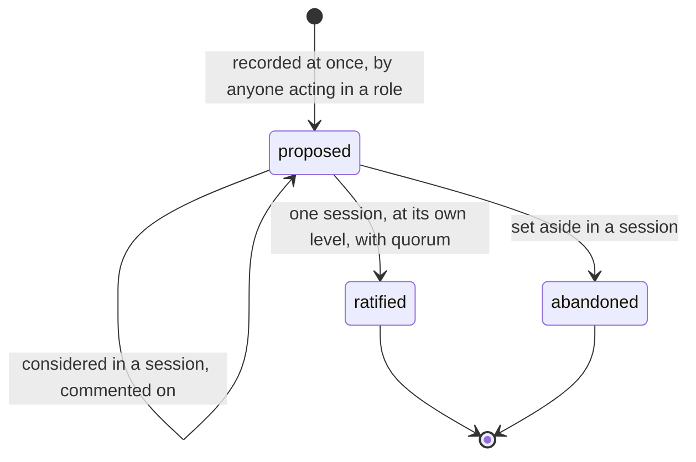
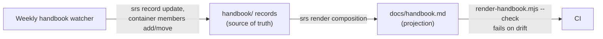

<!-- Rendered from handbook/ (an SRS repository) by scripts/render-handbook.mjs. Do not edit: change the records. -->

# Clerk handbook

### How work is driven

This part tells the whole story in order. "Stage by stage" then takes each stage of the chain in turn, with what works today and what does not. "Reference" holds the principles, the SRS elements the process depends on, and where everything is written down.

This handbook is itself an SRS repository (`handbook/` in the clerk). `docs/handbook.md` is rendered from it and is never edited by hand. See "How this handbook is made" at the end.

#### The whole picture

The programme answers one question again and again: **what should we work on next, and why?**

The answer is never "because someone said so". Work is justified by a **problem**, a problem only counts when we know **who** has it (a persona) and **where** it happens (a domain), and the order of work comes from a **ranking** the owner has made. Everything else in this handbook is the machinery that carries that reasoning from a statement of need to a merged pull request, and back again as a report.

There are three surfaces, each with one job:

| Surface | Holds | Lives in |
|---|---|---|
| **Meaning** | domains, personas, problems, remedies, objectives, periods, epics, decisions, roles | SRS records in `the-greenman/srs-programme` |
| **Execution** | issues, stories, epics as issues, board fields, labels, PRs | GitHub Project #6 "SemanticOps" and the governed repos |
| **Practice** | the code that reads the meaning and drives the execution, and the briefs agents follow | this repository, `the-greenman/clerk` |

The two halves meet in two places only: the epic (a record with an `issue_ref`) and the `Answers: SP-nn` line at the top of every issue. Closing that seam is most of the open work in "Stage by stage".

Three rules shape everything that follows:

- **Agents suggest; the human layer wins.** Agents write to Suggestions. The owner forks a record into Affirmed. Only affirmed records carry weight.
- **Authority comes from the role, not the kind of mind.** Humans and agents claim, review, decide and report through the same commands.
- **Theory and practice together.** There is always a working system, and the theory stays beside it. We build when a trigger fires, not ahead of need.

#### Domains, personas and problems define the work

A **domain** says *where* and *when* a problem occurs: an area of work with a purpose, and what is in and out of scope. A **persona** says *who* has it: their jobs and needs. A **problem** is a claim that something is wrong for that persona in that domain.

> A problem lives in a domain and for a persona. Without knowing who it is for and when it occurs, it cannot be prioritised and no remedy can be found. (Owner, 2026-10-11.)

**How the pieces fit.**

1. **Domain container.** A domain is a container whose identity is the domain record. Its outline holds clusters at depth 0 and their problems at depth 1. Membership is arrangement, not meaning.
2. **Cluster.** A cluster is named meaning: problems are raw ideas, and a synthesiser job groups and names them. The owner affirms the cluster's name and description; which problems sit under it stays fluid.
3. **Persona in domain.** The same person needs different things in different domains, so each domain gets a persona-in-domain that `refines` the shared persona and points to exactly one domain with `in-domain`.
4. **Problem.** A problem is `held-by` a persona-in-domain. Its domain is derived through that link and never stored twice.
5. **Remedy.** A remedy `answers` one or more problems. It carries a **falsifier** (what would show it failed) and a **return_when** (when to look again).
6. **Objective and period.** An objective `addresses` clusters. A period ranks objectives, and that ranking alone gives priority.
7. **Epic.** An epic `implements` remedies and `serves` an objective. It is also a GitHub issue, where the execution half begins.

**Suggested, affirmed, set aside.** Every record sits in one of three layer containers.

A scout or any participant writes a suggestion under its own actor (`createdBy`). The owner affirms by forking it into Affirmed, which keeps a `derived-from` link back to the suggestion. Set aside is a reversible no. Readers resolve every link to its affirmed end through `canon()` (follow `derived-from`).

**Where it stands** changes week by week. The stages Domain, Persona, Problem and Remedy, in "Stage by stage", hold the current state.

#### How work moves across the boards

The boards are GitHub Project #6 "SemanticOps" and a set of plain labels that mirror it. Priority is **derived, never hand-set**: it flows down from the period ranking.

**The levels.** An epic lives in the story repo (`the-greenman/semanticops.com`) with the label `epic` and a title `Epic NN: Name`. Stories hang under it as sub-issues, with the label `user-story` and a MoSCoW. Implementation issues hang under stories, across any governed repo. An epic is a release: whatever it reaches through sub-issues.

**Derived priority.** `clerk board rollup` walks each issue up to the stories it serves. Must gives P0, Should P1, Could or blank P2, and Won't excludes. With no story, the issue inherits its epic's Priority one tier down. A bug is never weaker than P1. `critical-path`, `blocks-gate` and `regression` bump one tier.

**The ready queue.** `topup` keeps about six issues Ready. It nominates the top Backlog candidates in implementation order (epic Priority, started epics first, the `NN` in the title, issue priority, sub-issue position) by writing `promote:ready`. `promote` turns that intent into Status Ready. Blocked issues (an open blocked-by edge, or the `blocked` label), `needs-input` issues and bugs are never nominated. Bugs have their own track: `label:bug`, oldest first.

**One hourly pass.** The srs-programme workflow `board-sync.yml` runs `clerk board sync` every hour: stories sync, rollup, topup, promote, stale claims, reconcile. Only this tool writes Projects v2 fields. Cloud routines cannot reach Projects v2, so they read and write the label mirror (`ready`, `priority: Pn`, `status: in progress`, `promote:ready`, `blocked`, `needs-input`).

**Claiming.** Before anyone starts, `clerk claim <repo#n> --as <seat>` checks that the issue is open, has no branch, PR or assignee, answers an affirmed problem, falls under a group, and that the actor holds the seat. It then assigns, labels and comments. The same command serves humans, local sessions and routines.

**Grounding.** `clerk ground` walks a merged PR back up the chain (issue, `Answers:` problem, affirmed persona and domain, epic, group) and reports how far it got. The daily share of grounded PRs is indicator I1.

Full detail, every command and the API budget: [board.md](board.md).

#### Working groups and delegation

The owner cannot judge every merge. So the owner **delegates**: a working group gets a mandate, decides and merges inside it, and reports back. Anything outside the mandate comes back to the owner as one proposed decision. This is how a co-op runs a subcommittee.

**What a group has.** A purpose; standing orders; a delegation order (what it decides, what it escalates); a compass; membership and quorum; a rhythm with a cycle and a budget; its own decision log; and a duty to report. All of it is records in srs-programme. The numbers that code needs (label, quorum seats, budget per cycle, cycle close, pause limit, governed repos) are fields on the group role, read by `clerk groups`. Nothing is hard-coded.

**Inside or outside the mandate.**

**Quorum and merge.** A group PR merges only when a builder and a *different* reviewer agree after the last commit, the gates are green, the cycle's budget is not spent and the group is not paused. The reviewer posts a `<!-- wg-quorum -->` comment; `pr-upkeep` checks it every 15 minutes and merges. A new commit voids the quorum.

**Pause.** If the owner leaves two cycle reports unacknowledged, the group pauses: no new builds and no group merges, though reviews and escalations continue. Silence slows the group down rather than letting it run unwatched.

**The central group.** Work with no `wg:` label belongs to the central group, SemanticOps, held by the Owner role. Its seats are the owner's builder and reviewer, plus agents `authorised-by` the Owner role, such as the nightly `agent:unattended-worker`. The central group never claims a delegated group's work.

**Proposed rulings, not yet ratified** (srs-programme#113): SemanticOps is the root decision-making authority for its domain, and other bodies such as muDemocracy are separate (31e40305); the central group undertakes all work no group holds by delegation (4fca091f); anyone working on a group's work joins that group and works within its practices (ccd593c3); a group is chartered only with a known domain, a problem set and standing orders (9a45c0a1).

**Groups today.** WG Third-party ready (semanticops.com#31, `wg:third-party-ready`) is in force. WG Agent-supported editor (semanticops.com#29, `wg:agent-editor`) has been chartered as records. A new group is chartered only on a trigger: a steady ready queue that needs delegated merges.

**Chartering.** `clerk charter` writes the whole charter as drafts and a proposed decision; an owner session ratifies it and asserts `delegates`. The steps are in stage 10. The briefs the members follow: [routines/working-groups.md](../routines/working-groups.md).

#### Decisions

A decision is **one standing choice that governs later choices**. It is not a task, not a plan and not a diary entry.

**The four tests.** A candidate goes in the decision log only if it passes all four:

1. **Reuse.** Would a later choice be settled by pointing at it?
2. **One thing.** Can it be said in one sentence without "and"?
3. **Timeless.** Does it read true with every date, issue number and id removed?
4. **Testable.** Can someone apply it to a new case and say whether the case conforms? Does it say when to review it?

Anything that fails the first test is still recorded, but as an issue (a task), an application or a plan, linked to the decision it serves.

**Seven kinds**, adopted to test (`decision_kind` on the decision record):

| Kind | Frame | Example |
|---|---|---|
| Purpose | We exist to X, for Y. | Deep context for action (f5b4656a) |
| Boundary | X covers A, not B. | Programme coordination domain (da7877f3) |
| Premise | We work as if X. | Stance agents are universal (7841bb87) |
| Preference | X over Y, unless Z. | Convention before enforcement (e337703b) |
| Policy | Every X must Y; measured by I. | A group's session ratifies (70a05a5c) |
| Design | We model X as Y, because principle P. | Domain container (a6280447) |
| Mandate | Group G may X within M. | Charter for WG Third-party ready (00567bf1) |

**How a decision is made.**

- **Recorded at once.** A choice made between sessions is written straight away as `proposed` and may be acted on if it falls inside the group's remit.
- **Ratified once.** A decision is ratified in exactly one session, at the level that owns it (a group's log, or the SemanticOps log for the owner) and with that level's quorum. Before that it may pass through many sessions as a proposal, each recording `considers`.
- **Sessions.** A session has attendees, a time and an agenda in this order: decisions since the last session, reports, exercises, decisions for this session, merges. `clerk` (a terminal UI) and `clerk session` write one `programme/session` record with `attended-by`, `ratifies`, `sets-aside`, `considers` and `receives` relations, and open a signed PR that merges itself.
- **Three kinds of minute.** A *report* is received, not decided. An *exercise* is an open discussion that feeds proposals and is never ratified. A *decision* is ratified or set aside.
- **Discussion.** Humans and agents comment the same way: a comment record `comments-on` the decision (`clerk comment`). A comment between sessions is discussion, not a session.

**Escalating to the owner.** Information must fit the reader. An escalation is one decision with its stakes, options, consequences and a recommendation, never a flood of technical questions.

Full rules, kinds and the worked re-read of the log: [decision-log.md](decision-log.md).

#### Routines review, report and allocate

A **routine** is a cloud agent that runs a brief on a trigger. A **workflow** is a GitHub Action that runs clerk code with no AI. Together they keep the programme moving between sessions.

Exact schedules and triggers live in [tools.md](tools.md); this table says what each one is for.

| Job | Runs | Kind | What it does |
|---|---|---|---|
| Allocate | `board-sync` hourly | workflow | rollup, topup, promote, stale claims, reconcile |
| Allocate | `roadmap --apply` daily and on push | workflow | epic Priority from the period ranking, `parked` label |
| Allocate | analyst, daily 12:00 | routine | only when the last report says "Queue running dry": files ruling-backed issues as ready |
| Build | wg-builder, on events | routine | one group issue per run, claimed with `clerk claim` |
| Build | unattended worker, nightly | routine | up to 3 `lane:unattended` issues, as the central group's builder |
| Review | wg-reviewer, on PR events | routine | gates, mandate check, quorum comment; never reviews its own work |
| Review | pr-upkeep, every 15 min | workflow | merges PRs whose gate label and quorum allow it; daily digest |
| Review | steward check, daily | workflow | reopens false closes; comments on issues with no `Answers:` line |
| Review | ground, daily | workflow | I1: share of merged PRs grounded to an affirmed problem |
| Report | wg-steward, daily 11:30 | routine | closes the cycle: run report record, ratifies the group's decisions in one group session, report on #31 |
| Report | handbook watcher, weekly | routine | re-reads code, data and boards; updates the handbook records; renders; opens a PR |

**Rules for every routine.**

- **Thin prompt.** The trigger only points at its brief in `routines/`. Rules live in the brief, so a change is a pull request.
- **Record first.** Each routine has a standing-job record in srs-programme (`routine_id`, `brief_path`) and an agent record with its `SRS_ACTOR`. `clerk routines --check` reports drift between records, triggers and briefs.
- **Never run a brief that is not on the clerk default branch.**
- **Stop honestly.** A run that hits a human gate comments the exact question, adds `needs-input`, and stops.
- **Report what you learned.** Every report ends with a short "What we learned": which part of the theory held, which did not.

Lifecycle and drift check: [routines.md](routines.md). Every routine and workflow: [tools.md](tools.md).

### Stage by stage

Each stage has the same parts:

- **Theory**: where we are trying to get to. It is kept even when practice falls short.
- **Status**: *working*, *partial* or *theory only*.
- **Practice**: what works today, naming the record type, the tool and the doc.
- **Gap**: where practice differs from theory, or from itself.
- **Open questions**: what we do not know yet. Each one is answered by a decision in the decision log, never by editing this text alone.
- **Test**: where `test/process.test.mjs` proves it.

Facts here were checked against clerk and srs-programme on 2026-10-11. The weekly handbook watcher re-checks them.

#### Roles and layers

**Theory**: Every act is done by someone holding a role. The **owner** is the programme's top authority and delegates to working groups. **Members** of a group hold seats: steward, builder, reviewer, analyst. **Scouts** suggest problems. Records carry who made them (`createdBy`) and sit in one of three layers: Affirmed, Suggestions, Set aside.

**Status**: partial

**Practice**:
- **Layers:** the Affirmed, Suggestions and Set aside containers in srs-programme, checked by `scripts/check-method.mjs` (`checkGates`): an AI actor cannot author a record in a human layer.
- **Roles:** only the owner is built into `lib/practice/roles.mjs`. Every group role is read from records: a `governance/role` with charter fields, the Owner role `delegates` to it, and agents `authorised-by` it carry `actor_id` and `seat` (`clerk groups`).
- **Agents:** a `method/agent` is a universal stance agent that `instantiates` one of the eight archetypes. A `stewardship/agent` is a seat-holder in a group and is `derived-from` a method agent. The unattended worker (`agent:unattended-worker`) is `authorised-by` the Owner role as the central group's builder.

**Gap**:
- Set aside has never been used: its only member is its own identity record.
- The difference between `method/agent` and `stewardship/agent` is practice, not a ruling.

**Open questions**:
- Should the stance-agent and seat-holder split be ruled, or one type retired?

**Test**: Stage 1: 3 passing. Two todos (roles read from records; the analyst as a member role) describe work already done and should become passing tests.

#### Domain

**Theory**: A domain is an area of work with a purpose and what is in and out of scope. It tells us *when* a problem occurs. A domain is a container whose identity is the domain record; its outline holds clusters at depth 0 and their problems at depth 1. A problem with no cluster sits at depth 0: early in a domain we do not yet know all its parts, so an unclustered problem is valid, never a gap. Where a cluster is required (an objective `addresses` clusters), a cluster holding one problem is valid. Clusters evolve, and problems move between them as understanding changes (owner, 2026-10-11). A problem's domain is derived (problem `held-by` persona-in-domain `in-domain` domain), never stored. Domains nest by perspective. The owner affirms a domain in the srs-web Method editor.

**Status**: partial

**Practice**:
- Type `com.semanticops.method/domain` (title, purpose, in_scope, out_of_scope).
- 7 domain records, all in Suggestions: Deep context, Programme coordination, Semantic records, Agent memory, Group meaning ownership, Evidence-backed writing, Stance.
- 6 domain containers exist. Evidence-backed writing's outline holds its clusters and their problems (srs-programme#112).
- Deep context nests Semantic records, Group meaning ownership and Agent memory (decision dbaa4716).
- `clerk ground` reads domains through `contains` (domain to cluster to problem) to compute I1. Nothing else reads them.
- Plan: [plans/two-domains-end-to-end.md](../plans/two-domains-end-to-end.md), walking Evidence-backed writing and Agent memory first.

**Gap**:
- No domain is affirmed.
- Clusters still hang off domains by `contains` edges as well as by container outline: two groupings for one goal, until readers switch to the outline (decision a6280447).
- Nothing checks that a problem has a domain.
- An affirmed domain is a fork, so its container identity still names the suggestion; readers resolve it with `canon()`.
- Decision a8aabd01 (unclustered problems and one-problem clusters are valid) is proposed, not yet ratified.

**Open questions**:
- How is a domain retired?
- How does a domain relate to a working group's boundary or compass?

**Test**: Stage 2: pending (every problem has a domain; the domain says when).

#### Persona

**Theory**: A persona is someone the work is for: their jobs and needs. It tells us *who* a problem is for. The shared persona stays general. Each domain adds a **persona-in-domain** (title, goals, jobs, needs) that `refines` the shared persona and points to exactly one domain with `in-domain`. A problem is `held-by` the persona-in-domain.

**Status**: partial

**Practice**:
- Type `com.semanticops.method/persona` (title, summary, jobs, needs): 5 records, all in Suggestions.
- Type `com.semanticops.method/persona-in-domain`, field `goals` and relation `in-domain`: method package v1 (clerk#34), installed in srs-programme (srs-programme#105).
- 3 persona-in-domain records, all suggestions, all in Evidence-backed writing: Writer, AI agent, and A person working with AI.
- 15 `held-by` edges point to a persona-in-domain; the rest still point to shared personas, as domains not yet walked are allowed to (decision e4a9b0ac).
- `clerk roadmap --explain` shows personas as labels, marked "suggested".

**Gap**:
- Personas never reach issues, priority or assignment.
- The exactly-one `in-domain` rule will be checked in clerk `check-method`, not in core, until the process settles (decision 071eadb2).
- No persona or persona-in-domain is affirmed, and only Evidence-backed writing has persona-in-domain records.

**Open questions**:
- Do personas weight priority, or only qualify it?
- How do we hear from a real persona, as opposed to a modelled one?

**Test**: Stage 3: 1 passing; pending: personas reach issues and priority.

#### Problem

**Theory**: A problem is a claim, held by a person or agent, about something wrong for a persona in a domain. Anyone may suggest one; a human affirms it. Work is judged by the problem it answers. Gate (decision e3ed9e54): an affirmed problem must be `held-by` an affirmed persona-in-domain whose `in-domain` reaches an affirmed domain. It warns until both pilot domains are walked, then errors.

**Status**: partial

**Practice**:
- Type `com.semanticops.method/problem` (problem_id `SP-nn`, statement, kind, source_ref).
- SP-01 to SP-66 exist; 47 are affirmed as forks of their suggestions.
- Problems group into clusters. Parked issues are sources for problems, never bulk imports.
- **Duplicate guard:** search the trackers and comment rather than file a near-duplicate.
- The gate is ruled and not built (clerk#35, in the unattended lane).

**Gap**:
- A problem can be affirmed with no persona and no domain, which breaks the rule above.
- Problems link to issues only backwards, as text (`source_ref`, `Answers:`).
- The 27 affirmed problems outside the two pilot domains must be grounded or set aside before the gate errors.
- Programme coordination's problems (SP-49 to SP-66) have no cluster and none is affirmed.
- Decision ee59155b (proposed) duplicates the ratified gate e3ed9e54.

**Open questions**:
- What closes a problem: solved, set aside or superseded? Who says so?
- How often are suggestions reviewed, and by whom?

**Test**: Stage 4: 2 passing; pending: the persona and domain gate; problem closure.

#### Remedy

**Theory**: A remedy is a move that answers one or more problems. It carries a **falsifier** (what would show it failed) and a **return_when** (when to look again). Agents suggest one to three remedies per domain; the owner affirms them; an existing epic implements each one.

**Status**: partial

**Practice**:
- Type `com.semanticops.method/remedy`, linked to problems by `answers`.
- `check-method` requires an affirmed remedy to answer an affirmed problem and to carry a falsifier.
- 5 records: two affirmed remedies with their suggestions, and one suggested remedy (lenses).

**Gap**:
- Falsifiers and `return_when` are never evaluated.

**Open questions**:
- Who checks a falsifier, and when: each report, or period close?
- What happens when a falsifier fires?

**Test**: Stage 5: 2 passing; pending: falsifiers and return_when evaluated.

#### Objective and period

**Theory**: A period is a focus span. It ranks objectives, which are directions that `addresses` clusters of problems. Priority is derived from that ranking and never set by hand. A period ends with a retrospective.

**Status**: partial

**Practice**:
- Types `programme/period` (objective_rank) and `programme/objective`.
- Current period "Focus 1: writing and memory", from 2026-10-08, no end date. It ranks five objectives: 1 Keep work moving to done (P0); 2 Agent-supported writing (P1); 3 Agent memory (P2); 4 A public specification that reads as it describes; 5 A reference implementation that honours its contracts.
- `clerk roadmap --apply` sets epic Priority from the rank and labels unranked epics `parked`.

**Gap**:
- Objectives have no success criteria.
- Periods have no end condition and no retrospective.
- Only one objective `addresses` a cluster.

**Open questions**:
- What does an objective need before it can be ranked: a domain, a persona, success criteria?
- How does a period end: a date, objectives met, or the owner's call?

**Test**: Stage 6: 2 passing; pending: objective success criteria; period retrospective.

#### Epic

**Theory**: An epic is tracked work that implements remedies, answers problems and serves an objective. An epic becomes a working group only when chartered, on a trigger: a steady ready queue that needs delegated merges.

**Status**: partial

**Practice**:
- Type `programme/epic` (issue_ref), linked by `implements`, `answers` and `serves`.
- 12 epic records: 6 serve a ranked objective, 6 are parked.
- Only Third-party ready (`8cbb562f`, semanticops.com#31) carries the whole chain from persona to epic.

**Gap**:
- Most epics have no remedy or problem link.
- Epic `answers` and `implements` edges point at suggestion-layer problems, not their affirmed forks.
- `6c5cbdde` (muDemocracy.org#159) nearly duplicates `8cbb562f`.

**Open questions**:
- Must an epic implement a remedy before it can serve an objective?

**Test**: Stage 7: 2 passing; pending: epic is a working group; remedy before serving an objective.

#### Work item

**Theory**: An issue names the problem it answers (`Answers: SP-nn`, or "No affirmed problem yet: ..."), sits under a story or epic from the moment it is filed, and is small enough for one session.

**Status**: partial

**Practice**:
- GitHub issues on the governed repos; stories carry MoSCoW.
- `clerk steward` comments on an issue with no `Answers:` line, and reopens false closes.
- `clerk claim` refuses an issue whose `Answers:` is not an affirmed problem.
- `clerk ground` walks a merged PR to its issue, problem, persona and domain, epic and group, and reports the level reached.
- The analyst files issues in the group's issue shape (`routines/wg-analyst.md`). Board model: [board.md](board.md).

**Gap**:
- The link to the problem is a line of text, not a record.

**Open questions**:
- Should the problem link become a record or relation? What would it be?
- Can a work item answer a problem directly, without an epic?

**Test**: Stage 8: 1 passing; pending: problem link as a record.

#### Priority and queue

**Theory**: Priority flows down the chain: period rank, then epic, then story MoSCoW, then work item. A group may set local priorities by a ratified decision. The queue is fed before it runs dry.

**Status**: working

**Practice**:
- **Rollup:** `clerk board rollup` writes the `priority: Pn` label.
- **Promotion:** `topup` and `promote` set Status Ready and the `ready` label, run hourly by `board sync`.
- **Held work:** the queue and the builders skip issues labelled `blocked` or `needs-input`, and issues already assigned or with an open PR.
- **Local priorities:** a ratified "Local priorities: ..." decision, read by `lib/practice/agenda.mjs`.
- **Preview:** `clerk queue`. Detail: [board.md](board.md).

**Gap**:
- Personas and domains do not affect priority, although no problem may be prioritised without them.

**Open questions**:
- Does the persona and domain rule enter priority as a gate (not ready without them) or as a weight?

**Test**: Stage 9: 3 passing; pending: persona and domain in priority.

#### Working groups

**Theory**: A working group is a delegated authority with a purpose, standing orders, a delegation order, a compass (at least three tensions, this-over-that leanings, separate layers), membership and quorum, a rhythm with a cycle and a budget, its own decision log and a duty to report. Its charter is records, and its rules are read from them.

**Status**: partial

**Practice**:
- **WG Third-party ready** (semanticops.com#31, `wg:third-party-ready`): in force. Charter decision `00567bf1`, group role `834b61fd` (the Owner role `delegates` to it), decision log `88c32389`. Charter fields on the role: quorum of 2 with the reviewer required, budget 10 delegated merges per cycle, cycle close 11:30 UTC, pause after 2 unacknowledged reports.
- **WG Agent-supported editor** (semanticops.com#29, `wg:agent-editor`): chartered by `clerk charter`, charter decision `384a704a`, role `1fc9ce85`, log `e509eb61`.
- **Central group** (SemanticOps, the Owner role) holds all work with no `wg:` label.

**Chartering, step by step.**

1. An orchestrator session runs `clerk charter --repo <programme> --title "WG ..." --epic <repo#n> --label wg:... --repos a,b --budget N --cycle-close HH:MM --quorum-seats builder,reviewer --required-seat reviewer --prefix 
 --dry-run`, reads the plan, then runs it for real. Duplicates and malformed options are refused before anything is written.
2. It creates, as drafts and proposals: the group's log and container, the group role with its charter fields, four standing-order articles, one member agent per seat, a boundary with a compass copied from the first group, and the charter decision, listed in both the group log and the SemanticOps log.
3. The orchestrator validates, commits on a branch and opens a PR.
4. An owner session ratifies the charter decision and asserts `delegates` from the Owner role to the group role.
5. Then, by hand: the `wg:` label in each governed repo, the cloud routines and their standing-job records.

**Gap**:
- WG Agent-supported editor has no `delegates` edge yet, so it is not in force.
- The articles' prose and the role's fields state the same numbers twice; nothing checks they agree.
- Every group reports to the same issue (#31), a programme setting.
- The analyst was added before its decision `b447e8ea` was ratified.
- The compass is all Suggestions.

**Open questions**:
- How is a group dissolved? There is no command or rule yet.
- Which relation links an epic to its group? None fits; `clerk charter` names the epic in the role text.
- Does a group's boundary map to a domain?

**Test**: Stage 10: 3 passing; pending: epic-group relation. Also test/charter.test.mjs.

#### Assignment and claim

**Theory**: Before work starts, check that no branch or PR exists, then claim the issue (assignee, In progress, and a comment naming the branch). A dead claim is recovered.

**Status**: working

**Practice**:
- `clerk claim <repo#n> --as <seat> [--branch <name>]` is the one claim path. It refuses unless the issue is open and free, answers an affirmed problem and falls under a group, and the actor holds the seat. Exit 2 with the reasons if refused.
- **Jurisdiction:** an issue with a chartered group's label stays with that group. An issue with no `wg:` label falls to the central group, whose seats are the owner's builder and reviewer and the agents `authorised-by` the Owner role. The central group never claims a delegated group's work.
- **Local sessions** act as members under the same rules (decision f799b6bc): `SRS_ACTOR='{"kind":"human","id":"human:the-greenman"}' clerk claim <repo#n> --as builder --branch <n-slug> --repo <programme>`. Start only if it exits 0.
- `clerk board stale-claims` returns claims idle for 3 hours to Ready. `clerk queue` is read-only.

**Gap**:
- The epic-owned-by-the-group check waits for an epic-group relation; the label is the binding.
- The owner holds builder and reviewer seats by convention until humans have seat records.

**Test**: Stage 11: 5 passing, including the central group.

#### Execution

**Theory**: One issue per session, in a fresh worktree, with gates judged by exit code. The ship stages run: plan, design pause, review, docs, dogfood.

**Status**: working

**Practice**:
- Briefs: `routines/wg-builder.md`, `routines/unattended-worker.md`. Both call `clerk claim` first; the unattended worker acts as `agent:unattended-worker`.
- Worktrees only through `scripts/wt new <repo> <issue#-slug>`.

**Test**: Stage 12: pending (no pure function to assert; briefs and scripts/wt only).

#### Review and merge

**Theory**: A group PR merges when its quorum is met: a builder and a different reviewer agree, and the gates are green, within the cycle's budget and while the group is not paused. Anything beyond the mandate escalates.

**Status**: working

**Practice**:
- The reviewer posts the `<!-- wg-quorum -->` comment and adds `gate:auto-merge` (`routines/wg-reviewer.md`). It assents to a builder's decision and never ratifies it; the group's session at cycle close does (decision 70a05a5c).
- `pr-upkeep` checks the quorum every 15 minutes and merges.
- PRs outside any group follow their gate label: `gate:auto-merge` or `gate:owner-merge`.

**Gap**:
- Every agent posts as the owner's GitHub account, so builder and reviewer identities are stated by the routines, not proven by GitHub.

**Test**: Stage 13: 5 passing. The todo about the reviewer ratifying is out of date (decision 70a05a5c settled it) and should be replaced.

#### Report, session and ratification

**Theory**: There are three kinds of minute: a **report**, received by the parent's session; an **exercise**, an open discussion that feeds proposals and is never ratified; and a **decision**, ratified in exactly one session. A session has attendees, a time, and an agenda: decisions since the last session, reports, exercises, decisions for this session, merges.

**Status**: partial

**Practice**:
- The group steward writes a `stewardship/run-report` record and the cycle report on #31 (`routines/wg-steward.md`), and ratifies the group's proposed decisions in one group session.
- `clerk` (terminal UI) and `clerk session` write one `programme/session` record with `attended-by`, `ratifies`, `sets-aside`, `considers` and `receives`, then open a signed PR with auto-merge enabled. `clerk comment` does the same for a comment between sessions.
- The recorder warns, never blocks, when a decision fails the framing tests; the kind goes in `decision_kind`.
- Detail: README "Sessions", `.claude/commands/session.md`, [decision-log.md](decision-log.md).

**Gap**:
- `endSession` returns from the whole function when a session takes up an exercise: that exercise's `considers`, comments and proposals, every later choice, and the validate, commit and PR are all skipped. The session record is left uncommitted in its worktree.
- There are no exercise records yet.
- The owner's thumbs-up on #31 still drives the pause rule, alongside the `receives` link.
- Session acts are stamped with the end-of-session time, not when they happened (clerk#43).

**Open questions**:
- Should the pause rule read `receives` instead of the thumbs-up?
- Should a group session's quorum also be recorded on the session itself?

**Test**: Stage 14: 5 passing; pending: the endSession exercise bug; pause rule reads `receives`.

#### Measurement and retrospective

**Theory**: The process must show whether it has value. Each cycle records a few indicators; each report reads them and asks whether they still mean anything; each period closes with a retrospective that keeps, changes or drops practices. Every governing decision names an indicator (decision f6175b4a).

**Status**: partial

**Practice**:
- **I1** is computed by `clerk ground --since <date>` and the daily `programme-ground.yml` job summary: the share of merged PRs grounded to an affirmed problem, and separately with an affirmed persona and domain. No result record is written yet.
- `argument/indicator` and `argument/measurement-result` are installed but have no records.
- `revisit_when` on decisions and roles is displayed but never checked; remedy falsifiers are never tested.

| # | Question | Indicator |
|---|---|---|
| I1 | Is work grounded? | Share of merged PRs whose issue answers an affirmed problem with an affirmed persona-in-domain and domain |
| I2 | Does work flow? | Delegated merges against budget, and ready count at cycle close against target |
| I3 | Does governance keep up? | Median days from proposed to ratified; reports awaiting acknowledgement |
| I4 | Does done mean done? | Reopened issues, false closes and reverted PRs |

Each report records the indicators with one line each: useful, noisy or misleading. At period close a retrospective decision keeps, changes or drops each one.

**Gap**:
- I2 to I4 have no computation, and no indicator writes a result record (clerk#25).

**Open questions**:
- Who rules on the retrospective: the owner's session, every time?

**Test**: Stage 15: 2 passing (routine drift, I1); pending: I2 to I4, revisit_when, the retrospective loop.

### Reference

Principles, the SRS elements the process depends on, and where everything else is written down.

#### Principles

The owner's standing rulings. Every stage must respect them.

1. **Theory and practice together.** There is always a working system, and the theory is kept beside it. We build when a trigger fires, not ahead of need. Rulings grow into principles.
2. **A problem lives in a domain and for a persona.** Without knowing who it is for and when it occurs, it cannot be prioritised and no remedy can be found.
3. **Measure a little, then evaluate as we report.** Start with a few indicators. Each report says whether they still tell us anything.
4. **Authority comes from the role, not the kind of mind.** The same rules and tools apply to humans and AI agents.
5. **Agents suggest; the human layer wins.** Agents write to Suggestions. A human forks a record into Affirmed. Set aside is a reversible no.
6. **A decision is ratified in exactly one session, at its own level and with that level's quorum.** Before that it may pass through many sessions as a proposal.
7. **Rules hold at their boundary.** A rule is valid inside the boundary that made it.
8. **Outputs are projections.** Any task is understood within the whole picture. A document, a roadmap or an issue is one projection of the records, never a second source (decision f5b4656a). This handbook is one.
9. **Dogfood everything.** We run the programme on our own tools, and log every bug and missing feature we hit as an issue.

#### The SRS elements behind the process

What the clerk reads and writes in srs-programme. When a stage changes, these are the records to check. Namespaces: `method` is `com.semanticops.method` (clerk `packages/method`), `programme` is `com.semanticops.programme`, `governance` is `com.mudemocracy.governance`, `stewardship` is `com.mudemocracy.stewardship`.

#### Layer containers

**Kind**: container

**Defined in**: srs-programme

**Meaning**: Affirmed, Suggestions and Set aside. Which one a record sits in is its standing: affirmed records carry weight, suggestions do not.

**Read by**: `check-method` (`checkGates`), `roadmap`, `ground`, `claim`

#### Domain container

**Kind**: container

**Defined in**: srs-programme (containerType method/domain)

**Meaning**: One per domain; identity is the domain record; outline holds clusters at depth 0 and problems at depth 1.

**Read by**: `ground` (through `contains` today), srs-web Method editor

#### method/domain

**Kind**: type

**Defined in**: method

**Meaning**: Where and when a problem occurs: purpose, in scope, out of scope.

**Read by**: `ground`; planned: `check-method` gate (clerk#35)

#### method/persona and method/persona-in-domain

**Kind**: type

**Defined in**: method

**Meaning**: Who a problem is for. The persona-in-domain refines a shared persona for one domain.

**Read by**: `roadmap --explain`, `ground`

#### method/problem

**Kind**: type

**Defined in**: method

**Meaning**: A claim that something is wrong for a persona in a domain; carries `problem_id` SP-nn.

**Read by**: `roadmap`, `claim`, `ground`, `steward`, `check-method`

#### method/cluster

**Kind**: type

**Defined in**: method

**Meaning**: Named meaning grouping problems; objectives address clusters.

**Read by**: `roadmap`, srs-web board

#### method/remedy

**Kind**: type

**Defined in**: method

**Meaning**: A move that answers problems; carries falsifier and return_when.

**Read by**: `check-method`, `roadmap`

#### programme/period and programme/objective

**Kind**: type

**Defined in**: programme

**Meaning**: The period ranks objectives (`objective_rank`); the rank derives priority.

**Read by**: `roadmap`

#### programme/epic

**Kind**: type

**Defined in**: programme

**Meaning**: Tracked work, with `issue_ref` to its GitHub issue.

**Read by**: `roadmap --apply`, `ground`

#### programme/programme

**Kind**: type

**Defined in**: programme (clerk packages/programme)

**Meaning**: The settings record: owner, governed repos, report and digest issues, board project, story repo.

**Read by**: every clerk command (`clerk settings`)

#### governance/decision and governance/decision_log

**Kind**: type

**Defined in**: governance

**Meaning**: Decisions with lifecycle proposed, ratified or abandoned, and an optional `decision_kind`; logs are containers per level.

**Read by**: `clerk session`, the agenda, `wg-steward`

#### governance/role

**Kind**: type

**Defined in**: governance

**Meaning**: Owner and group roles; a group role carries the charter fields (`group_label`, `quorum_*`, `budget_per_cycle`, `cycle_close_utc`, `max_unacked_reports`, `governed_repos`).

**Read by**: `clerk groups`, `claim`, `queue`, `pr-upkeep`, `session`

#### programme/session

**Kind**: type

**Defined in**: programme

**Meaning**: One per session, with attendees and what it ratified, set aside, considered and received.

**Read by**: `clerk session`, the agenda

#### stewardship/agent and method/agent

**Kind**: type

**Defined in**: stewardship, method

**Meaning**: A seat-holding member (`actor_id`, `seat`) derived from a stance agent, which instantiates an archetype.

**Read by**: `clerk groups`, `claim`, `session`

#### stewardship/standing-job

**Kind**: type

**Defined in**: stewardship

**Meaning**: A routine's record: `trigger`, `routine_id`, `brief_path`, done_when.

**Read by**: `clerk routines --check`

#### stewardship/run-report

**Kind**: type

**Defined in**: stewardship

**Meaning**: One run's minute: chose, rationale, figures, landed_as.

**Read by**: the agenda (Reports), `pr-upkeep` pause rule (with the #31 thumbs-up)

#### held-by, in-domain, answers, implements, serves, addresses

**Kind**: relation

**Defined in**: method, programme

**Meaning**: The chain: problem held-by persona-in-domain, in-domain domain; remedy answers problem; epic implements remedy and serves objective; objective addresses cluster.

**Read by**: `roadmap`, `ground`, `check-method`

#### delegates, authorised-by

**Kind**: relation

**Defined in**: governance, stewardship

**Meaning**: Owner role delegates to a group role; agents and standing jobs are authorised-by a role.

**Read by**: `clerk groups`, `claim`

#### ratifies, sets-aside, considers, receives, attended-by

**Kind**: relation

**Defined in**: programme

**Meaning**: What a session did, one edge per act.

**Read by**: `clerk session`, the agenda, I3 (planned)

#### derived-from

**Kind**: relation

**Defined in**: core

**Meaning**: Affirmed fork to its suggestion; resolved by `canon()`.

**Read by**: every reader of affirmed records

#### Board labels

**Kind**: label

**Defined in**: GitHub (clerk `gh-project.mjs`)

**Meaning**: `ready`, `priority: Pn`, `status: in progress`, `promote:ready`, `blocked`, `needs-input`, `parked`, `wg:*`, `lane:unattended`, `gate:auto-merge`, `gate:owner-merge`.

**Read by**: `board sync`, `queue`, `claim`, `pr-upkeep`, every routine

#### How we know

`test/process.test.mjs` runs one full programme cycle as a fixture (domain, persona, problem, remedy, objective, epic, issue, PR, report, session), with one test group per stage. It is the progress bar: a stage moves from theory to practice when its `test.todo` becomes a passing test. A Practice claim that the test contradicts is a bug in this handbook or in the code, fixed under its own issue.

On 2026-10-11 it ran 60 tests: 36 passing, 24 todo, none failing.

#### Where things are documented

| Topic | Doc |
|---|---|
| Method chain, sessions, minutes | [README.md](../README.md) |
| Board, priority rollup, queue | [board.md](board.md) |
| Every command, script, workflow, routine and label | [tools.md](tools.md) |
| What goes in the decision log | [decision-log.md](decision-log.md) |
| Routine lifecycle | [routines.md](routines.md) |
| Working groups | [routines/working-groups.md](../routines/working-groups.md) and `routines/wg-*.md` |
| Unattended lane | [routines/unattended-worker.md](../routines/unattended-worker.md) |
| Handbook watcher | [routines/handbook-watcher.md](../routines/handbook-watcher.md) |
| Two-domain walk | [plans/two-domains-end-to-end.md](../plans/two-domains-end-to-end.md) |
| Clerked owner session | `.claude/commands/session.md` |
| Programme data rules | srs-programme `CLAUDE.md` |
| Concept and boundary mapping | srs-programme `source-documents/agent-democracy-2026-10-10/`, `boundaries-2026-10-09/` |

#### How this handbook is made

The handbook is an SRS repository in `handbook/`, with its own package `com.semanticops.handbook`: a `chapter` (title, body), a `stage` (theory, status, practice, gaps, open questions, test) and an `element` (kind, home, meaning, read by). The root container's outline is the order of the document. The composition `handbook` renders it.

- **Edit the records, never the markdown.** Use the srs CLI: `srs record update`, `srs container members add|move|remove`, then `node scripts/render-handbook.mjs` and commit both.
- **Check:** `node scripts/render-handbook.mjs --check` exits 1 if `docs/handbook.md` differs from the records.
- **Why it is built this way:** it answers SP-67 (the handbook says things that are no longer true) and SP-68 (no one place tells how work is driven), both suggested in the Programme coordination domain, and SP-65 (the same rule restated in many places drifts apart).
- **Keep it current:** the weekly handbook watcher (`routines/handbook-watcher.md`) does this as a routine. Anyone may do it in a session.
