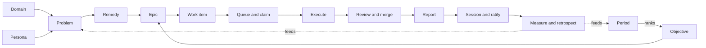

# Handbook

How a programme run by the clerk works, end to end: from the domain and persona a problem belongs to, through the work that answers it, to the committee that does that work and the measures that tell us whether any of it has value.

This is a **skeleton** (clerk#17). Each stage says what is known and lists what is still open. Fill a stage in place when one of its questions is answered; do not start a second document.

## How to read this

Every stage has the same parts:

- **Theory**: where we are trying to get to. It is kept even when practice falls short, so we don't lose sight of the aim.
- **Practice**: what works today. It names the record type, the tool and the doc. `Status` is one of *working*, *partial* or *theory only*.
- **Gap**: where practice differs from theory, or from itself.
- **Open questions**: what we don't know yet. Each one is answered by a decision in the decision log, never by editing the text alone.

Records live in srs-programme, and code and briefs live in the clerk. Where a detailed doc already exists, the stage points to it rather than repeating it.

## How we know

`test/process.test.mjs` runs one full programme cycle as a fixture (domain, persona, problem, remedy, objective, epic, issue, PR, report, session), with one test group per stage below. It is the progress bar. A stage moves from theory to practice when its `test.todo` becomes a passing test; a Practice claim that the test contradicts is a bug in this handbook or in the code, and is fixed under its own issue.

## Principles

These are the owner's standing rulings that every stage must respect.

1. **Theory and practice together.** There is always a working system, and the theory is kept beside it. We build when a trigger fires, not ahead of need. Rulings grow into principles.
2. **A problem lives in a domain and for a persona.** A problem is only relevant within a domain and to a persona. Without knowing who it is for and when it occurs, it cannot be prioritised and no remedy can be found. (Owner, 2026-10-11.)
3. **Measure a little, then evaluate as we report.** Start with a few indicators. Each report says whether they still tell us anything. (Owner, 2026-10-11.)
4. **Authority comes from the role, not the kind of mind.** The same rules and tools apply to humans and AI agents.
5. **Agents suggest; the human layer wins.** Agents write to *Suggestions*. A human forks a record into *Affirmed*. *Set aside* is a reversible no.
6. **A decision is ratified in exactly one session, at its own level and with that level's quorum.** Before that it may pass through many sessions as a proposal.
7. **Rules hold at their boundary.** A rule is valid inside the boundary that made it.

## The chain

The chain has two halves. The **meaning half**, from domain to epic, is SRS records in srs-programme. The **execution half**, from work item to merge, is GitHub plus clerk routines. Today they meet only at the epic and at the `Answers: SP-nn` line in an issue. Closing that seam is the main job of this handbook.

---

## 1. Roles and layers

**Theory.** Every act is done by someone holding a role:
- **Owner:** the programme's top authority. The owner delegates to working groups.
- **Working-group members:** the steward, builder, reviewer and analyst.
- **Scouts:** agents that suggest problems.

Records carry who made them (`createdBy`) and sit in one of three layers.

**Practice.** *Partial.*
- **Layers:** the Affirmed, Suggestions and Set aside containers in srs-programme, checked by `scripts/check-method.mjs` (`checkGates`).
- **Roles:** the owner is built into `lib/practice/roles.mjs`; every working-group member role is read from records (`governance/role` with `delegates`; agents `authorised-by` the group role carry `actor_id` and `seat`; `clerk groups`).

**Gap.**
- Set aside has never been used.
- `method/agent` and `stewardship/agent` both exist with no stated difference.

**Open questions.**
- Is a role read from records, or kept in code until a second group is chartered?
- What is the difference between `method/agent` and `stewardship/agent`? Should one go?

**Test:** test/process.test.mjs — stage 1 (passing (3), pending: roles read from records; analyst role)

## 2. Domain

**Theory.** A domain is an area of work with a purpose, and what is in and out of scope. Every problem belongs to at least one domain. The domain tells us *when* a problem occurs.

A domain is a container whose identity is the domain record (`containerType com.semanticops.method/domain`). Its outline holds clusters at depth 0 and their problems at depth 1 (ruling D2a, 2026-10-11, proposed). A problem's domain is derived, never stored: problem `held-by` persona-in-domain, which is `in-domain` of a domain record. Container membership is arrangement only. A problem can reach more than one domain through more than one persona-in-domain (rulings D4 and D5, 2026-10-11, proposed). The owner affirms a domain in the srs-web Method editor (ruling D6).

**Practice.** *Theory only.*
- Type `com.semanticops.method/domain` (title, purpose, in_scope, out_of_scope).
- 5 records, all in Suggestions: Agent memory, Stance, Semantic records, Group meaning ownership, Collaborative writing.
- A domain `contains` clusters and tensions.
- No code reads domains.
- Planned: `plans/two-domains-end-to-end.md` (Collaborative writing and Agent memory first). Nothing is built.

**Gap.**
- No domain is affirmed.
- A problem reaches its domain only indirectly, through a cluster.
- Nothing checks that a problem has a domain.
- No domain container exists yet; the old `contains` edges (domain to cluster, cluster to problem) must be deleted once readers switch to the outline (one way per goal).
- The affirmed domain is a fork, so the container identity still names the original. Readers resolve it with `canon()` (follow `derived-from`) until a non-`canon()` reader needs a core fix (ruling D2b).

**Open questions.**
- How is a domain retired?
- How does a domain relate to a working group's boundary or compass?

**Test:** test/process.test.mjs — stage 2 (pending: every problem has a domain; domain says when)

## 3. Persona

**Theory.** A persona is someone the work is for: their jobs and needs. Every problem is held by at least one persona. The persona tells us *who* the problem is for.

The shared persona stays. Each domain adds a **persona-in-domain** (title, goals, jobs, needs) that `refines` the shared persona and points to exactly one domain record with `in-domain`. A problem is `held-by` the persona-in-domain (rulings D3 and D4, 2026-10-11, proposed). The shared persona need not be affirmed (ruling D5).

**Practice.** *Partial (data only).*
- Type `com.semanticops.method/persona` (title, summary, jobs, needs).
- 5 records, all in Suggestions.
- 97 problems are linked by `held-by`.
- `clerk roadmap --explain` shows personas as labels, marked "suggested".
- Planned: `persona-in-domain` type, `goals` field and `in-domain` relation in the method package (`plans/two-domains-end-to-end.md`, step 1). Nothing is built.

**Gap.**
- No persona is affirmed.
- Personas never reach issues, priority or assignment.
- `held-by` has no type constraint in its definition (description only), so nothing stops it pointing at a shared persona.
- The `in-domain` exactly-one rule is checked in clerk `check-method`, not in core (standing rule: no core changes until the process is refined).

**Open questions.**
- Do personas weight priority, or only qualify it?
- How do we hear from a real persona, as opposed to a modelled one?

**Test:** test/process.test.mjs — stage 3 (passing (1), pending: personas reach issues and priority)

## 4. Problem

**Theory.** A problem is a claim, held by a person or agent, about something wrong for a persona in a domain. It is suggested by anyone and affirmed by a human. Work is judged by the problem it answers.

Gate (ruling D5, 2026-10-11, proposed): an affirmed problem must be `held-by` at least one affirmed persona-in-domain whose `in-domain` (exactly one) reaches an affirmed domain record. Ends resolve through `derived-from`. Severity is a warning everywhere until both pilot domains are walked, then an error everywhere.

**Practice.** *Partial.*
- Type `com.semanticops.method/problem` (problem_id `SP-nn`, statement, kind, source_ref, imbalance).
- Scouts suggest problems. The owner forks them into Affirmed: 53 distinct `SP-nn`, 47 affirmed.
- Problems group into clusters. Parked issues are sources for problems, never bulk imports.
- **Duplicate guard:** search the trackers and comment rather than file a near-duplicate.
- Planned: the gate above in `check-method` (`plans/two-domains-end-to-end.md`, step 2). Nothing is built.

**Gap.**
- How a suggestion becomes affirmed is undocumented here.
- A problem can be affirmed with no persona and no domain, which breaks principle 2.
- Problems link to issues only backwards, as evidence (`source_ref`).
- When the gate flips to error, the 27 affirmed problems in the other three domains must be grounded or set aside, or the flip must be scoped to walked domains.
- Five suggested problems have no cluster.

**Open questions.**
- What closes a problem: solved, set aside, or superseded? Who says so?
- How often are suggestions reviewed, and by whom?

**Test:** test/process.test.mjs — stage 4 (passing (2), pending: principle 2 gate (persona and domain); problem closure)

## 5. Remedy

**Theory.** A remedy is a move that answers one or more problems. It carries a **falsifier** (what would show it failed) and a **return_when** (when to look again).

Per domain, agents suggest one to three remedies that answer affirmed problems, and the owner affirms them. An existing epic implements each one (ruling D7.4, 2026-10-11, proposed): `abfa5866` (semanticops.com#29) for writing, `5746dee3` (semanticops.com#28) for memory. A new epic is made only if none fits.

**Practice.** *Partial.*
- Type `com.semanticops.method/remedy`, linked to problems by `answers`.
- `check-method` requires an affirmed remedy to answer an affirmed problem and to have a falsifier.
- 5 records, two of them duplicated as fork plus original.
- Planned: remedy suggestions in the two-domain walk (`plans/two-domains-end-to-end.md`, section 5). Nothing is built.

**Gap.** Falsifiers and `return_when` are never evaluated.

**Open questions.**
- Who checks a falsifier, and when: each report, or period close?
- What happens when a falsifier fires?

**Test:** test/process.test.mjs — stage 5 (passing (2), pending: falsifiers and return_when evaluated)

## 6. Objective and period

**Theory.** A period is a focus span. It ranks objectives, which are directions that address clusters of problems for stakeholders. `addresses` stays objective to **cluster**: a cluster is named meaning (problems are the raw ideas, a synthesiser job groups and names them), and a domain is too large to address (ruling D7.1, 2026-10-11, proposed). The cluster's name and description are affirmed; which problems sit under it is fluid arrangement, reviewed by the steward (ruling D7.2). Priority is derived from that ranking and never set by hand. A period ends with a retrospective.

**Practice.** *Partial.*
- **Types:** `programme/period` (objective_rank) and `programme/objective`.
- **Current period:** "Focus 1: writing and memory", from 2026-10-08 with no end date. It ranks 4 objectives, all still marked "Draft".
- **Priority:** `clerk roadmap --apply` sets board Priority: rank 1 is P0, rank 2 is P1, rank 3 and below is P2, and anything unranked is parked.

**Gap.**
- Objectives have no success criteria.
- Periods have no end condition and no retrospective.
- Only one objective `addresses` a cluster. Planned: `0b59ff0b` and `8e561b4c` gain `addresses` edges in the two-domain walk (`plans/two-domains-end-to-end.md`).

**Open questions.**
- What does an objective need before it can be ranked: a domain, a persona, success criteria?
- How does a period end: a date, objectives met, or the owner's call?
- What does the retrospective record (see stage 15)?

**Test:** test/process.test.mjs — stage 6 (passing (2), pending: objective success criteria; period retrospective)

## 7. Epic

**Theory.** An epic is tracked work that implements remedies, answers problems and serves an objective. An epic is also a **working group** (stage 10), but only once chartered. Epics semanticops.com#28 and #29 stay plain owner-run epics. A group is chartered on a trigger: a steady ready queue that needs delegated merges (ruling D7.3, 2026-10-11, proposed).

**Practice.** *Partial.*
- **Type:** `programme/epic` (issue_ref), linked by `implements`, `answers` and `serves`.
- **Records:** 10 epics. 4 serve an objective and 6 are parked.
- **Full chain:** only `8cbb562f` (semanticops.com#31) has the whole chain from persona to epic.

**Gap.**
- Most epics have no remedy or problem link.
- `6c5cbdde` (muDemocracy.org#159) nearly duplicates `8cbb562f`.
- Epics `abfa5866` and `5746dee3` have no remedy or problem link yet. Planned: `plans/two-domains-end-to-end.md`.

**Open questions.**
- Must an epic implement a remedy before it can serve an objective?

**Test:** test/process.test.mjs — stage 7 (passing (2), pending: epic is a working group; remedy before serving an objective)

## 8. Work item

**Theory.** An issue names the problem it answers (`Answers: SP-nn`, or "No affirmed problem yet: …"), sits under a story or epic from the moment it is filed, and is small enough for one session.

**Practice.** *Partial.*
- GitHub issues on the governed repos. Stories carry MoSCoW.
- `steward-check` comments on an issue with no `Answers:` line.
- The analyst files issues in the group's issue shape (`routines/wg-analyst.md`).
- Board model: `docs/board.md`.

**Gap.**
- The link to the problem is a line of text, not a record.
- The `steward-check` answers rule is undocumented in `docs/tools.md`.

**Open questions.**
- Should the problem link become a record or relation? What would it be?
- Can a work item answer a problem directly, without an epic?

**Test:** test/process.test.mjs — stage 8 (passing (1), pending: problem link as a record)

## 9. Priority and queue

**Theory.** Priority flows down the chain: period rank, then epic, then story MoSCoW, then work item. A group may set local priorities by a ratified decision. The queue is fed before it runs dry.

**Practice.** *Working.*
- **Rollup:** `gh-project rollup` writes the `priority: Pn` label.
- **Promotion:** `topup` and `promote` set Status=Ready and the `ready` label, run hourly by `sync`.
- **Local priorities:** a ratified "Local priorities: …" decision, read by `lib/practice/agenda.mjs`.
- **Queue preview:** `clerk queue`.
- Details: `docs/board.md`.

**Gap.** Personas and domains do not affect priority, although principle 2 says no problem is prioritised without them.

**Open questions.**
- How does principle 2 enter priority: as a gate (no persona and domain means not ready), or as a weight?

**Test:** test/process.test.mjs — stage 9 (passing (3), pending: principle 2 in priority)

## 10. Working groups (committees)

**Theory.** A working group is a delegated authority. It has:
- a purpose;
- standing orders;
- a delegation order: what it decides and what it escalates;
- a compass: at least 3 tensions, "this over that" leanings, and separate layers;
- membership and quorum;
- a rhythm, with a cycle and a budget;
- its own decision log;
- a duty to report back.

Its charter is records, and its rules are read from them.

**Practice.** *Partial.* One group, **WG Third-party ready** (semanticops.com#31):
- **Charter decision:** `00567bf1`.
- **Group role:** `834b61fd`.
- **Standing orders:** quorum, cycle (daily, closing 11:30 UTC), budget (10 delegated merges per cycle), reporting, in prose as articles and as data on the group role: `group_label`, `quorum_min_members`, `quorum_seats`, `quorum_required_seat`, `budget_per_cycle`, `cycle_close_utc`, `max_unacked_reports`, `governed_repos`. `clerk groups` reads them; `quorum()`, `pr-upkeep.sh`, the queue and the Next forecast use them.
- **Decision log:** `88c32389`.
- **Members:** steward, builder, reviewer and analyst.
- **Second group:** **WG Agent-supported editor** (semanticops.com#29, `wg:agent-editor`), chartered by `clerk charter` as drafts and proposals; in force only when the owner ratifies its charter decision (`384a704a`).

**How a group is chartered, step by step.**
1. An orchestrator session (any member or agent, under its own `SRS_ACTOR`) runs `clerk charter --repo <programme> --title "WG ..." --epic <repo#n> --label wg:... --repos a,b --budget N --cycle-close HH:MM --quorum-seats builder,reviewer --required-seat reviewer --prefix 
 --dry-run`, reads the plan, then runs it without `--dry-run`. A duplicate label or title, an unknown required seat or a malformed option is refused before anything is written.
2. It creates, as drafts and proposals: the group's decision log and container, the group role with its charter fields, four standing-order articles (membership and quorum, cycle and report, budget, reporting and minutes), a member agent per seat (`agent:<prefix>-<seat>`, `authorised-by` the role), a boundary with the compass copied from the first existing group (`narrows` and `holds-tension`; the articles are `within-boundary`), and the charter decision, proposed, listed in the group log and in the SemanticOps decision log (one record, two logs).
3. The orchestrator validates, commits on a branch and opens a PR for the owner. Nothing is in force: the role and articles stay draft, the charter decision is proposed.
4. An owner session ratifies the charter decision, then asserts `delegates` from the Owner role to the group role (as the Third-party ready precedent did, in its ratification commit; the command never asserts it), and may move the role and articles out of draft.
5. Owner steps after that, not done by the command: create the `wg:...` label in each governed repo, create the cloud routines and standing-job records.
Local Claude Code sessions act as members under the same rules as routines (owner decision `f799b6bc`, proposed), and a group's session ratifies its builders' decisions (`70a05a5c`, proposed).
- Docs: `routines/working-groups.md`. Concept: srs-programme `source-documents/agent-democracy-2026-10-10/concept.md`. Mapping: `source-documents/boundaries-2026-10-09/proposal.md`.

**Gap.**
- The role and its standing orders are still draft ("agent testimony until ratified"), although the charter was ratified.
- The charter decision is in neither decision log.
- The articles' prose and the role's data fields state the same numbers twice; nothing checks they agree.
- The report issue (#31) is a programme setting, so every group reports to the same issue.
- The analyst was added before its decision `b447e8ea` was ratified.
- The compass is all Suggestions.
- #33 (the unattended lane) is not chartered.

**Open questions.**
- How is a group dissolved? (Chartering is `clerk charter`; dissolving has no command or rule yet.)
- Which relation links an epic to its group? None fits (`delegates` is owner to group, `serves` is epic to objective); `clerk charter` names the epic in the role text. A relation type is a spec question, not invented here.
- Does a group's boundary map to a domain?

**Test:** test/process.test.mjs — stage 10 (passing (3), charter read from records; pending: epic-group relation) and test/charter.test.mjs (the planner)

## 11. Assignment and claim

**Theory.** Before work starts, check that no branch or PR exists, then claim the issue (assignee, In progress, and a comment naming the branch). A dead claim is recovered.

**Practice.** *Partial (briefs only).*
- Claiming is done by routine briefs (`routines/wg-builder.md`, `routines/unattended-worker.md`).
- `stale-claims` recovers dead claims.
- `clerk queue` is read-only.

**Gap.** No code performs a claim.

**Open questions.** Should claiming be a clerk command, so humans and agents claim the same way?

**Test:** test/process.test.mjs — stage 11 (passing (1), pending: a clerk command that claims)

## 12. Execution

**Theory.** One issue per session, in a fresh worktree, with gates judged by exit code. The ship stages run: plan, design pause, review, docs, dogfood.

**Practice.** *Working.* `routines/wg-builder.md`, `routines/unattended-worker.md`, worktrees via `scripts/wt`.

**Gap.** none recorded

**Open questions.** none recorded

**Test:** test/process.test.mjs — stage 12 (pending: no pure function to assert (briefs and scripts/wt only))

## 13. Review and merge

**Theory.** A group PR merges when its quorum is met: a builder and a different reviewer agree, and the gates are green, within the cycle's budget and while the group is not paused. Anything beyond the mandate escalates.

**Practice.** *Working.*
- The reviewer posts the `<!-- wg-quorum -->` comment (`routines/wg-reviewer.md`).
- `pr-upkeep.sh` `wg_verdict` checks the quorum and merges `gate:auto-merge` PRs.

**Gap.** `wg-reviewer.md` moves a decision to `ratified` directly, which breaks principle 6.

**Open questions.** Does the reviewer's quorum make a *group session*, so that ratification happens there?

**Test:** test/process.test.mjs — stage 13 (passing (5), pr-upkeep and the queue read the group's charter; pending: reviewer quorum as a group session)

## 14. Report, session and ratification

**Theory.** There are three kinds of minute:
- **Report:** received by the parent's session. It forecasts the next work and whether the queue is fed.
- **Exercise:** an open discussion with no decision. It is never ratified and feeds proposals.
- **Decision:** ratified in exactly one session.

A session has attendees, a time, and an agenda in this order: decisions since the last session, reports, exercises, decisions for this session, merges. A comment between sessions is discussion, not a session.

**Practice.** *Working, with a bug.*
- The steward writes a `stewardship/run-report` record and the #31 comment (`routines/wg-steward.md`).
- `clerk` (TUI) and `clerk session` write a `programme/session` record with `attended-by`, `ratifies`, `sets-aside`, `considers` and `receives` relations.
- Details: README "Sessions", `.claude/commands/session.md`.

**Gap.**
- `lib/adapters/session.mjs` `endSession` returns early when a session takes up an exercise. The session record is written, but `considers`, comments and proposals are not, and there is no validate or PR.
- There are 0 exercise records so far.
- The owner's thumbs-up on #31 still drives the pause rule, alongside the `receives` link.

**Open questions.**
- Should the pause rule read `receives` instead of the thumbs-up?
- Should a group-level session's quorum also be recorded on the session itself?

**Test:** test/process.test.mjs — stage 14 (passing (5), quorum from the group's charter; pending: endSession exercise bug; pause rule reads receives)

## 15. Measurement and retrospective

**Theory.** The process must show whether it has value. Each cycle records a few indicators. Each report reads them and asks whether they still mean anything. Each period closes with a retrospective that keeps, changes or drops practices, and that decision goes in the log.

Home (ruling D8, 2026-10-11, proposed): I1-I4 are `argument/indicator` records, and each cycle writes an `argument/measurement-result` per indicator that the report links. A clerk script computes I1 and shares `canon()` with the principle 2 gate. The baseline is I1 computed retroactively for the cycle before the walk (about 0%), compared with the next two cycles. I2-I4 get results once their computations exist.

**Practice.** *Theory only.*
- What exists:
  - `run-report.figures`, one line of free text.
  - The steward report's "What we learned" section.
  - `revisit_when` on decisions, roles and articles. It is displayed but never checked.
  - Remedy falsifiers, never tested.
- Planned: the I1 script and records (`plans/two-domains-end-to-end.md`, section 6; clerk#22, clerk#25). Nothing is built.
- `argument/indicator` and `argument/measurement-result` are installed but have no records.

**Initial indicators (proposed, not yet ratified).** These are deliberately few, one per question we want answered.

| # | Question | Indicator | Source |
|---|---|---|---|
| I1 | Is work grounded? | Share of PRs merged this cycle whose issue answers an affirmed problem that has an affirmed persona-in-domain and domain | merged PRs → `Answers:` → problem → `held-by` persona-in-domain → `in-domain` → domain (via `canon()`) |
| I2 | Does work flow? | Delegated merges against budget, plus ready count at cycle close against budget (queue fed) | `pr-upkeep`, `clerk queue` |
| I3 | Does governance keep up? | Days from `proposed` to `ratified`, median across the cycle; reports awaiting acknowledgement | decision lifecycle, sessions `receives` |
| I4 | Does done mean done? | Reopened issues, false closes and reverted PRs this cycle | `steward-check` |

**Evaluation loop.**
- **Each report:** the steward records the indicators and adds one line on each: "useful / noisy / misleading".
- **When `revisit_when` falls due:** the steward lists the due review clauses and remedy falsifiers on the agenda.
- **At period close:** a retrospective decision records, for each indicator and practice, whether to keep, change or drop it.

**Open questions.**
- Who rules on the retrospective: the owner's session, every time?

**Test:** test/process.test.mjs — stage 15 (pending: indicators I1-I4, revisit_when, falsifier and retrospective loop (only routine drift is checked))

---

## Known contradictions to fix

Each will be fixed under its own issue. The list is from the 2026-10-11 survey.

1. NEEDS A DECISION. `wg-reviewer.md:22` ratifies outside a session (stage 13); left as is, the choice is the owner's (options in clerk#26).
2. FIXED. `roles.mjs` has a `tpr-analyst` role, the README role list names it, and the `working-groups.md` diagram and text show four members. The adding decision `b447e8ea` is still `proposed`; the analyst is not in `GROUP_MEMBERS`, so it does not count toward quorum.
3. FIXED. `wg-analyst.md` runs the srs-programme `board-sync.yml`.
4. FIXED. `docs/tools.md` now says the scripts all read settings; only the WG ready count in `bin/clerk.mjs` names the four WG repos.
5. FIXED. `gh-project.mjs` comments name a generic bug-fix routine and say none has a brief yet.
6. FIXED. `queue.mjs` output now says up to 3 issues per run, a wg build counting among them, as `unattended-worker.md` does.
7. FIXED. `working-groups.md` says the charter records are in srs-programme.
8. FIXED. The `figures` field guidance in `packages/stewardship` no longer cites the missing script. srs-programme's installed copy updates at its next package upgrade.
9. FIXED. `docs/tools.md` lists domain, persona, cluster, pole and agent for the method package.
10. FIXED. The README key tables match the prompts in `bin/clerk.mjs`, plus a section-menu row.
11. OTHER REPO. srs-programme `CLAUDE.md` still says consumers read Affirmed only; the change is in clerk#26.
12. FIXED. No clerk doc says the cycle is weekly; the concept document is a dated source in srs-programme and is not edited.

## Where things are documented

| Topic | Doc |
|---|---|
| Method chain, sessions, minutes | `README.md` |
| Board, priority rollup, queue | `docs/board.md` |
| Every command and script | `docs/tools.md` |
| Routine lifecycle | `docs/routines.md` |
| Working groups | `routines/working-groups.md` and `routines/wg-*.md` |
| Unattended lane | `routines/unattended-worker.md` |
| Clerked owner session | `.claude/commands/session.md` |
| Programme data rules | srs-programme `CLAUDE.md` |
| Concept and boundary mapping | srs-programme `source-documents/agent-democracy-2026-10-10/`, `boundaries-2026-10-09/` |
