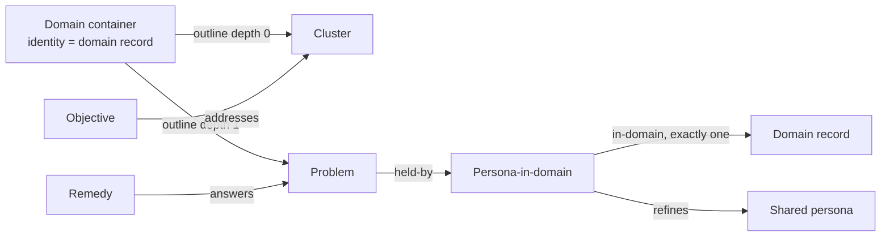

# Two domains end to end

## 1. Purpose

Walk two domains, Collaborative writing and Agent memory, through the whole handbook chain: domain, persona, problem, cluster, remedy, objective, epic, work item, priority, group, report, measure. This is the first worked example of `docs/handbook.md`.

Tracked in clerk#32, under epic clerk#19 (process) and semanticops.com#34. Nothing here is built yet. These are rulings and an order of work.

## 2. Rulings (2026-10-11)

The owner gave these rulings in a session. They are logged as `proposed` governance decisions via the relay and are ratified later in a clerk session. Until then they are proposals.

| # | Ruling | Why |
|---|---|---|
| D1 | The two domains are Collaborative writing (`b7cf0ead`) and Agent memory (`2d20b9a6`). | They match objectives ranked 1 (P0) and 2 (P1) in period `3a279650`, and two domains are needed to test problems and personas that span domains. |
| D2a | Domain container: `containerType com.semanticops.method/domain`, identity = the existing domain record, created by an agent. Outline: clusters at depth 0, problems at depth 1. srs-web `buildBoard` and `roadmap.mjs` read clusters from the outline; then `domain contains cluster` and `cluster contains problem` are deleted in the same data change. | One way per goal: two groupings would drift. |
| D2b | Identity gap: the container's identity keeps naming the suggestion after the domain is affirmed; readers resolve it to its affirmed fork through `canon()` (follow `derived-from`), as for every other entry. Core fork `replaceIn` is deferred until a reader other than `canon()` needs it (domain rendering). | Affirming a domain forks the record, so the container still names the original. A resolver is cheaper than a core change. |
| D3 | New method type `persona-in-domain` v1 (title, goals as a new list field, jobs and needs reused). It `refines` the shared persona (core relation) and is affirmed as a definition. A new method relation `com.semanticops.method/in-domain` points from it to the domain record; exactly one is checked in clerk `check-method`. | The same persona needs different jobs per domain. A package relation avoids touching core. |
| D3-rule | Standing: no core (srs-rust or spec) changes until the process is refined. Extend through package relations. `check-method` is clerk general method code. | Refine the process first, then harden it. |
| D4 | `held-by` points to the persona-in-domain. A problem's domain is derived, never stored. Domain container membership is arrangement only. Domains not yet walked keep `held-by` to the shared persona (a warning). | One stored fact per goal. |
| D5 | Gate in `check-method`: an affirmed problem is `held-by` at least one affirmed persona-in-domain, whose `in-domain` (exactly one) reaches an affirmed domain record. Ends resolve via `derived-from` (JS `canon()`). Severity: warn everywhere until both domains are walked, then error everywhere. The shared persona need not be affirmed. | Principle 2 as a check, introduced gently. |
| D6 | srs-rust#1377 proceeds (ruled 2026-10-09; a generic fork fix, not a process change). Six-step order, section 4. | With it, affirming a persona-in-domain re-points the affirmed problems' carried `held-by` to the affirmed fork, under the owner's actor: the repair needs no new UI. |
| D7.1 | `addresses` stays objective to cluster. Clusters are named meaning: problems are brainstorm ideas, grouped, then named by a synthesiser job. Features address clusters. | A domain is too large to address. |
| D7.2 | srs-web #548 keeps cluster affirm. The cluster's name and description are affirmed meaning. Which problems sit under it is fluid arrangement, reviewed by the steward as a boundary review. | Affirm meaning, not arrangement. |
| D7.3 | Epics #28 and #29 stay plain owner-run epics. A working group is chartered on a trigger (a steady ready queue that needs delegated merges). | No group before the work needs one. |
| D7.4 | Agents suggest 1-3 remedies per domain (answers affirmed problems, falsifier, `return_when`); the owner affirms. #29 (`abfa5866`) implements the writing remedy, #28 (`5746dee3`) the memory remedy. `6b0d881d` is reviewed in the writing walk. New epic only if none fits. | Epics exist; reuse them. |
| D8 | Measures: I1-I4 as `argument/indicator` records. I1 is computed by a clerk script that shares `canon()` with the gate, writing an `argument/measurement-result` per cycle; reports link results. Baseline = I1 computed retroactively for the pre-walk cycle (about 0%), compared with the next two cycles. I2-I4 get results when their computations exist. | Existing types, few indicators. |

## 3. Model after the rulings

- **Domain container.** `containerType com.semanticops.method/domain`. The identity is the domain record. The outline holds clusters at depth 0 and their problems at depth 1. The identity is resolved through `canon()` (decision D2b).
- **Cluster.** A named meaning: an affirmed name and description. Its member set is fluid arrangement and is not affirmed.
- **Persona-in-domain.** Fields: title, goals, jobs, needs. It `refines` the shared persona. `in-domain` points to the domain record, exactly one.
- **Held-by and domain.** A problem is `held-by` a persona-in-domain. Its domain is derived: problem `held-by` PiD `in-domain` domain. Container membership never decides it.
- **Addresses.** An objective `addresses` a cluster, not a domain and not a single problem.

| Affirmed (meaning, definition) | Arrangement (fluid) |
|---|---|
| Domain, persona-in-domain, cluster (name and description), problem, remedy | Which problems sit under which cluster; which clusters sit in a domain container |

## 4. Tool order

Order from D6. Each step depends on the one before unless noted. Step 4 runs in two parts: 4a builds the containers before the readers switch (steps 2 and 3), and 4b deletes the `contains` edges after. No core change appears except srs-rust#1377, already ruled.

| # | Repo | What changes | Depends on | Exit criterion | Issue |
|---|---|---|---|---|---|
| 1 | clerk | Method package v1 additions: `persona-in-domain`, field `goals`, relation `in-domain`, `held-by` description. Upgrade srs-programme's installed copy. | none | `srs repo validate` on srs-programme has 0 errors with the new definitions installed | Proposed issue: clerk: Method package v1: persona-in-domain, goals, in-domain, held-by description. Add the type, field and relation to `packages/method`; upgrade srs-programme. |
| 2 | clerk | `check-method` gate at warn level (D5). `roadmap.mjs` reads clusters from the domain outline and `held-by` persona-in-domain. A shared `canon()` helper. | 1 | Gate warns on today's data; on a copy with step 4a's containers, `clerk roadmap --explain` lists the same clusters from the outline as from `contains` | Proposed issue: clerk: check-method principle 2 gate and roadmap outline reader (warn). Add the gate with severity switch, `canon()` in `lib/`, and the outline reader in `roadmap.mjs`. |
| 3 | srs-web | Rebase, review and land #548 (cluster, problem, remedy, persona affirm). Add domain and persona-in-domain affirm. `buildBoard` reads the domain outline. No membership UI (agents and CLI). | 1 (#546 also needs srs-rust#1377) | A domain and a persona-in-domain can be affirmed from the Method editor; the board shows clusters from the outline | srs-web #548 (for #541), #546 (re-point after #1377). Proposed issue: srs-web: affirm domain and persona-in-domain; buildBoard reads domain outline. Extend `method-document.ts` affirm and `buildBoard` (116-212). |
| 4 | srs-programme (agent data) | Per domain: (4a) create container and outline; suggest persona-in-domain records; re-point suggested `held-by`; (4b) delete `contains` after readers switch. | 4a (create containers and outline, alongside `contains`): 1. 4b (delete `contains`): 2 and 3 merged | Both domain containers exist; every clustered problem sits in the outline; old `contains` edges are gone; `repo validate` is clean | Proposed issue: srs-programme: domain containers, persona-in-domain suggestions and held-by re-point for the two domains. Agent data work; one PR per domain. |
| 5 | owner act | Owner affirms the domain, then each persona-in-domain. With srs-rust#1377 the fork carries and repairs the affirmed problems' `held-by`. | 4; srs-rust#1377 | Affirmed problems in both domains pass the gate | srs-rust#1377 (exists). Owner affirm acts need no issue. |
| 6 | srs-programme | Remove the old affirmed-problem `held-by` edges to shared personas. | 5 | No affirmed problem in the two domains is `held-by` a shared persona | Proposed issue: srs-programme: remove old held-by to shared personas (owner act). Owner-run via `srs relation delete`. |

Existing issues that map: srs-web #548 and #541 (step 3), #546 (step 3, after #1377), srs-rust#1377 (step 5), clerk#22 (PR grounding check, the I1 count in section 6), clerk#25 (`clerk measure` I1-I4, section 6), semanticops.com#34 (the umbrella story). There is no clerk affirm path. The srs-web Method editor is the one affirm UI, with the CLI as fallback.

## 5. Walk per domain

Roles: **agent** suggests, **owner** affirms, **script** computes. Each domain is walked in the same order. Ids are from the 2026-10-11 survey.

### Collaborative writing (`b7cf0ead`)

20 problems, 10 affirmed. Clusters: `52bf3e08` Unclear roles of writer and agents (4), `e167e0a4` Document shape the writer cannot see (6), `29c8badb` Work that cannot leave and return (4), `074800d9` Agent help that overwhelms the writer (6). Held-by today: Writer `f15ba1ea` (16), AI agent `c1efab46` (2), Person working with AI `af81a9fa` (2).

| Stage | Who | What, with ids | Exit criterion |
|---|---|---|---|
| Domain | agent creates; owner affirms | Container with identity `b7cf0ead`; outline of the 4 clusters at depth 0 | Domain affirmed; container validates |
| Persona-in-domain | agent suggests; owner affirms | Writer in Collaborative writing (refines `f15ba1ea`); likely also AI agent and person-with-AI variants (`c1efab46`, `af81a9fa`) | `in-domain` exactly one each; affirmed |
| Problem | agent re-points `held-by`; owner affirms (carry via #1377) | 20 problems to their PiD; 10 already affirmed repaired | Gate passes for the 10 affirmed |
| Cluster | synthesiser job groups and names; owner affirms name | The 4 clusters above; steward reviews membership | Each cluster has an affirmed name and description |
| Remedy | agent suggests 1-3; owner affirms | Review `6b0d881d` (Open every repository through lenses; answers `443cc665`, `869f95f2`, `0cd1671c`; only `869f95f2` is in this domain, cluster `e167e0a4`) | Affirmed remedy has falsifier and `return_when` |
| Objective | owner | `0b59ff0b` Agent-supported writing; add `addresses` to the relevant clusters | Objective `addresses` at least one cluster |
| Epic | owner | `abfa5866` (semanticops.com#29) `implements` the remedy, `serves` `0b59ff0b` | Epic has a remedy and an objective |
| Work item | analyst agent files | Issues under #29 with `Answers: SP-nn` | Every issue names an affirmed problem |
| Priority | script | `clerk roadmap --apply`: `0b59ff0b` is rank 1, so P0 | Issues carry `priority: P0` |
| Working group | owner, on trigger | Chartering when the ready queue is steady and needs delegated merges | Not before the trigger |
| Report | steward | Run report links I1 result | Report names the result |
| Measure | script | I1 for the cycle (section 6) | Result recorded |

### Agent memory (`2d20b9a6`)

20 problems, 10 affirmed. Clusters: `c5e36b05` Shared memory without rules (4), `7f66efec` Costly and incomplete orientation (8), `68be8a3f` Tools and environment mislead agents (8). Held-by today: AI agent (18), Person working with AI (2).

| Stage | Who | What, with ids | Exit criterion |
|---|---|---|---|
| Domain | agent creates; owner affirms | Container with identity `2d20b9a6`; 3 clusters at depth 0 | Domain affirmed; container validates |
| Persona-in-domain | agent suggests; owner affirms | AI agent in Agent memory (refines `c1efab46`); Person working with AI (refines `af81a9fa`) | `in-domain` exactly one each; affirmed |
| Problem | agent re-points `held-by`; owner affirms | 20 problems; 10 affirmed repaired | Gate passes for the 10 affirmed |
| Cluster | synthesiser job groups and names; owner affirms name | The 3 clusters above | Each has an affirmed name and description |
| Remedy | agent suggests 1-3; owner affirms | New remedy answering affirmed problems in `7f66efec` (orientation); others as the problems show | Affirmed remedy has falsifier and `return_when` |
| Objective | owner | `8e561b4c` Agent memory (no edges today); add `addresses` to its clusters | Objective `addresses` at least one cluster |
| Epic | owner | `5746dee3` (semanticops.com#28) `implements` the remedy, `serves` `8e561b4c` | Epic has a remedy and an objective |
| Work item | analyst agent files | Issues under #28 with `Answers: SP-nn` | Every issue names an affirmed problem |
| Priority | script | Period `3a279650` ranks `8e561b4c` second, so P1 | Issues carry `priority: P1` |
| Working group | owner, on trigger | As above | Not before the trigger |
| Report | steward | Run report links I1 result | Report names the result |
| Measure | script | I1 for the cycle | Result recorded |

## 6. Measures

- **I1 path.** Merged PR, then its issue's `Answers: SP-nn`, then the problem (affirmed), then `held-by` persona-in-domain, then `in-domain` to an affirmed domain. Every end resolves through `canon()`. I1 is the share of merged PRs whose chain completes. One script computes it, shared with the gate (clerk#22 is the PR check, clerk#25 the command).
- **Baseline.** Compute I1 retroactively for the cycle before the walk (about 0%, since no persona-in-domain exists). Compare the next two cycles against it.
- **Records.** `argument/indicator` for I1-I4 (indicator_id, title, measurement_method, baseline_state). `argument/measurement-result` per cycle (result_id, observed_finding, observation_period, evaluator). Reports link the results. I2-I4 get results when their computations exist.

## 7. Open items

- **D5 flip.** The 27 affirmed problems in the other three domains (Stance, Semantic records, Group meaning ownership) have no persona-in-domain. Before the warn-to-error flip they must be grounded or set aside, or the flip must be scoped to walked domains.
- **Unclustered problems.** Five suggested problems have no cluster: `5451ce85`, `60075103`, `62899c66`, `a06ce32d`, `d6ec220e`.
- **Duplicate `canon()`.** The JS `canon()` duplicates srs-web's. Move it to core when the process settles.
- **Triggers, not built.**
  - Domain rendering: the trigger for core fork `replaceIn` (D2b).
  - Membership UI: the owner wants to regroup in the editor.
  - Working group: a steady ready queue that needs delegated merges.
- **Cluster reach.** Should remedies and epics also address clusters, not only objectives?
- **Shared persona.** Revisit whether it must be affirmed once personas weight priority.

## 8. What we learned

- Affirm meaning, not arrangement. A cluster's name is a claim; its member list is a working view that changes.
- When meaning must stay stable, use relations (`held-by`, `in-domain`), not container membership.
- A cluster is a named synthesis of ideas. Grouping alone is not enough; the name is the work.
- The fork refusal in srs-rust is narrower than we assumed: it only refuses the anchor or identity of the container forked into. A resolver (`canon()`) avoids a core change for now.
- Extending through package relations let us keep the "no core changes" rule without blocking the process.
