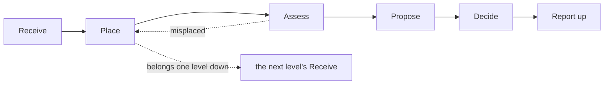
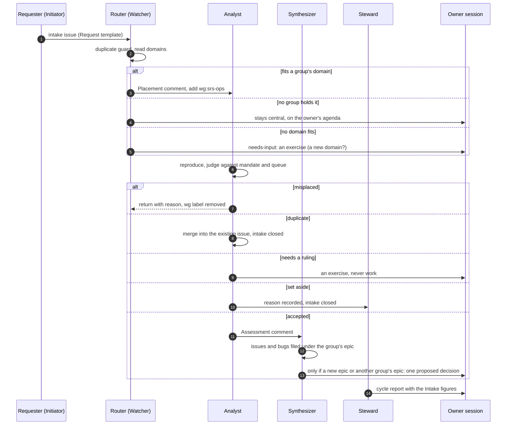

# Proposal: WG SRS operations, and how a request reaches a working group

For the owner's session (the central committee, SemanticOps). Status: **proposed, nothing in force** (clerk#56). The handbook records in this PR describe the same design as Theory, marked proposed. Each decision below is asked for one at a time; ratify, amend or set aside each on its own.

## 1. What this answers

Two gaps, both seen in the 2026-10-11 survey:

1. **Requests have no way in.** Bugs, friction and feature ideas reach a group only as finished `ready` issues. Nobody estimates which domain a request belongs to, so it either lands on the owner or is filed straight as work, with no assessment against the group's priorities or queue. (Suggested problem; no SP number yet.)
2. **Our own daily use of SRS has no home.** The dogfooding traps recorded in srs-context (stale sibling checkouts give false greens, `container update` replaces membership wholesale, the MCP mount cannot write into a worktree, client build pins render empty silently) are fixed ad hoc, by whoever hits them. No group owns making the tools reliable for the work we actually do.

The existing domains do not cover the second gap. *Semantic records* (5f433971) is about what the spec means: versioning, identity, governance. *Programme coordination* (3576be41) keeps work moving but lists "what the products do (spec, editor features)" as out of scope. WG Third-party ready executes recorded rulings so the tool behaves as the spec says. That runs from the spec to the tool. Friction found while *using* the tool runs the other way, and nobody holds it.

## 2. The domain: SRS operations

| Field | Proposed value |
|---|---|
| title | SRS operations |
| purpose | Keep our day-to-day practice with SRS working: the implementation, tools and spec run reliably and serve the goals and projects we are pursuing now. |
| in_scope | Bugs and reliability in srs-rust, srs-vscode and srs-web; friction found while dogfooding (CLI, MCP, WASM, release assets, pins, worktrees); agent-facing usage docs (`srs-usage.md`, CLAUDE.md sections, srs-context traps); refinements to the spec that make it usable without changing what it means (Door 1 only: carrying out an existing ruling, never a new RFC or a revision). |
| out_of_scope | What the spec should mean (Semantic records); new rulings and RFCs; editor product features (WG Agent-supported editor); programme and governance tooling (Programme coordination, the clerk). |

**Stance.** Relative to the programme's boundary, the domain is a **Steward**: Observe · Stabilise · Focus. It looks at *how we work*, keeps it *stable and reliable*, and serves *our current goals*. The Steward's listed complements are the Challenger and the Initiator. The group therefore needs someone who challenges every change (the reviewer) and a steady flow of drive from outside (anyone who hits friction and files it). The Steward's shadow is resistance to change and overprotection: a group that hoards its queue or turns requests away. The intake indicator (section 7) counts the requests it sets aside or leaves waiting, which is where that shadow would show. The group's own stance is Steward; one of its seats is also called steward (the member who closes the cycle). The seat is a job inside the group, the stance describes the whole group seen from the programme.

**Personas in this domain** (each `refines` a shared persona and is `in-domain` SRS operations):

- *AI agent in SRS operations*: runs the CLI and MCP all day. Needs tools that refuse clearly rather than pass silently, and errors it can branch on.
- *A person working with AI in SRS operations*: the owner or any human builder. Needs a green check to mean green, and a fix to land once, in the core.

**Seed problem set** (for the proposed rule that a group needs a known domain and a problem set, 9a45c0a1, not yet ratified), drawn from srs-context traps. Each is evidence-backed:

1. A check passes locally against a stale sibling checkout or binary and fails in CI (false green).
2. A tool accepts an input that a later validate rejects (for example srs-rust#1396).
3. A whole-object write silently drops what the writer did not know about (`container update`).
4. The tool surface and the place work happens disagree (the MCP mount cannot write into a worktree).
5. A client pinned to an older build renders a newer corpus as empty, with no error.

## 3. The intake cycle: the same shape at every level

A **request** is something someone ran into or wants. Work a scout files from a recorded ruling (for example the WG Third-party ready analyst filling its queue) is not a request: it already has its ruling and its group, and keeps its own path.

An srs-context **finding** is memory: the trap, so the next agent avoids it. The work to remove the trap is a request. The srs-context dream cycle (srs-context#15) files a Request for each new finding with no issue, and the finding links to it. So the same friction has one home for memory and one for work.

**A decision you cannot make in the moment is a request too** (kind *decision*). This is how working windows get lost: the work stops on a question, and the question is never asked anywhere it would be answered. It is recorded at once as a **proposed decision** in the decision log of the level that owns it (D11, ratified 2026-10-15), using template T8 in the handbook. If you are not sure which level owns it, use the SemanticOps log and the router moves it. The blocked issue gets `needs-input` with a link to the proposal, and work moves on. The proposal appears on that level's agenda (decisions to ratify), where the session ratifies, amends or sets it aside. What is missing is a one-step way to write one (see section 9).



Every level runs the same six steps. Only *what it looks across* changes:

| Level | Input queue | Places across | Assesses against | Decides in |
|---|---|---|---|---|
| Programme (central group) | `intake`, no `wg:` label | all domains, so all groups | the period ranking | the owner's session |
| Working group | `intake` + its `wg:` label | its own epics and stories | its queue, budget and local priorities | the group's session at cycle close |
| Sub-group (future) | `intake` + its `wg:` label | its parent's delegation | the same | its own session |

A level never decides for the level above. Anything outside its mandate goes up as one proposed decision. Anything that belongs below is placed into the lower level's queue, never done in its place.

## 3b. Kinds of meeting

Different questions need different meetings. Each kind has its own agenda, and every kind writes the same session record, with its kind (clerk#59):

| Kind | What it handles | How often |
|---|---|---|
| Decision | ratify or set aside decisions, receive reports, merges | weekly, or when the agenda fills |
| Affirmation review | walk Suggestions (domains, personas in domain, clusters, problems, remedies) in the srs-web Method editor | when a domain is walked |
| Unblock | parked decisions, `needs-input` issues, approved PRs that have not merged, PRs stating `Decision asked:` | daily, minutes long |
| Intake triage | requests at the programme level waiting for placement | with Unblock until volume grows |
| Retrospective | keep, change or drop practices and indicators | at period close |

An Unblock meeting keeps working windows from being lost: whatever needs the owner is a short list, and every PR that needs the owner says what it asks (template T9).

## 4. Who acts: stances read relative to the boundary

Seats are named by the job; stances are named by archetype. A stance is read **relative to the boundary** it acts in, so the same agent can sit at a different point of the cube in another group.

| Step | Who | Seat | Stance (relative to the boundary) |
|---|---|---|---|
| Receive | anyone, human or agent, while doing work | none | **Initiator** (Act · Disrupt · Focus): it was doing something, it broke |
| Place | programme router | `router`, a seat of the central group, not of the working group | **Watcher** (Observe · Stabilise · Zoom out): reads across every domain, places without pushing |
| Assess | group analyst | `analyst` | **Analyst** (Observe · Disrupt · Focus): reproduces, names the core issue, flags bugs |
| Propose | group synthesizer | `synthesizer` | **Synthesizer** (Act · Stabilise · Focus): shapes accepted items into issues and epic placements |
| Build | group builder | `builder` | **Builder** (Act · Stabilise · Zoom out) |
| Review | group reviewer | `reviewer` | **Challenger** (Act · Disrupt · Zoom out): "this does not work yet" |
| Close the cycle | group steward | `steward` | **Steward** (Observe · Stabilise · Focus): the group's own stance |
| "Why are we doing this at all?" | anyone | none | **Rebel** (Observe · Disrupt · Zoom out): an exercise, never work |

All eight stances are present or reachable, as the archetype guidance asks. The Rebel and Initiator have no seat: anyone takes them. In records, a seat-holder (`stewardship/agent`) is `derived-from` a stance agent (`method/agent`), which `instantiates` its archetype. These types and relations already exist. Only the links are missing.

To start, the analyst and the synthesizer may be one routine run in two passes, provided each pass writes under its own actor. Split them when one run cannot finish both passes.



## 5. Mechanics: what is new and what is reused

| Need | Uses | New? |
|---|---|---|
| An input queue | label `intake` plus the group's `wg:` label | **one new label** |
| A domain estimate | the Placement comment while it is provisional; once accepted, a **suggested problem `held-by` a persona-in-domain** in srs-programme (the domain is derived, never stored) | no new type |
| Assessment against priorities | `clerk queue`, the group's budget and local-priorities decision; placement under a story is what sets priority (rollup) | none; priority is never set by hand |
| Bugs | `bug` label and the bug track (oldest first, never weaker than P1) | none |
| Epic placement | sub-issue of the group's epic or story (inside the mandate); a new epic or another group's epic is an escalation | none |
| Stances | `derived-from` and `instantiates` | links only |
| Machine-readable steps | HTML-comment first lines, as `<!-- wg-quorum -->` already does: `<!-- intake-placement -->`, `<!-- intake-assessment -->`, `<!-- intake-proposal -->` | three markers |

Skipped on purpose: an intake record type, a board status "Triage", and a `clerk intake` command. Searching for `label:intake` covers all of it. Add the command when intake regularly exceeds about ten items a week.

## 6. WG SRS operations: proposed charter

| Item | Proposed |
|---|---|
| Purpose | Make SRS reliable and useful for the work we do now. |
| Label | `wg:srs-ops` |
| Governed repos | srs-rust, srs-vscode, srs-web, srs (non-normative docs only), srs-context |
| Epic | new, in semanticops.com: "Epic NN: SRS works in daily use". It `implements` an intake-and-reliability remedy and `serves` *Keep work moving to done* (cba2c1cf, rank 1). |
| Seats | steward, analyst, synthesizer, builder, reviewer; quorum builder + reviewer, the reviewer required |
| Cycle and budget | daily, closing 11:45 UTC (after Third-party ready); 10 delegated merges per cycle; pause after 2 unacknowledged reports |
| Decides | fixes and reliability work that change no ruling and no public contract; placement of accepted intake under its own epic; its local priorities; agent-facing docs |
| Escalates | any spec change beyond Door 1; breaking CLI, payload or WASM contracts; a new epic or work in another group's epic; gate and merge rules; anything over budget |
| Compass | **Core once over a client workaround**, unless the workaround unblocks a ranked objective today and an issue tracks the core fix (reuses tension *Core once and adapter convenience*). **Our ranked goals over general polish** when choosing among issues of the same derived priority, unless the defect corrupts data or gives a false green (new tension *Our goals and the tool's general good*; it orders work inside the group's queue and never sets a priority). **Reliable over new**: at equal derived priority a bug goes first, on top of the bug floor (a bug is never weaker than P1) (new tension *Reliable and new*). **Strict and repairable**: refuse clearly, then offer the repair (reuses the parent boundary's tension). |
| Boundary | `narrows` SRS implementation (b3bcd516), like the two existing groups |

**Placement rule between the two SRS groups.** If the request names a ruling, RFC requirement or invariant that the tool breaks, it goes to WG Third-party ready. Otherwise it goes to WG SRS operations. The groups sit side by side. Revisit after two cycles whether Third-party ready should become a sub-group of SRS operations.

**When to charter: the trigger.** A group is chartered only on a trigger, a steady ready queue that needs delegated merges. That queue does not exist yet. So the order is:

1. Ratify the domain and the intake decisions (section 8). Intake starts at once, with the **central group** holding SRS-operations requests: the router places them in the domain, and the owner's session (or any session acting as the central group's analyst and synthesizer) assesses and proposes.
2. **Trigger:** two consecutive cycles in which intake yields at least five accepted SRS-operations issues per cycle. The steward of the central group (or the owner) then proposes the charter.
3. `clerk charter` writes the charter in this section as drafts and a proposed charter decision (the exact command is in section 9; `--dry-run` first). The owner's session ratifies it as usual.

If the trigger never fires, the domain is still useful and the group is not needed.

## 7. Measure: one indicator

**I5, "Does intake flow?"** (proposed; it joins I1 to I4 in stage Measurement only when ratified). Three numbers per cycle, read by the steward:

- the median days from Request to Assessment;
- the share of placements returned as misplaced;
- the requests set aside or waiting longer than one cycle (where a Steward's shadow, hoarding the queue, would show).

**Falsifier for the whole proposal:** after two cycles, either of these shows it failed:

- most SRS-ops work still arrives as direct `ready` issues that bypass intake;
- the median time to assessment is longer than one cycle.

If either holds, the intake has become ceremony. Drop it or redesign it at the next session.

## 8. Decisions asked for, one at a time

Each one is framed to pass the four tests: reuse, one thing, timeless, testable.

| # | Kind | Statement | Review when |
|---|---|---|---|
| D1 | Boundary | SRS operations covers how we use, run and repair SRS in our own work, not what the spec should mean. | a request is placed in it that its scope cannot judge |
| D2 | Premise | We work as if every level (programme, group, sub-group) runs the same intake cycle: receive, place, assess, propose, decide, report. | a level needs a step the others do not |
| D3 | Policy | A level never decides a request for the level above it; it escalates one proposed decision instead. | an escalation is overturned as within the lower level's mandate |
| D4 | Policy | Every request is placed in a domain before any group assesses it. | I5's returned share stays high for two cycles |
| D5 | Policy | A request reaches a group only through that group's input queue, never filed straight as ready work. | the falsifier in section 7 fires |
| D6 | Design | We model a group's input queue as its `wg:` label plus `intake`, because labels are the execution surface every routine already reads. | intake exceeds about ten items a week |
| D7 | Design | We model an accepted domain estimate as a suggested problem `held-by` a persona-in-domain, because a domain is derived, never stored. | a request is accepted that no persona holds |
| D8 | Design | We model a member's stance as its seat-holder `derived-from` a stance agent that `instantiates` an archetype, because those types and relations already exist. | a seat fits no archetype |
| D9 | Premise | We work as if a stance is read relative to the boundary it acts in. | the same agent's stance needs to be fixed across groups |
| D10 | Preference | Groups sit beside each other rather than nested, unless an observed overlap is recorded in a decision that nests them. | two cycles after a second group shares repos with another |
| D11 | Policy | **Ratified 2026-10-15** (srs-programme#127): a decision that cannot be made now is recorded at once as a proposal. | a proposal waits longer than two sessions |
| D12 | Premise | We work as if a meeting's kind sets its agenda: decision, affirmation review, unblock, intake triage or retrospective. | a meeting is held that fits no kind |
| D13 | Design | We model every kind of meeting as one session record with a kind, because one way per goal. | a kind needs a field the session record cannot hold |

Each statement passes the four tests in [decision-log.md](../docs/decision-log.md): reuse, one thing, timeless, testable. The charter itself is not on this list: `clerk charter` writes it as its own proposed decision once the trigger in section 6 fires. Recommended order: D1, then D2 and D3, then D4 to D7 (intake can start), then D8 to D10. D11 stands alone and can be taken first: parking needs no other decision. D12 and D13 also stand alone, and clerk#59 builds them.

## 9. On ratification (filed then, not now)

1. srs-programme, as Suggestions: the domain record; the two persona-in-domain records; the five seed problems; the boundary, with its compass. The owner affirms them in the Method editor.
2. semanticops.com: the epic issue, and a **Request** issue form that adds `intake` (it builds on the unmerged issue-forms branch).
3. clerk: `clerk charter` accepts the analyst and synthesizer seats (seat briefs are hard-coded to three today, `lib/practice/charter.mjs`) and a stance per seat that writes `derived-from`.
4. clerk: briefs `routines/intake-router.md` and `routines/wg-srs-ops-intake.md`, holding the templates in the handbook; the steward brief gains the Intake section of the report.
5. clerk: the three intake `test.todo`s in `test/process.test.mjs` become tests.
6. clerk: `clerk park`, a one-step way to write a parked decision (a proposed decision in the owning log, T8) and mark the blocked issue `needs-input`. This is one of two items that can be built before the rest: clerk#58.
7. clerk: `clerk agenda --kind` and the Unblock sections, plus the `Decision asked:` line (T9) in PR conventions: clerk#59.
8. The charter itself, only when the trigger in section 6 fires:

```
clerk charter --repo <srs-programme> --title "WG SRS operations" --epic semanticops.com#NN \
  --label wg:srs-ops --repos srs-rust,srs-vscode,srs-web,srs,srs-context --budget 10 \
  --cycle-close 11:45 --quorum-seats builder,reviewer --required-seat reviewer --prefix ops --dry-run
```

## What we learned

- The theory gives no model for processes that cross between systems. It names only the boundary and what crosses it. The fractal intake cycle is our design, not doctrine. Test it like any premise.
- Seat names and archetype names already coincide (steward, builder, analyst) by accident, with nothing linking them. Seats should be named by job and stances by archetype, so the reviewer can be a Challenger without renaming anything.
